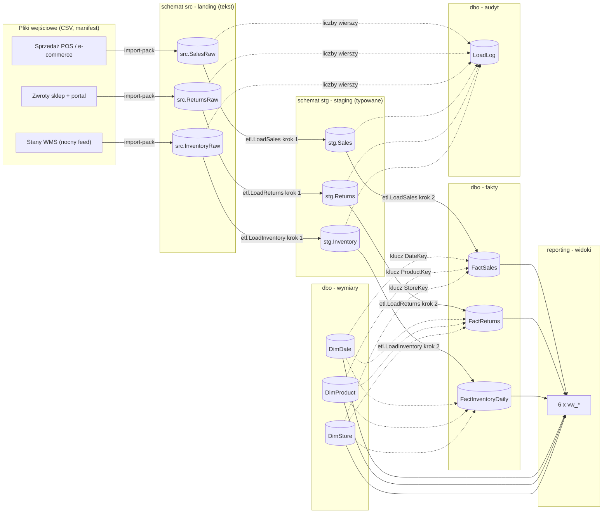
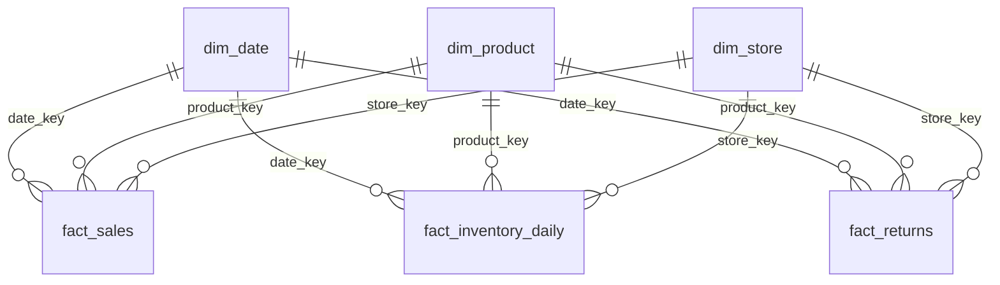
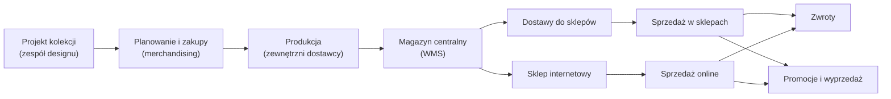

<!-- Generated by SpecStory, Markdown v2.1.0 -->

# 2026-11-17 11:03:27Z

<!-- Copilot CLI Session e36f14ac-e005-4988-97f3-cc67e4330429 (2026-11-17 11:03:27Z) -->

_**User (2026-11-17 11:03:27Z)**_

zrób analizę bazy z plików - do dokumentacji istniejacego projektu dla developerów i analityków 

- tabele, wymiary, fakty, proceduy + opisy

- struktura bazy, konwnecje, sciezki do plików

- pokaż flow ETL - tabelki + diagram mermaid

- skanowalne,  tabelki,.listy, bez bloków prozy
- na początku TOC

zapisz do docs


---

_**Agent (Anthropic/claude-haiku-5-5 2026-11-17 11:03:29Z)**_

Zacznę od przejrzenia struktury `RetailDW`.

_**Agent (Anthropic/claude-haiku-5-5 2026-11-17 11:03:32Z)**_

<tool-use data-tool-type="shell" data-tool-name="powershell"><details>
<summary>Tool use: **powershell**</summary>

List RetailDW files and repo root

```powershell
Get-ChildItem -Recurse -File "C:\Users\teamsharq\Desktop\infoshare-silkycoders-sql-ai-5\RetailDW" | Select-Object FullName, Length | Format-Table -AutoSize | Out-String -Width 300; Get-ChildItem "C:\Users\teamsharq\Desktop\infoshare-silkycoders-sql-ai-5" -Force | Select-Object Name
```

**Result:**

```text
FullName                                                                                                     Length
--------                                                                                                     ------
C:\Users\teamsharq\Desktop\infoshare-silkycoders-sql-ai-5\RetailDW\.gitignore                                    39
C:\Users\teamsharq\Desktop\infoshare-silkycoders-sql-ai-5\RetailDW\RetailDW.sqlproj                             574
C:\Users\teamsharq\Desktop\infoshare-silkycoders-sql-ai-5\RetailDW\Procedures\etl.LoadInventory.sql            2628
C:\Users\teamsharq\Desktop\infoshare-silkycoders-sql-ai-5\RetailDW\Procedures\etl.LoadReturns.sql              3273
C:\Users\teamsharq\Desktop\infoshare-silkycoders-sql-ai-5\RetailDW\Procedures\etl.LoadSales.sql                3949
C:\Users\teamsharq\Desktop\infoshare-silkycoders-sql-ai-5\RetailDW\Scripts\PostDeployment.sql                   243
C:\Users\teamsharq\Desktop\infoshare-silkycoders-sql-ai-5\RetailDW\Scripts\Seed\00-DimDate.sql                 2635
C:\Users\teamsharq\Desktop\infoshare-silkycoders-sql-ai-5\RetailDW\Scripts\Seed\01-DimProduct.sql              3625
C:\Users\teamsharq\Desktop\infoshare-silkycoders-sql-ai-5\RetailDW\Scripts\Seed\02-DimStore.sql                1164
C:\Users\teamsharq\Desktop\infoshare-silkycoders-sql-ai-5\RetailDW\Security\etl.sql                              22
C:\Users\teamsharq\Desktop\infoshare-silkycoders-sql-ai-5\RetailDW\Security\reporting.sql                        48
C:\Users\teamsharq\Desktop\infoshare-silkycoders-sql-ai-5\RetailDW\Security\src.sql                              22
C:\Users\teamsharq\Desktop\infoshare-silkycoders-sql-ai-5\RetailDW\Security\stg.sql                              22
C:\Users\teamsharq\Desktop\infoshare-silkycoders-sql-ai-5\RetailDW\Tables\dbo.DimDate.sql                      1232
C:\Users\teamsharq\Desktop\infoshare-silkycoders-sql-ai-5\RetailDW\Tables\dbo.DimProduct.sql                   1289
C:\Users\teamsharq\Desktop\i
… (output truncated)
```
</details></tool-use>

_**Agent (Anthropic/claude-haiku-5-5 2026-11-17 11:03:35Z)**_

Pliki są małe, przeczytam wszystkie naraz.

_**Agent (Anthropic/claude-haiku-5-5 2026-11-17 11:03:35Z)**_

<tool-use data-tool-type="shell" data-tool-name="powershell"><details>
<summary>Tool use: **powershell**</summary>

Read all RetailDW source files

```powershell
cd "C:\Users\teamsharq\Desktop\infoshare-silkycoders-sql-ai-5\RetailDW"; Get-ChildItem -Recurse -File -Include *.sql,*.sqlproj,.gitignore | Where-Object { $_.FullName -notmatch 'Seed\\0[12]' } | ForEach-Object { "=== " + $_.FullName.Replace((Get-Location).Path + '\','') ; Get-Content -Raw $_.FullName }
```
</details></tool-use>

---

_**User (2026-11-17 11:03:45Z)**_

.

---

_**Agent (Anthropic/claude-haiku-5-5 2026-11-17 11:03:48Z)**_

Poprzednie odczytanie zostało przerwane, więc wczytam pliki ponownie, mniejszymi partiami.

_**Agent (Anthropic/claude-haiku-5-5 2026-11-17 11:03:49Z)**_

<tool-use data-tool-type="read" data-tool-name="view"><details>
<summary>Tool use: **view**</summary>

view the file at C:\Users\teamsharq\Desktop\infoshare-silkycoders-sql-ai-5\RetailDW\RetailDW.sqlproj.

**Input:**

- path: `C:\Users\teamsharq\Desktop\infoshare-silkycoders-sql-ai-5\RetailDW\RetailDW.sqlproj`

**Result:**

```
<?xml version="1.0" encoding="utf-8"?>
<Project DefaultTargets="Build">
  <Sdk Name="Microsoft.Build.Sql" Version="2.2.0" />
  <PropertyGroup>
    <Name>RetailDW</Name>
    <DSP>Microsoft.Data.Tools.Schema.Sql.Sql160DatabaseSchemaProvider</DSP>
    <ModelCollation>1045, CI</ModelCollation>
    <ProjectGuid>{4D80AF47-4BB6-462B-976B-47EFCAF119E6}</ProjectGuid>
  </PropertyGroup>
  <ItemGroup>
    <Build Remove="Scripts\**\*.sql" />
    <PostDeploy Include="Scripts\PostDeployment.sql" />
    <None Include="Scripts\Seed\*.sql" />
  </ItemGroup>
</Project>
```
</details></tool-use>

_**Agent (Anthropic/claude-haiku-5-5 2026-11-17 11:03:49Z)**_

<tool-use data-tool-type="read" data-tool-name="view"><details>
<summary>Tool use: **view**</summary>

view the file at C:\Users\teamsharq\Desktop\infoshare-silkycoders-sql-ai-5\RetailDW\Tables\dbo.FactSales.sql.

**Input:**

- path: `C:\Users\teamsharq\Desktop\infoshare-silkycoders-sql-ai-5\RetailDW\Tables\dbo.FactSales.sql`

**Result:**

```
/*
    Sales fact. Grain: one row per sold line of a transaction
    (one SKU within one receipt).

    [GrossAmount] = [Quantity] * [UnitPrice] - [DiscountAmount], VAT included.
    [NetAmount]   = [GrossAmount] / 1.23, VAT excluded.
    [UnitCost]    is copied from the product dimension at load time so that
                  margin can be recalculated without re-joining the dimension.
*/
CREATE TABLE [dbo].[FactSales]
(
    [SalesKey]       BIGINT          IDENTITY (1, 1) NOT NULL,
    [DateKey]        INT             NOT NULL,
    [ProductKey]     INT             NOT NULL,
    [StoreKey]       INT             NOT NULL,
    [TransactionNo]  NVARCHAR (30)   NOT NULL,
    [LineNumber]         INT             NOT NULL,
    [Quantity]       INT             NOT NULL,
    [UnitPrice]      DECIMAL (10, 2) NOT NULL,
    [DiscountAmount] DECIMAL (10, 2) NOT NULL,
    [GrossAmount]    DECIMAL (12, 2) NOT NULL,
    [NetAmount]      DECIMAL (12, 2) NOT NULL,
    [UnitCost]       DECIMAL (10, 2) NOT NULL,
    [LoadId]         INT             NOT NULL,
    CONSTRAINT [PK_FactSales] PRIMARY KEY CLUSTERED ([SalesKey] ASC),
    CONSTRAINT [FK_FactSales_DimDate] FOREIGN KEY ([DateKey]) REFERENCES [dbo].[DimDate] ([DateKey]),
    CONSTRAINT [FK_FactSales_DimProduct] FOREIGN KEY ([ProductKey]) REFERENCES [dbo].[DimProduct] ([ProductKey]),
    CONSTRAINT [FK_FactSales_DimStore] FOREIGN KEY ([StoreKey]) REFERENCES [dbo].[DimStore] ([StoreKey])
);
GO

CREATE NONCLUSTERED INDEX [IX_FactSales_DateKey]
    ON [dbo].[FactSales] ([DateKey] ASC)
    INCLUDE ([ProductKey], [StoreKey], [Quantity], [GrossAmount], [NetAmount]);
GO

CREATE NONCLUSTERED INDEX [IX_FactSales_ProductKey]
    ON [dbo].[FactSales] ([ProductKey] ASC);
GO

CREATE NONCLUSTERED INDEX [IX_FactSales_TransactionNo]
    ON [dbo].[FactSales] ([TransactionNo] ASC);
```
</details></tool-use>

_**Agent (Anthropic/claude-haiku-5-5 2026-11-17 11:03:49Z)**_

<tool-use data-tool-type="read" data-tool-name="view"><details>
<summary>Tool use: **view**</summary>

view the file at C:\Users\teamsharq\Desktop\infoshare-silkycoders-sql-ai-5\RetailDW\Tables\dbo.DimDate.sql.

**Input:**

- path: `C:\Users\teamsharq\Desktop\infoshare-silkycoders-sql-ai-5\RetailDW\Tables\dbo.DimDate.sql`

**Result:**

```
/*
    Calendar dimension. One row per day.

    [YearWeek] uses the ISO-8601 week numbering, which is what the trading
    calendar in the weekly reports is based on - note that the ISO year can
    differ from the calendar year around 1 January.
*/
CREATE TABLE [dbo].[DimDate]
(
    [DateKey]    INT           NOT NULL, -- yyyymmdd
    [Date]       DATE          NOT NULL,
    [Year]       SMALLINT      NOT NULL,
    [Quarter]    TINYINT       NOT NULL,
    [Month]      TINYINT       NOT NULL,
    [MonthName]  NVARCHAR (20) NOT NULL,
    [YearMonth]  NVARCHAR (7)  NOT NULL, -- '2026-09'
    [IsoYear]    SMALLINT      NOT NULL,
    [IsoWeek]    TINYINT       NOT NULL,
    [YearWeek]   NVARCHAR (8)  NOT NULL, -- '2026-W38'
    [DayOfWeek]  TINYINT       NOT NULL, -- 1 = Monday
    [DayName]    NVARCHAR (20) NOT NULL,
    [IsWeekend]  BIT           NOT NULL,
    [Season]     NVARCHAR (10) NOT NULL, -- retail season the day belongs to
    CONSTRAINT [PK_DimDate] PRIMARY KEY CLUSTERED ([DateKey] ASC)
);
GO

CREATE UNIQUE NONCLUSTERED INDEX [UX_DimDate_Date]
    ON [dbo].[DimDate] ([Date] ASC);
GO

CREATE NONCLUSTERED INDEX [IX_DimDate_YearWeek]
    ON [dbo].[DimDate] ([YearWeek] ASC);
```
</details></tool-use>

_**Agent (Anthropic/claude-haiku-5-5 2026-11-17 11:03:49Z)**_

<tool-use data-tool-type="read" data-tool-name="view"><details>
<summary>Tool use: **view**</summary>

view the file at C:\Users\teamsharq\Desktop\infoshare-silkycoders-sql-ai-5\RetailDW\Tables\dbo.DimProduct.sql.

**Input:**

- path: `C:\Users\teamsharq\Desktop\infoshare-silkycoders-sql-ai-5\RetailDW\Tables\dbo.DimProduct.sql`

**Result:**

```
/*
    Product dimension at SKU grain.

    A SKU is one size/colour variant of a style, e.g. style W-JKT-001 sold as
    W-JKT-001-CZA-M. Reporting by "model" means grouping on [StyleCode];
    reporting by "product" usually means the SKU.

    [ListPrice] is the current catalogue price including VAT. [UnitCost] is the
    landed cost of one unit.
*/
CREATE TABLE [dbo].[DimProduct]
(
    [ProductKey]  INT             IDENTITY (1, 1) NOT NULL,
    [SKU]         NVARCHAR (40)   NOT NULL,
    [StyleCode]   NVARCHAR (20)   NOT NULL,
    [StyleName]   NVARCHAR (100)  NOT NULL,
    [Department]  NVARCHAR (20)   NOT NULL,
    [Category]    NVARCHAR (30)   NOT NULL,
    [Color]       NVARCHAR (20)   NOT NULL,
    [Size]        NVARCHAR (5)    NOT NULL,
    [ListPrice]   DECIMAL (10, 2) NOT NULL,
    [UnitCost]    DECIMAL (10, 2) NOT NULL,
    [IsActive]    BIT             NOT NULL CONSTRAINT [DF_DimProduct_IsActive] DEFAULT (1),
    CONSTRAINT [PK_DimProduct] PRIMARY KEY CLUSTERED ([ProductKey] ASC)
);
GO

CREATE UNIQUE NONCLUSTERED INDEX [UX_DimProduct_SKU]
    ON [dbo].[DimProduct] ([SKU] ASC);
GO

CREATE NONCLUSTERED INDEX [IX_DimProduct_StyleCode]
    ON [dbo].[DimProduct] ([StyleCode] ASC)
    INCLUDE ([Category], [Department], [Size]);
```
</details></tool-use>

_**Agent (Anthropic/claude-haiku-5-5 2026-11-17 11:03:49Z)**_

<tool-use data-tool-type="read" data-tool-name="view"><details>
<summary>Tool use: **view**</summary>

view the file at C:\Users\teamsharq\Desktop\infoshare-silkycoders-sql-ai-5\RetailDW\Tables\dbo.DimStore.sql.

**Input:**

- path: `C:\Users\teamsharq\Desktop\infoshare-silkycoders-sql-ai-5\RetailDW\Tables\dbo.DimStore.sql`

**Result:**

```
/*
    Store dimension. Covers physical stores and the online shop, which is
    modelled as a store so that every sale has a selling location.

    [SalesAreaM2] is the current selling floor area and is NULL for the online
    shop. [RemodelDate] is the date of the last floor-area change; the area
    stored here is always the current one, not the one in force on a past
    trading day.
*/
CREATE TABLE [dbo].[DimStore]
(
    [StoreKey]    INT            IDENTITY (1, 1) NOT NULL,
    [StoreCode]   NVARCHAR (20)  NOT NULL,
    [StoreName]   NVARCHAR (100) NOT NULL,
    [City]        NVARCHAR (50)  NOT NULL,
    [Region]      NVARCHAR (50)  NOT NULL,
    [Channel]     NVARCHAR (10)  NOT NULL,
    [Format]      NVARCHAR (20)  NOT NULL,
    [SalesAreaM2] INT            NULL,
    [OpenedDate]  DATE           NOT NULL,
    [RemodelDate] DATE           NULL,
    CONSTRAINT [PK_DimStore] PRIMARY KEY CLUSTERED ([StoreKey] ASC),
    CONSTRAINT [CK_DimStore_Channel] CHECK ([Channel] IN (N'STORE', N'ONLINE'))
);
GO

CREATE UNIQUE NONCLUSTERED INDEX [UX_DimStore_StoreCode]
    ON [dbo].[DimStore] ([StoreCode] ASC);
```
</details></tool-use>

_**Agent (Anthropic/claude-haiku-5-5 2026-11-17 11:03:49Z)**_

<tool-use data-tool-type="read" data-tool-name="view"><details>
<summary>Tool use: **view**</summary>

view the file at C:\Users\teamsharq\Desktop\infoshare-silkycoders-sql-ai-5\RetailDW\Tables\dbo.FactReturns.sql.

**Input:**

- path: `C:\Users\teamsharq\Desktop\infoshare-silkycoders-sql-ai-5\RetailDW\Tables\dbo.FactReturns.sql`

**Result:**

```
/*
    Returns fact. Grain: one row per returned line.

    [ReturnAmount] is the refunded amount, VAT included, and is stored as a
    positive number.
*/
CREATE TABLE [dbo].[FactReturns]
(
    [ReturnKey]     BIGINT          IDENTITY (1, 1) NOT NULL,
    [DateKey]       INT             NOT NULL,
    [ProductKey]    INT             NOT NULL,
    [StoreKey]      INT             NOT NULL,
    [ReturnNo]      NVARCHAR (30)   NOT NULL,
    [TransactionNo] NVARCHAR (30)   NOT NULL,
    [Quantity]      INT             NOT NULL,
    [ReturnAmount]  DECIMAL (12, 2) NOT NULL,
    [ReturnReason]  NVARCHAR (30)   NULL,
    [LoadId]        INT             NOT NULL,
    CONSTRAINT [PK_FactReturns] PRIMARY KEY CLUSTERED ([ReturnKey] ASC),
    CONSTRAINT [FK_FactReturns_DimDate] FOREIGN KEY ([DateKey]) REFERENCES [dbo].[DimDate] ([DateKey]),
    CONSTRAINT [FK_FactReturns_DimProduct] FOREIGN KEY ([ProductKey]) REFERENCES [dbo].[DimProduct] ([ProductKey]),
    CONSTRAINT [FK_FactReturns_DimStore] FOREIGN KEY ([StoreKey]) REFERENCES [dbo].[DimStore] ([StoreKey])
);
GO

CREATE NONCLUSTERED INDEX [IX_FactReturns_DateKey]
    ON [dbo].[FactReturns] ([DateKey] ASC)
    INCLUDE ([ProductKey], [StoreKey], [Quantity], [ReturnAmount]);
```
</details></tool-use>

_**Agent (Anthropic/claude-haiku-5-5 2026-11-17 11:03:49Z)**_

<tool-use data-tool-type="read" data-tool-name="view"><details>
<summary>Tool use: **view**</summary>

view the file at C:\Users\teamsharq\Desktop\infoshare-silkycoders-sql-ai-5\RetailDW\Tables\dbo.FactInventoryDaily.sql.

**Input:**

- path: `C:\Users\teamsharq\Desktop\infoshare-silkycoders-sql-ai-5\RetailDW\Tables\dbo.FactInventoryDaily.sql`

**Result:**

```
/*
    Stock fact. Grain: one row per day / SKU / store, holding the stock level
    at the close of that trading day.

    This is a snapshot, not a movement log - two consecutive rows describe two
    states, and the difference between them is not a transaction.

    Stock is only collected for the current season; there are no rows for dates
    before the start of the feed.
*/
CREATE TABLE [dbo].[FactInventoryDaily]
(
    [InventoryKey]  BIGINT NOT NULL IDENTITY (1, 1),
    [DateKey]       INT    NOT NULL,
    [ProductKey]    INT    NOT NULL,
    [StoreKey]      INT    NOT NULL,
    [StockQuantity] INT    NOT NULL,
    [LoadId]        INT    NOT NULL,
    CONSTRAINT [PK_FactInventoryDaily] PRIMARY KEY CLUSTERED ([InventoryKey] ASC),
    CONSTRAINT [FK_FactInventoryDaily_DimDate] FOREIGN KEY ([DateKey]) REFERENCES [dbo].[DimDate] ([DateKey]),
    CONSTRAINT [FK_FactInventoryDaily_DimProduct] FOREIGN KEY ([ProductKey]) REFERENCES [dbo].[DimProduct] ([ProductKey]),
    CONSTRAINT [FK_FactInventoryDaily_DimStore] FOREIGN KEY ([StoreKey]) REFERENCES [dbo].[DimStore] ([StoreKey])
);
GO

CREATE NONCLUSTERED INDEX [IX_FactInventoryDaily_DateKey]
    ON [dbo].[FactInventoryDaily] ([DateKey] ASC)
    INCLUDE ([ProductKey], [StoreKey], [StockQuantity]);
```
</details></tool-use>

_**Agent (Anthropic/claude-haiku-5-5 2026-11-17 11:03:49Z)**_

<tool-use data-tool-type="read" data-tool-name="view"><details>
<summary>Tool use: **view**</summary>

view the file at C:\Users\teamsharq\Desktop\infoshare-silkycoders-sql-ai-5\RetailDW\Tables\dbo.LoadLog.sql.

**Input:**

- path: `C:\Users\teamsharq\Desktop\infoshare-silkycoders-sql-ai-5\RetailDW\Tables\dbo.LoadLog.sql`

**Result:**

```
/*
    Audit trail: one row per run of an [etl].[Load*] procedure.
*/
CREATE TABLE [dbo].[LoadLog]
(
    [LoadId]       INT             IDENTITY (1, 1) NOT NULL,
    [PackageName]  NVARCHAR (100)  NOT NULL,
    [StartedAt]    DATETIME2 (3)   NOT NULL CONSTRAINT [DF_LoadLog_StartedAt] DEFAULT (SYSUTCDATETIME()),
    [FinishedAt]   DATETIME2 (3)   NULL,
    [Status]       NVARCHAR (20)   NOT NULL CONSTRAINT [DF_LoadLog_Status] DEFAULT (N'RUNNING'),
    [RowsRead]     INT             NULL,
    [RowsLoaded]   INT             NULL,
    [RowsRejected] INT             NULL,
    [ErrorMessage] NVARCHAR (4000) NULL,
    CONSTRAINT [PK_LoadLog] PRIMARY KEY CLUSTERED ([LoadId] ASC),
    CONSTRAINT [CK_LoadLog_Status] CHECK ([Status] IN (N'RUNNING', N'SUCCEEDED', N'FAILED'))
);
```
</details></tool-use>

_**Agent (Anthropic/claude-haiku-5-5 2026-11-17 11:03:53Z)**_

<tool-use data-tool-type="read" data-tool-name="view"><details>
<summary>Tool use: **view**</summary>

view the file at C:\Users\teamsharq\Desktop\infoshare-silkycoders-sql-ai-5\RetailDW\Tables\src.SalesRaw.sql.

**Input:**

- path: `C:\Users\teamsharq\Desktop\infoshare-silkycoders-sql-ai-5\RetailDW\Tables\src.SalesRaw.sql`

**Result:**

```
/*
    Landing zone for the daily POS / e-commerce sales extract.

    Every column arrives as text exactly as the source system wrote it. Nothing
    is validated here - conversion and validation happen in [etl].[LoadSales].
*/
CREATE TABLE [src].[SalesRaw]
(
    [RawId]          BIGINT         IDENTITY (1, 1) NOT NULL,
    [TransactionNo]  NVARCHAR (30)  NULL,
    [LineNumber]         NVARCHAR (10)  NULL,
    [SalesDate]      NVARCHAR (20)  NULL,
    [SKU]            NVARCHAR (40)  NULL,
    [StoreCode]      NVARCHAR (20)  NULL,
    [Quantity]       NVARCHAR (20)  NULL,
    [UnitPrice]      NVARCHAR (20)  NULL,
    [DiscountAmount] NVARCHAR (20)  NULL,
    [SourceFile]     NVARCHAR (100) NULL,
    [ExtractedAt]    DATETIME2 (3)  NOT NULL CONSTRAINT [DF_src_SalesRaw_ExtractedAt] DEFAULT (SYSUTCDATETIME()),
    CONSTRAINT [PK_src_SalesRaw] PRIMARY KEY CLUSTERED ([RawId] ASC)
);
GO

CREATE NONCLUSTERED INDEX [IX_src_SalesRaw_SourceFile]
    ON [src].[SalesRaw] ([SourceFile] ASC);
```
</details></tool-use>

_**Agent (Anthropic/claude-haiku-5-5 2026-11-17 11:03:54Z)**_

<tool-use data-tool-type="read" data-tool-name="view"><details>
<summary>Tool use: **view**</summary>

view the file at C:\Users\teamsharq\Desktop\infoshare-silkycoders-sql-ai-5\RetailDW\Tables\src.ReturnsRaw.sql.

**Input:**

- path: `C:\Users\teamsharq\Desktop\infoshare-silkycoders-sql-ai-5\RetailDW\Tables\src.ReturnsRaw.sql`

**Result:**

```
/*
    Landing zone for customer returns registered in stores and in the online
    returns portal.
*/
CREATE TABLE [src].[ReturnsRaw]
(
    [RawId]         BIGINT         IDENTITY (1, 1) NOT NULL,
    [ReturnNo]      NVARCHAR (30)  NULL,
    [TransactionNo] NVARCHAR (30)  NULL,
    [ReturnDate]    NVARCHAR (20)  NULL,
    [SKU]           NVARCHAR (40)  NULL,
    [StoreCode]     NVARCHAR (20)  NULL,
    [Quantity]      NVARCHAR (20)  NULL,
    [ReturnAmount]  NVARCHAR (20)  NULL,
    [ReturnReason]  NVARCHAR (30)  NULL,
    [SourceFile]    NVARCHAR (100) NULL,
    [ExtractedAt]   DATETIME2 (3)  NOT NULL CONSTRAINT [DF_src_ReturnsRaw_ExtractedAt] DEFAULT (SYSUTCDATETIME()),
    CONSTRAINT [PK_src_ReturnsRaw] PRIMARY KEY CLUSTERED ([RawId] ASC)
);
```
</details></tool-use>

_**Agent (Anthropic/claude-haiku-5-5 2026-11-17 11:03:54Z)**_

<tool-use data-tool-type="read" data-tool-name="view"><details>
<summary>Tool use: **view**</summary>

view the file at C:\Users\teamsharq\Desktop\infoshare-silkycoders-sql-ai-5\RetailDW\Tables\src.InventoryRaw.sql.

**Input:**

- path: `C:\Users\teamsharq\Desktop\infoshare-silkycoders-sql-ai-5\RetailDW\Tables\src.InventoryRaw.sql`

**Result:**

```
/*
    Landing zone for the nightly stock feed sent by the warehouse system (WMS).

    The daily export can include multiple stores. One row represents a
    store / SKU / day observation of the closing stock level.
*/
CREATE TABLE [src].[InventoryRaw]
(
    [RawId]         BIGINT         IDENTITY (1, 1) NOT NULL,
    [SnapshotDate]  NVARCHAR (20)  NULL,
    [SKU]           NVARCHAR (40)  NULL,
    [StoreCode]     NVARCHAR (20)  NULL,
    [StockQuantity] NVARCHAR (20)  NULL,
    [SourceFile]    NVARCHAR (100) NULL,
    [ExtractedAt]   DATETIME2 (3)  NOT NULL CONSTRAINT [DF_src_InventoryRaw_ExtractedAt] DEFAULT (SYSUTCDATETIME()),
    CONSTRAINT [PK_src_InventoryRaw] PRIMARY KEY CLUSTERED ([RawId] ASC)
);
```
</details></tool-use>

_**Agent (Anthropic/claude-haiku-5-5 2026-11-17 11:03:54Z)**_

<tool-use data-tool-type="read" data-tool-name="view"><details>
<summary>Tool use: **view**</summary>

view the file at C:\Users\teamsharq\Desktop\infoshare-silkycoders-sql-ai-5\RetailDW\Tables\stg.Sales.sql.

**Input:**

- path: `C:\Users\teamsharq\Desktop\infoshare-silkycoders-sql-ai-5\RetailDW\Tables\stg.Sales.sql`

**Result:**

```
/*
    Typed, validated sales rows. Populated by [etl].[LoadSales] from
    [src].[SalesRaw]; rows that fail conversion never reach this table.
*/
CREATE TABLE [stg].[Sales]
(
    [StagingRowId]   BIGINT          IDENTITY (1, 1) NOT NULL,
    [TransactionNo]  NVARCHAR (30)   NOT NULL,
    [LineNumber]         INT             NOT NULL,
    [SalesDate]      DATE            NOT NULL,
    [SKU]            NVARCHAR (40)   NOT NULL,
    [StoreCode]      NVARCHAR (20)   NOT NULL,
    [Quantity]       INT             NOT NULL,
    [UnitPrice]      DECIMAL (10, 2) NOT NULL,
    [DiscountAmount] DECIMAL (10, 2) NOT NULL,
    [SourceFile]     NVARCHAR (100)  NULL,
    [LoadId]         INT             NOT NULL,
    CONSTRAINT [PK_stg_Sales] PRIMARY KEY CLUSTERED ([StagingRowId] ASC)
);
GO

CREATE NONCLUSTERED INDEX [IX_stg_Sales_SalesDate]
    ON [stg].[Sales] ([SalesDate] ASC);
```
</details></tool-use>

_**Agent (Anthropic/claude-haiku-5-5 2026-11-17 11:03:54Z)**_

<tool-use data-tool-type="read" data-tool-name="view"><details>
<summary>Tool use: **view**</summary>

view the file at C:\Users\teamsharq\Desktop\infoshare-silkycoders-sql-ai-5\RetailDW\Tables\stg.Returns.sql.

**Input:**

- path: `C:\Users\teamsharq\Desktop\infoshare-silkycoders-sql-ai-5\RetailDW\Tables\stg.Returns.sql`

**Result:**

```
/*
    Typed, validated returns. Populated by [etl].[LoadReturns] from
    [src].[ReturnsRaw].
*/
CREATE TABLE [stg].[Returns]
(
    [StagingRowId]  BIGINT          IDENTITY (1, 1) NOT NULL,
    [ReturnNo]      NVARCHAR (30)   NOT NULL,
    [TransactionNo] NVARCHAR (30)   NOT NULL,
    [ReturnDate]    DATE            NOT NULL,
    [SKU]           NVARCHAR (40)   NOT NULL,
    [StoreCode]     NVARCHAR (20)   NOT NULL,
    [Quantity]      INT             NOT NULL,
    [ReturnAmount]  DECIMAL (10, 2) NOT NULL,
    [ReturnReason]  NVARCHAR (30)   NULL,
    [SourceFile]    NVARCHAR (100)  NULL,
    [LoadId]        INT             NOT NULL,
    CONSTRAINT [PK_stg_Returns] PRIMARY KEY CLUSTERED ([StagingRowId] ASC)
);
```
</details></tool-use>

_**Agent (Anthropic/claude-haiku-5-5 2026-11-17 11:03:54Z)**_

<tool-use data-tool-type="read" data-tool-name="view"><details>
<summary>Tool use: **view**</summary>

view the file at C:\Users\teamsharq\Desktop\infoshare-silkycoders-sql-ai-5\RetailDW\Tables\stg.Inventory.sql.

**Input:**

- path: `C:\Users\teamsharq\Desktop\infoshare-silkycoders-sql-ai-5\RetailDW\Tables\stg.Inventory.sql`

**Result:**

```
/*
    Typed, validated stock levels. Populated by [etl].[LoadInventory] from
    [src].[InventoryRaw].
*/
CREATE TABLE [stg].[Inventory]
(
    [StagingRowId]  BIGINT         IDENTITY (1, 1) NOT NULL,
    [SnapshotDate]  DATE           NOT NULL,
    [SKU]           NVARCHAR (40)  NOT NULL,
    [StoreCode]     NVARCHAR (20)  NOT NULL,
    [StockQuantity] INT            NOT NULL,
    [SourceFile]    NVARCHAR (100) NULL,
    [LoadId]        INT            NOT NULL,
    CONSTRAINT [PK_stg_Inventory] PRIMARY KEY CLUSTERED ([StagingRowId] ASC)
);
GO

CREATE NONCLUSTERED INDEX [IX_stg_Inventory_SnapshotDate]
    ON [stg].[Inventory] ([SnapshotDate] ASC);
```
</details></tool-use>

_**Agent (Anthropic/claude-haiku-5-5 2026-11-17 11:03:54Z)**_

<tool-use data-tool-type="read" data-tool-name="view"><details>
<summary>Tool use: **view**</summary>

view the file at C:\Users\teamsharq\Desktop\infoshare-silkycoders-sql-ai-5\RetailDW\Procedures\etl.LoadSales.sql.

**Input:**

- path: `C:\Users\teamsharq\Desktop\infoshare-silkycoders-sql-ai-5\RetailDW\Procedures\etl.LoadSales.sql`

**Result:**

```
/*
    Loads sales from the landing zone into the warehouse.

    Step 1: [src].[SalesRaw] -> [stg].[Sales]      (type conversion, validation)
    Step 2: [stg].[Sales]    -> [dbo].[FactSales]  (dimension lookup, measures)

    Full reload: both targets are truncated first, so the procedure can be
    re-run at any time and always reflects the current content of the landing
    zone.
*/
CREATE PROCEDURE [etl].[LoadSales]
AS
BEGIN
    SET NOCOUNT ON;
    SET XACT_ABORT ON;

    DECLARE @LoadId INT, @RowsRead INT, @RowsLoaded INT, @RowsRejected INT;

    INSERT INTO [dbo].[LoadLog] ([PackageName]) VALUES (N'etl.LoadSales');
    SET @LoadId = CAST(SCOPE_IDENTITY() AS INT);

    BEGIN TRY
        SELECT @RowsRead = COUNT(*) FROM [src].[SalesRaw];

        DELETE FROM [dbo].[FactSales];
        DELETE FROM [stg].[Sales];

        -- Step 1: convert text to typed columns. A row that cannot be converted
        -- is dropped here and shows up in the rejected count below.
        INSERT INTO [stg].[Sales]
            ([TransactionNo], [LineNumber], [SalesDate], [SKU], [StoreCode],
             [Quantity], [UnitPrice], [DiscountAmount], [SourceFile], [LoadId])
        SELECT  r.[TransactionNo],
                TRY_CAST(r.[LineNumber] AS INT),
                TRY_CAST(r.[SalesDate] AS DATE),
                r.[SKU],
                r.[StoreCode],
                TRY_CAST(r.[Quantity] AS INT),
                TRY_CAST(r.[UnitPrice] AS DECIMAL (10, 2)),
                ISNULL(TRY_CAST(r.[DiscountAmount] AS DECIMAL (10, 2)), 0),
                r.[SourceFile],
                @LoadId
        FROM    [src].[SalesRaw] AS r
        WHERE   r.[TransactionNo]                       IS NOT NULL
            AND TRY_CAST(r.[LineNumber]    AS INT)          IS NOT NULL
            AND TRY_CAST(r.[SalesDate] AS DATE)         IS NOT NULL
            AND r.[SKU]                                 IS NOT NULL
            AND r.[StoreCode]            
… (output truncated)
```
</details></tool-use>

_**Agent (Anthropic/claude-haiku-5-5 2026-11-17 11:03:54Z)**_

<tool-use data-tool-type="read" data-tool-name="view"><details>
<summary>Tool use: **view**</summary>

view the file at C:\Users\teamsharq\Desktop\infoshare-silkycoders-sql-ai-5\RetailDW\Procedures\etl.LoadReturns.sql.

**Input:**

- path: `C:\Users\teamsharq\Desktop\infoshare-silkycoders-sql-ai-5\RetailDW\Procedures\etl.LoadReturns.sql`

**Result:**

```
/*
    Loads customer returns from the landing zone into the warehouse.

    Step 1: [src].[ReturnsRaw] -> [stg].[Returns]
    Step 2: [stg].[Returns]    -> [dbo].[FactReturns]

    Full reload, same pattern as [etl].[LoadSales].
*/
CREATE PROCEDURE [etl].[LoadReturns]
AS
BEGIN
    SET NOCOUNT ON;
    SET XACT_ABORT ON;

    DECLARE @LoadId INT, @RowsRead INT, @RowsLoaded INT, @RowsRejected INT;

    INSERT INTO [dbo].[LoadLog] ([PackageName]) VALUES (N'etl.LoadReturns');
    SET @LoadId = CAST(SCOPE_IDENTITY() AS INT);

    BEGIN TRY
        SELECT @RowsRead = COUNT(*) FROM [src].[ReturnsRaw];

        DELETE FROM [dbo].[FactReturns];
        DELETE FROM [stg].[Returns];

        INSERT INTO [stg].[Returns]
            ([ReturnNo], [TransactionNo], [ReturnDate], [SKU], [StoreCode],
             [Quantity], [ReturnAmount], [ReturnReason], [SourceFile], [LoadId])
        SELECT  r.[ReturnNo],
                r.[TransactionNo],
                TRY_CAST(r.[ReturnDate] AS DATE),
                r.[SKU],
                r.[StoreCode],
                TRY_CAST(r.[Quantity] AS INT),
                TRY_CAST(r.[ReturnAmount] AS DECIMAL (10, 2)),
                r.[ReturnReason],
                r.[SourceFile],
                @LoadId
        FROM    [src].[ReturnsRaw] AS r
        WHERE   r.[ReturnNo]                                IS NOT NULL
            AND r.[TransactionNo]                           IS NOT NULL
            AND TRY_CAST(r.[ReturnDate]   AS DATE)          IS NOT NULL
            AND r.[SKU]                                     IS NOT NULL
            AND r.[StoreCode]                               IS NOT NULL
            AND TRY_CAST(r.[Quantity]     AS INT)           IS NOT NULL
            AND TRY_CAST(r.[ReturnAmount] AS DECIMAL (10, 2)) IS NOT NULL;

        INSERT INTO [dbo].[FactReturns]
            ([DateKey], [ProductKey], [StoreKey], [ReturnNo], [TransactionNo],
             [Quantity], [ReturnAmount
… (output truncated)
```
</details></tool-use>

_**Agent (Anthropic/claude-haiku-5-5 2026-11-17 11:03:54Z)**_

<tool-use data-tool-type="read" data-tool-name="view"><details>
<summary>Tool use: **view**</summary>

view the file at C:\Users\teamsharq\Desktop\infoshare-silkycoders-sql-ai-5\RetailDW\Procedures\etl.LoadInventory.sql.

**Input:**

- path: `C:\Users\teamsharq\Desktop\infoshare-silkycoders-sql-ai-5\RetailDW\Procedures\etl.LoadInventory.sql`

**Result:**

```
/*
    Loads stock levels from the landing zone into the warehouse.

    Step 1: [src].[InventoryRaw] -> [stg].[Inventory]
    Step 2: [stg].[Inventory]    -> [dbo].[FactInventoryDaily]

    Full reload, same pattern as [etl].[LoadSales].
*/
CREATE PROCEDURE [etl].[LoadInventory]
AS
BEGIN
    SET NOCOUNT ON;
    SET XACT_ABORT ON;

    DECLARE @LoadId INT, @RowsRead INT, @RowsLoaded INT, @RowsRejected INT;

    INSERT INTO [dbo].[LoadLog] ([PackageName]) VALUES (N'etl.LoadInventory');
    SET @LoadId = CAST(SCOPE_IDENTITY() AS INT);

    BEGIN TRY
        SELECT @RowsRead = COUNT(*) FROM [src].[InventoryRaw];

        DELETE FROM [dbo].[FactInventoryDaily];
        DELETE FROM [stg].[Inventory];

        INSERT INTO [stg].[Inventory]
            ([SnapshotDate], [SKU], [StoreCode], [StockQuantity], [SourceFile], [LoadId])
        SELECT  TRY_CAST(r.[SnapshotDate] AS DATE),
                r.[SKU],
                r.[StoreCode],
                TRY_CAST(r.[StockQuantity] AS INT),
                r.[SourceFile],
                @LoadId
        FROM    [src].[InventoryRaw] AS r
        WHERE   TRY_CAST(r.[SnapshotDate]  AS DATE) IS NOT NULL
            AND r.[SKU]                             IS NOT NULL
            AND r.[StoreCode]                       IS NOT NULL
            AND TRY_CAST(r.[StockQuantity] AS INT)  IS NOT NULL;

        INSERT INTO [dbo].[FactInventoryDaily]
            ([DateKey], [ProductKey], [StoreKey], [StockQuantity], [LoadId])
        SELECT  d.[DateKey],
                p.[ProductKey],
                st.[StoreKey],
                i.[StockQuantity],
                @LoadId
        FROM    [stg].[Inventory]  AS i
        JOIN    [dbo].[DimDate]    AS d  ON d.[Date]       = i.[SnapshotDate]
        JOIN    [dbo].[DimProduct] AS p  ON p.[SKU]        = i.[SKU]
        JOIN    [dbo].[DimStore]   AS st ON st.[StoreCode] = i.[StoreCode];

        SET @RowsLoaded = @@ROWCOUNT;
        SET @RowsReje
… (output truncated)
```
</details></tool-use>

_**Agent (Anthropic/claude-haiku-5-5 2026-11-17 11:03:58Z)**_

Teraz widoki, schematy bezpieczeństwa i skrypty.

_**Agent (Anthropic/claude-haiku-5-5 2026-11-17 11:03:58Z)**_

<tool-use data-tool-type="read" data-tool-name="view"><details>
<summary>Tool use: **view**</summary>

view the file at C:\Users\teamsharq\Desktop\infoshare-silkycoders-sql-ai-5\RetailDW\Views\reporting.vw_SalesDaily.sql.

**Input:**

- path: `C:\Users\teamsharq\Desktop\infoshare-silkycoders-sql-ai-5\RetailDW\Views\reporting.vw_SalesDaily.sql`

**Result:**

```
/*
    Daily sales, one row per trading day / store / product category.

    The base view for day-level questions; roll it up on [YearMonth] or
    [YearWeek] for longer periods.
*/
CREATE VIEW [reporting].[vw_SalesDaily]
AS
SELECT  d.[Date]                            AS [SalesDate],
        d.[YearMonth],
        d.[YearWeek],
        st.[StoreCode],
        st.[StoreName],
        st.[Channel],
        st.[Region],
        p.[Department],
        p.[Category],
        SUM(f.[Quantity])                   AS [Units],
        COUNT(DISTINCT f.[TransactionNo])   AS [Transactions],
        SUM(f.[GrossAmount])                AS [GrossAmount],
        SUM(f.[DiscountAmount])             AS [DiscountAmount],
        SUM(f.[NetAmount])                  AS [NetAmount],
        SUM(f.[Quantity] * f.[UnitCost])    AS [CostAmount]
FROM    [dbo].[FactSales]   AS f
JOIN    [dbo].[DimDate]     AS d  ON d.[DateKey]    = f.[DateKey]
JOIN    [dbo].[DimStore]    AS st ON st.[StoreKey]  = f.[StoreKey]
JOIN    [dbo].[DimProduct]  AS p  ON p.[ProductKey] = f.[ProductKey]
GROUP BY d.[Date], d.[YearMonth], d.[YearWeek],
         st.[StoreCode], st.[StoreName], st.[Channel], st.[Region],
         p.[Department], p.[Category];
```
</details></tool-use>

_**Agent (Anthropic/claude-haiku-5-5 2026-11-17 11:03:58Z)**_

<tool-use data-tool-type="read" data-tool-name="view"><details>
<summary>Tool use: **view**</summary>

view the file at C:\Users\teamsharq\Desktop\infoshare-silkycoders-sql-ai-5\RetailDW\Views\reporting.vw_SalesWeekly.sql.

**Input:**

- path: `C:\Users\teamsharq\Desktop\infoshare-silkycoders-sql-ai-5\RetailDW\Views\reporting.vw_SalesWeekly.sql`

**Result:**

```
/*
    Weekly trading numbers by channel, region and category. Weeks follow the
    ISO-8601 calendar (Monday-Sunday), which is the trading week used in the
    Monday report.
*/
CREATE VIEW [reporting].[vw_SalesWeekly]
AS
SELECT  d.[IsoYear],
        d.[IsoWeek],
        d.[YearWeek],
        MIN(d.[Date])                       AS [WeekStart],
        MAX(d.[Date])                       AS [WeekEnd],
        st.[Channel],
        st.[Region],
        p.[Department],
        p.[Category],
        SUM(f.[Quantity])                   AS [Units],
        COUNT(DISTINCT f.[TransactionNo])   AS [Transactions],
        SUM(f.[GrossAmount])                AS [GrossAmount],
        SUM(f.[DiscountAmount])             AS [DiscountAmount],
        SUM(f.[NetAmount])                  AS [NetAmount],
        SUM(f.[Quantity] * f.[UnitCost])    AS [CostAmount]
FROM    [dbo].[FactSales]   AS f
JOIN    [dbo].[DimDate]     AS d  ON d.[DateKey]    = f.[DateKey]
JOIN    [dbo].[DimStore]    AS st ON st.[StoreKey]  = f.[StoreKey]
JOIN    [dbo].[DimProduct]  AS p  ON p.[ProductKey] = f.[ProductKey]
GROUP BY d.[IsoYear], d.[IsoWeek], d.[YearWeek],
         st.[Channel], st.[Region], p.[Department], p.[Category];
```
</details></tool-use>

_**Agent (Anthropic/claude-haiku-5-5 2026-11-17 11:03:58Z)**_

<tool-use data-tool-type="read" data-tool-name="view"><details>
<summary>Tool use: **view**</summary>

view the file at C:\Users\teamsharq\Desktop\infoshare-silkycoders-sql-ai-5\RetailDW\Views\reporting.vw_ProductPerformance.sql.

**Input:**

- path: `C:\Users\teamsharq\Desktop\infoshare-silkycoders-sql-ai-5\RetailDW\Views\reporting.vw_ProductPerformance.sql`

**Result:**

```
/*
    Product scorecard at SKU level.

    [UnitsSoldSeason] and [SellThroughPct] cover the current season only, i.e.
    the period for which the stock feed has data - sell-through compares what
    was sold with what is still on the shelf, so both sides have to describe
    the same intake.
*/
CREATE VIEW [reporting].[vw_ProductPerformance]
AS
WITH [SeasonStart] AS
(
    SELECT MIN([DateKey]) AS [DateKey] FROM [dbo].[FactInventoryDaily]
),
[StockNow] AS
(
    SELECT  i.[ProductKey],
            SUM(i.[StockQuantity]) AS [StockQuantity]
    FROM    [dbo].[FactInventoryDaily] AS i
    WHERE   i.[DateKey] = (SELECT MAX([DateKey]) FROM [dbo].[FactInventoryDaily])
    GROUP BY i.[ProductKey]
),
[SoldTotal] AS
(
    SELECT  f.[ProductKey],
            SUM(f.[Quantity])  AS [Units],
            SUM(f.[NetAmount]) AS [NetAmount]
    FROM    [dbo].[FactSales] AS f
    GROUP BY f.[ProductKey]
),
[SoldSeason] AS
(
    SELECT  f.[ProductKey],
            SUM(f.[Quantity]) AS [Units]
    FROM    [dbo].[FactSales] AS f
    WHERE   f.[DateKey] >= (SELECT [DateKey] FROM [SeasonStart])
    GROUP BY f.[ProductKey]
),
[Returned] AS
(
    SELECT  r.[ProductKey],
            SUM(r.[Quantity])     AS [Units],
            SUM(r.[ReturnAmount]) AS [ReturnAmount]
    FROM    [dbo].[FactReturns] AS r
    GROUP BY r.[ProductKey]
)
SELECT  p.[SKU],
        p.[StyleCode],
        p.[StyleName],
        p.[Department],
        p.[Category],
        p.[Color],
        p.[Size],
        p.[ListPrice],
        ISNULL(t.[Units], 0)            AS [UnitsSoldTotal],
        ISNULL(t.[NetAmount], 0)        AS [NetRevenueTotal],
        ISNULL(ss.[Units], 0)           AS [UnitsSoldSeason],
        ISNULL(rt.[Units], 0)           AS [UnitsReturned],
        ISNULL(rt.[ReturnAmount], 0)    AS [ReturnAmount],
        ISNULL(sn.[StockQuantity], 0)   AS [StockOnHand],
        CASE WHEN ISNULL(ss.[Units], 0) + ISNULL(sn.[StockQuantity], 0) = 0
   
… (output truncated)
```
</details></tool-use>

_**Agent (Anthropic/claude-haiku-5-5 2026-11-17 11:03:59Z)**_

<tool-use data-tool-type="read" data-tool-name="view"><details>
<summary>Tool use: **view**</summary>

view the file at C:\Users\teamsharq\Desktop\infoshare-silkycoders-sql-ai-5\RetailDW\Views\reporting.vw_MarginAnalysis.sql.

**Input:**

- path: `C:\Users\teamsharq\Desktop\infoshare-silkycoders-sql-ai-5\RetailDW\Views\reporting.vw_MarginAnalysis.sql`

**Result:**

```
/*
    Margin by style and month, calculated from the sold lines.

    Used by the merchandising margin review.
*/
CREATE VIEW [reporting].[vw_MarginAnalysis]
AS
SELECT  d.[YearMonth],
        p.[StyleCode],
        p.[StyleName],
        p.[Department],
        p.[Category],
        SUM(f.[Quantity])                   AS [Units],
        SUM(f.[NetAmount])                  AS [NetRevenue],
        SUM(f.[Quantity] * f.[UnitCost])    AS [CostAmount],
        SUM(f.[NetAmount]) - SUM(f.[Quantity] * f.[UnitCost]) AS [GrossMargin],
        CASE WHEN SUM(f.[NetAmount]) = 0 THEN NULL
             ELSE CAST(100.0 * (SUM(f.[NetAmount]) - SUM(f.[Quantity] * f.[UnitCost]))
                       / SUM(f.[NetAmount]) AS DECIMAL (5, 2))
        END                                 AS [GrossMarginPct]
FROM    [dbo].[FactSales]  AS f
JOIN    [dbo].[DimDate]    AS d ON d.[DateKey]    = f.[DateKey]
JOIN    [dbo].[DimProduct] AS p ON p.[ProductKey] = f.[ProductKey]
GROUP BY d.[YearMonth], p.[StyleCode], p.[StyleName], p.[Department], p.[Category];
```
</details></tool-use>

_**Agent (Anthropic/claude-haiku-5-5 2026-11-17 11:03:58Z)**_

<tool-use data-tool-type="read" data-tool-name="view"><details>
<summary>Tool use: **view**</summary>

view the file at C:\Users\teamsharq\Desktop\infoshare-silkycoders-sql-ai-5\RetailDW\Views\reporting.vw_StockAvailability.sql.

**Input:**

- path: `C:\Users\teamsharq\Desktop\infoshare-silkycoders-sql-ai-5\RetailDW\Views\reporting.vw_StockAvailability.sql`

**Result:**

```
/*
    Stock availability by snapshot date, store and product category.
    Based on recorded inventory snapshots.
*/
CREATE VIEW [reporting].[vw_StockAvailability]
AS
SELECT  d.[Date]        AS [SnapshotDate],
        d.[YearMonth],
        d.[YearWeek],
        st.[StoreCode],
        st.[StoreName],
        p.[Department],
        p.[Category],
        COUNT(*)                                                    AS [SkuCount],
        SUM(CASE WHEN i.[StockQuantity] > 0 THEN 1 ELSE 0 END)      AS [SkuInStock],
        CAST(100.0 * SUM(CASE WHEN i.[StockQuantity] > 0 THEN 1 ELSE 0 END) / COUNT(*)
             AS DECIMAL (5, 2))                                     AS [AvailabilityPct],
        SUM(i.[StockQuantity])                                      AS [StockQuantity]
FROM    [dbo].[FactInventoryDaily] AS i
JOIN    [dbo].[DimDate]            AS d  ON d.[DateKey]    = i.[DateKey]
JOIN    [dbo].[DimStore]           AS st ON st.[StoreKey]  = i.[StoreKey]
JOIN    [dbo].[DimProduct]         AS p  ON p.[ProductKey] = i.[ProductKey]
GROUP BY d.[Date], d.[YearMonth], d.[YearWeek],
         st.[StoreCode], st.[StoreName], p.[Department], p.[Category];
```
</details></tool-use>

_**Agent (Anthropic/claude-haiku-5-5 2026-11-17 11:03:58Z)**_

<tool-use data-tool-type="read" data-tool-name="view"><details>
<summary>Tool use: **view**</summary>

view the file at C:\Users\teamsharq\Desktop\infoshare-silkycoders-sql-ai-5\RetailDW\Views\reporting.vw_StoreScorecard.sql.

**Input:**

- path: `C:\Users\teamsharq\Desktop\infoshare-silkycoders-sql-ai-5\RetailDW\Views\reporting.vw_StoreScorecard.sql`

**Result:**

```
/*
    Monthly store scorecard: the productivity measures the area managers get
    every month - revenue, average basket, units per transaction and revenue
    per square metre.
*/
CREATE VIEW [reporting].[vw_StoreScorecard]
AS
SELECT  st.[StoreCode],
        st.[StoreName],
        st.[City],
        st.[Region],
        st.[Channel],
        st.[Format],
        st.[SalesAreaM2],
        d.[YearMonth],
        SUM(f.[NetAmount])                                  AS [NetRevenue],
        SUM(f.[Quantity])                                   AS [Units],
        COUNT(DISTINCT f.[TransactionNo])                   AS [Transactions],
        CAST(SUM(f.[NetAmount]) / COUNT(DISTINCT f.[TransactionNo]) AS DECIMAL (10, 2))
                                                            AS [AvgBasketValue],
        CAST(1.0 * SUM(f.[Quantity]) / COUNT(DISTINCT f.[TransactionNo]) AS DECIMAL (10, 2))
                                                            AS [UnitsPerTransaction],
        CAST(SUM(f.[NetAmount]) / st.[SalesAreaM2] AS DECIMAL (10, 2))
                                                            AS [NetRevenuePerM2]
FROM    [dbo].[FactSales] AS f
JOIN    [dbo].[DimStore]  AS st ON st.[StoreKey] = f.[StoreKey]
JOIN    [dbo].[DimDate]   AS d  ON d.[DateKey]   = f.[DateKey]
WHERE   st.[SalesAreaM2] > 0
GROUP BY st.[StoreCode], st.[StoreName], st.[City], st.[Region], st.[Channel],
         st.[Format], st.[SalesAreaM2], d.[YearMonth];
```
</details></tool-use>

_**Agent (Anthropic/claude-haiku-5-5 2026-11-17 11:03:58Z)**_

<tool-use data-tool-type="read" data-tool-name="view"><details>
<summary>Tool use: **view**</summary>

view the file at C:\Users\teamsharq\Desktop\infoshare-silkycoders-sql-ai-5\RetailDW\Scripts\PostDeployment.sql.

**Input:**

- path: `C:\Users\teamsharq\Desktop\infoshare-silkycoders-sql-ai-5\RetailDW\Scripts\PostDeployment.sql`

**Result:**

```
PRINT N'Starting RetailDW dimension seed.';
GO
:r .\Seed\00-DimDate.sql
GO
:r .\Seed\01-DimProduct.sql
GO
:r .\Seed\02-DimStore.sql
GO
PRINT N'RetailDW dimensions are ready. Import P0 and run ETL separately with scripts/dw.ps1.';
GO
```
</details></tool-use>

_**Agent (Anthropic/claude-haiku-5-5 2026-11-17 11:03:58Z)**_

<tool-use data-tool-type="read" data-tool-name="view"><details>
<summary>Tool use: **view**</summary>

view the file at C:\Users\teamsharq\Desktop\infoshare-silkycoders-sql-ai-5\RetailDW\Security.

**Input:**

- path: `C:\Users\teamsharq\Desktop\infoshare-silkycoders-sql-ai-5\RetailDW\Security`

**Result:**

```
etl.sql
reporting.sql
src.sql
stg.sql
```
</details></tool-use>

_**Agent (Anthropic/claude-haiku-5-5 2026-11-17 11:04:02Z)**_

Mam już schemat, procedury i widoki. Doczytam uprawnienia, nagłówki seedów oraz skrypt uruchamiający ETL (`scripts/dw.ps1`), żeby opisać flow poprawnie.

_**Agent (Anthropic/claude-haiku-5-5 2026-11-17 11:04:05Z)**_

<tool-use data-tool-type="shell" data-tool-name="powershell"><details>
<summary>Tool use: **powershell**</summary>

Read security, seed headers, scripts and docs

```powershell
cd "C:\Users\teamsharq\Desktop\infoshare-silkycoders-sql-ai-5"; foreach($f in 'RetailDW\Security\etl.sql','RetailDW\Security\reporting.sql','RetailDW\Security\src.sql','RetailDW\Security\stg.sql','RetailDW\.gitignore'){ "=== $f"; Get-Content -Raw -LiteralPath $f }; "=== seed heads"; foreach($f in Get-ChildItem RetailDW\Scripts\Seed\*.sql){ "--- " + $f.Name; (Get-Content -TotalCount 12 -LiteralPath $f.FullName) -join "`n" }; "=== scripts"; Get-ChildItem scripts, docs | Select-Object -ExpandProperty FullName
```

**Result:**

```text
=== RetailDW\Security\etl.sql
CREATE SCHEMA [etl];

=== RetailDW\Security\reporting.sql
CREATE SCHEMA [reporting] AUTHORIZATION [dbo];

=== RetailDW\Security\src.sql
CREATE SCHEMA [src];

=== RetailDW\Security\stg.sql
CREATE SCHEMA [stg];

=== RetailDW\.gitignore
**/bin/
**/obj/
# deployment/.env


=== seed heads
--- 00-DimDate.sql
PRINT N'  seeding [dbo].[DimDate]';

IF NOT EXISTS (SELECT 1 FROM [dbo].[DimDate])
BEGIN
    DECLARE @CalendarFrom DATE = '2024-12-01',
            @CalendarTo   DATE = '2026-12-31';

    ;WITH [Sequence] AS
    (
        SELECT TOP (DATEDIFF(DAY, @CalendarFrom, @CalendarTo) + 1)
               ROW_NUMBER() OVER (ORDER BY (SELECT NULL)) - 1 AS [Offset]
        FROM   sys.all_objects AS a
--- 01-DimProduct.sql
PRINT N'  seeding [dbo].[DimProduct]';

IF NOT EXISTS (SELECT 1 FROM [dbo].[DimProduct])
BEGIN
    DECLARE @Styles TABLE
    (
        [StyleCode]  NVARCHAR (20)   NOT NULL,
        [StyleName]  NVARCHAR (100)  NOT NULL,
        [Department] NVARCHAR (20)   NOT NULL,
        [Category]   NVARCHAR (30)   NOT NULL,
        [ListPrice]  DECIMAL (10, 2) NOT NULL,
        [UnitCost]   DECIMAL (10, 2) NOT NULL,
--- 02-DimStore.sql
PRINT N'  seeding [dbo].[DimStore]';

IF NOT EXISTS (SELECT 1 FROM [dbo].[DimStore])
BEGIN
    INSERT INTO [dbo].[DimStore]
        ([StoreCode], [StoreName], [City], [Region], [Channel], [Format],
         [SalesAreaM2], [OpenedDate], [RemodelDate])
    VALUES
        (N'S-WAW-01', N'Warszawa Arkadia',      N'Warszawa', N'Mazowieckie',   N'STORE',  N'Galeria',      420,  '2016-04-15', NULL),
        (N'S-WAW-02', N'Warszawa Mokotow',      N'Warszawa', N'Mazowieckie',   N'STORE',  N'Galeria',      260,  '2019-09-01', NULL),
        (N'S-KRK-01', N'Krakow Rynek',          N'Krakow',   N'Malopolskie',   N'STORE',  N'Ulica',        320,  '2017-11-20', '2026-04-01'),
        (N'S-POZ-01', N'Poznan Stary Browar',   N'Poznan',   N'Wielkopolskie', N'STORE',  N'Galeria',      300,  '2018-03-10', NULL),
=== scripts
C:\Use
… (output truncated)
```
</details></tool-use>

_**Agent (Anthropic/claude-haiku-5-5 2026-11-17 11:04:07Z)**_

Ostatnie dwa pliki, które opisują przepływ ETL i konwencje: `scripts/dw.ps1` oraz istniejący przewodnik stylu.

_**Agent (Anthropic/claude-haiku-5-5 2026-11-17 11:04:10Z)**_

<tool-use data-tool-type="shell" data-tool-name="powershell"><details>
<summary>Tool use: **powershell**</summary>

Read dw.ps1, style guide and docs listing

```powershell
cd "C:\Users\teamsharq\Desktop\infoshare-silkycoders-sql-ai-5"; Get-Content -Raw -LiteralPath scripts\dw.ps1; "=== STYLE GUIDE"; Get-Content -Raw -LiteralPath docs\sql-style-guide.md; "=== docs"; Get-ChildItem docs | Select-Object Name
```

**Result:**

```text
Output too large to read at once (38.8 KB). Saved to: C:\Users\TEAMSH~1\AppData\Local\Temp\1794913450045-copilot-tool-output-2440-1c663187-e5f5-41ab-a35b-958d8853bab6.txt
Consider using tools like grep (for searching), head/tail (for viewing start/end), view with view_range (for specific sections), or jq (for JSON) to examine portions of the output.

Preview (first 500 chars):
#requires -Version 5.1
[CmdletBinding()]
param(
    [Parameter(Position=0)]
    [ValidateSet('help','setup','import-p0','import-pack','etl','verify','backup','restore','apply-sql','build')]
    [string]$Action = 'help',
    [string]$PackPath,
    [ValidateSet('all','sales','inventory','returns')]
    [string]$Feed = 'all',
    [string]$Path,
    [string]$Name,
    [switch]$Force
)

$ErrorActionPreference = 'Stop'
Add-Type -AssemblyName System.Data, Microsoft.VisualBasic
$Root = [IO.Path]::GetFul
<shellId: 28 completed with exit code 0>
```
</details></tool-use>

_**Agent (Anthropic/claude-haiku-5-5 2026-11-17 11:04:13Z)**_

Plik `dw.ps1` jest duży. Szukam w nim tylko tego, co dotyczy ETL, feedów i ścieżek, oraz przeglądam nagłówek style guide.

_**Agent (Anthropic/claude-haiku-5-5 2026-11-17 11:04:13Z)**_

<tool-use data-tool-type="search" data-tool-name="grep"><details>
<summary>Tool use: **grep**</summary>

(?i)(feed|\.csv|\.txt|inbox|landing|incoming|\\\\data|Path\s*=|etl\.Load|function |Action -eq|'import-p0'|'etl'|pack)

**Input:**

- -n: `true`
- head_limit: `120`
- output_mode: `content`
- paths:

```
[
  "C:\\Users\\teamsharq\\Desktop\\infoshare-silkycoders-sql-ai-5\\scripts\\dw.ps1"
]
```

- pattern: `(?i)(feed|\.csv|\.txt|inbox|landing|incoming|\\\\data|Path\s*=|etl\.Load|function |Action -eq|'import-p0'|'etl'|pack)`

**Result:**

```
[grep content: 65 matches across 1 file(s) under C:/Users/teamsharq/Desktop/infoshare-silkycoders-sql-ai-5/scripts]

dw.ps1 (65 match(es)):
  5:     [ValidateSet('help','setup','import-p0','import-pack','etl','verify','backup','restore','apply-sql','build')]
  7:     [string]$PackPath,
  9:     [string]$Feed = 'all',
  18: $EnvPath = Join-Path $Root '.env'
  19: $ComposePath = Join-Path $Root 'docker-compose.yml'
  20: $ProjectPath = Join-Path $Root 'RetailDW'
  21: $P0ManifestPath = Join-Path $Root 'data/P0/manifest.json'
  28: function Show-Help {
  34:   import-pack -PackPath   Import a validated participant manifest into src only.
  35:   etl -Feed all|sales|inventory|returns
  42:   build                  Optional SQL project compile check; needs .NET SDK/package access.
  49: function Read-LocalSettings {
  50:     if (-not (Test-Path -LiteralPath $EnvPath)) { throw 'Missing .env. Restore the workshop file from the starter package.' }
  64: function New-SqlConnection([string]$Catalog = 'master') {
  77: function Invoke-Scalar([string]$Catalog, [string]$SqlText) {
  88: function Invoke-NonQuery([string]$Catalog, [string]$SqlText, [int]$Timeout = 600) {
  99: function Invoke-DataTable([string]$Catalog, [string]$SqlText) {
  113: function Resolve-RepoFile([string]$Candidate) {
  122: function Invoke-SqlFile([string]$FilePath, [string]$Catalog = $DatabaseName) {
  150: function Start-LocalSqlServer {
  174: function Get-BackupPath([string]$BackupName) {
  181: function Test-BackupExists([string]$BackupName) {
  182:     $filePath = Get-BackupPath $BackupName
  193: function Save-Backup([string]$BackupName, [switch]$Overwrite) {
  194:     $filePath = Get-BackupPath $BackupName
  200:     $sqlPath = $filePath.Replace("'", "''")
  206: function Restore-Backup([string]$BackupName) {
  207:     $filePath = Get-BackupPath $BackupName
  209:     $sqlPath = $filePath.Replace("'", "''")
  219: function Get-SourceTables {
  228: function Install-V0 {
  243:     foreach ($f
… (output truncated)
```
</details></tool-use>

_**Agent (Anthropic/claude-haiku-5-5 2026-11-17 11:04:13Z)**_

<tool-use data-tool-type="search" data-tool-name="grep"><details>
<summary>Tool use: **grep**</summary>

^#

**Input:**

- -n: `true`
- output_mode: `content`
- paths:

```
[
  "C:\\Users\\teamsharq\\Desktop\\infoshare-silkycoders-sql-ai-5\\docs\\sql-style-guide.md"
]
```

- pattern: `^#`

**Result:**

```
C:\Users\teamsharq\Desktop\infoshare-silkycoders-sql-ai-5\docs\sql-style-guide.md:1:## SQL Style Guide – Data Warehouse (T-SQL, SQL Server 2022)
C:\Users\teamsharq\Desktop\infoshare-silkycoders-sql-ai-5\docs\sql-style-guide.md:9:### Spis treści
C:\Users\teamsharq\Desktop\infoshare-silkycoders-sql-ai-5\docs\sql-style-guide.md:23:### Zasady ogólne
C:\Users\teamsharq\Desktop\infoshare-silkycoders-sql-ai-5\docs\sql-style-guide.md:31:### Nazewnictwo obiektów
C:\Users\teamsharq\Desktop\infoshare-silkycoders-sql-ai-5\docs\sql-style-guide.md:47:### Konwencje nazw ograniczeń
C:\Users\teamsharq\Desktop\infoshare-silkycoders-sql-ai-5\docs\sql-style-guide.md:59:### Warstwy i schematy
C:\Users\teamsharq\Desktop\infoshare-silkycoders-sql-ai-5\docs\sql-style-guide.md:70:### Modelowanie wymiarowe (Kimball)
C:\Users\teamsharq\Desktop\infoshare-silkycoders-sql-ai-5\docs\sql-style-guide.md:86:### Formatowanie i komentarze
C:\Users\teamsharq\Desktop\infoshare-silkycoders-sql-ai-5\docs\sql-style-guide.md:94:### Przykłady
C:\Users\teamsharq\Desktop\infoshare-silkycoders-sql-ai-5\docs\sql-style-guide.md:96:#### DDL – tabela faktów
C:\Users\teamsharq\Desktop\infoshare-silkycoders-sql-ai-5\docs\sql-style-guide.md:137:#### SELECT – zapytanie raportowe
C:\Users\teamsharq\Desktop\infoshare-silkycoders-sql-ai-5\docs\sql-style-guide.md:212:#### Procedura – ładowanie wymiaru
C:\Users\teamsharq\Desktop\infoshare-silkycoders-sql-ai-5\docs\sql-style-guide.md:294:#### View – widok dla raportów
```
</details></tool-use>

_**Agent (Anthropic/claude-haiku-5-5 2026-11-17 11:04:18Z)**_

Mam strukturę. Brakuje mi jeszcze mapowania plików CSV na tabele `src` oraz konwencji z przewodnika, więc sprawdzę te fragmenty.

_**Agent (Anthropic/claude-haiku-5-5 2026-11-17 11:04:21Z)**_

<tool-use data-tool-type="shell" data-tool-name="powershell"><details>
<summary>Tool use: **powershell**</summary>

Read import mapping, style guide conventions

```powershell
cd "C:\Users\teamsharq\Desktop\infoshare-silkycoders-sql-ai-5"; (Get-Content -LiteralPath scripts\dw.ps1)[218..256] -join "`n"; "=== import body"; (Get-Content -LiteralPath scripts\dw.ps1)[313..345] -join "`n"; "=== style"; (Get-Content -LiteralPath docs\sql-style-guide.md)[0..93] -join "`n"; "=== data"; Get-ChildItem -Recurse data -ErrorAction SilentlyContinue | Select-Object -ExpandProperty FullName
```

**Result:**

```text
Output too large to read at once (9.7 KB). Saved to: C:\Users\TEAMSH~1\AppData\Local\Temp\1794913461017-copilot-tool-output-2440-f3c32346-69fd-4faf-93b1-5b42fa05f407.txt
Consider using tools like grep (for searching), head/tail (for viewing start/end), view with view_range (for specific sections), or jq (for JSON) to examine portions of the output.

Preview (first 500 chars):
function Get-SourceTables {
    return @(
        'Tables/dbo.DimDate.sql','Tables/dbo.DimProduct.sql','Tables/dbo.DimStore.sql',
        'Tables/dbo.FactInventoryDaily.sql','Tables/dbo.FactReturns.sql','Tables/dbo.FactSales.sql','Tables/dbo.LoadLog.sql',
        'Tables/src.InventoryRaw.sql','Tables/src.ReturnsRaw.sql','Tables/src.SalesRaw.sql',
        'Tables/stg.Inventory.sql','Tables/stg.Returns.sql','Tables/stg.Sales.sql'
    )
}

function Install-V0 {
    $exists = [int](Invoke-Scalar 'ma
<shellId: 29 completed with exit code 0>
```
</details></tool-use>

_**Agent (Anthropic/claude-haiku-5-5 2026-11-17 11:04:24Z)**_

<tool-use data-tool-type="read" data-tool-name="view"><details>
<summary>Tool use: **view**</summary>

view the file at C:\Users\teamsharq\Desktop\infoshare-silkycoders-sql-ai-5\docs\sql-style-guide.md.

**Input:**

- path: `C:\Users\teamsharq\Desktop\infoshare-silkycoders-sql-ai-5\docs\sql-style-guide.md`
- view_range: `[1,93]`

**Result:**

```
## SQL Style Guide – Data Warehouse (T-SQL, SQL Server 2022)

Wzorzec stylu i konwencji dla kodu SQL w hurtowni danych sprzedaży firmy odzieżowej (retail). Dokument opisuje zasady nazewnictwa, warstwy schematów, modelowanie wymiarowe (Kimball), formatowanie zapytań oraz gotowe przykłady: DDL, SELECT, procedurę i widok.

- **Data:** 2026-11-17
- **Autor:** Mateusz Kulesza (ev45ive@gmail.com)
- **Wersja:** 1.0

### Spis treści

- [Zasady ogólne](#zasady-ogolne)
- [Nazewnictwo obiektów](#nazewnictwo-obiektow)
- [Konwencje nazw ograniczeń](#konwencje-nazw-ograniczen)
- [Warstwy i schematy](#warstwy-i-schematy)
- [Modelowanie wymiarowe (Kimball)](#modelowanie-wymiarowe-kimball)
- [Formatowanie i komentarze](#formatowanie-i-komentarze)
- [Przykłady](#przyklady)
  - [DDL – tabela faktów](#ddl--tabela-faktow)
  - [SELECT – zapytanie raportowe](#select--zapytanie-raportowe)
  - [Procedura – ładowanie wymiaru](#procedura--ladowanie-wymiaru)
  - [View – widok dla raportów](#view--widok-dla-raportow)

### Zasady ogólne

- Składnia: T-SQL, SQL Server 2022.
- Nazwy obiektów, kolumn, aliasów i parametrów: **PascalCase**, po angielsku.
- Komentarze w kodzie: po angielsku, wyłącznie tam, gdzie logika nie jest oczywista.
- Kod SQL zawsze w skryptach wersjonowanych w repozytorium; bez hardcodowanych dat i wartości środowiskowych.
- Słowa kluczowe SQL wielkimi literami (`SELECT`, `FROM`, `JOIN`).

### Nazewnictwo obiektów

- Tabele wymiarów: `Dim<Name>` (np. `DimProduct`), tabele faktów: `Fact<Name>` (np. `FactSales`).
- Klucze surogatowe: `<Name>Key` typu `int` (wymiary) lub `bigint` (fakty).
- Klucz daty: `DateKey` w formacie `yyyyMMdd` (`int`).
- Kolumny miar: nazwy opisowe, bez skrótów (`GrossAmount`, `Quantity`).
- Atrybuty niepewne / nieznane: wiersz członka `Unknown` z kluczem `-1`.
- Aliasy: krótkie, stałe, zgodne z nazwą obiektu (`fs` = FactSales, `dp` = DimProduct).

| Obiekt | Wzorzec nazwy | Przykład |
|---|---|---|
| Tabela wymiaru 
… (output truncated)
```
</details></tool-use>

_**Agent (Anthropic/claude-haiku-5-5 2026-11-17 11:04:24Z)**_

<tool-use data-tool-type="search" data-tool-name="grep"><details>
<summary>Tool use: **grep**</summary>

(?i)(Tables/|table\s*=|\bcsv\b|-Feed|feed\b|SourceFile|Get-ChildItem|\.csv)

**Input:**

- -n: `true`
- output_mode: `content`
- paths:

```
[
  "C:\\Users\\teamsharq\\Desktop\\infoshare-silkycoders-sql-ai-5\\scripts\\dw.ps1"
]
```

- pattern: `(?i)(Tables/|table\s*=|\bcsv\b|-Feed|feed\b|SourceFile|Get-ChildItem|\.csv)`

**Result:**

```
C:\Users\teamsharq\Desktop\infoshare-silkycoders-sql-ai-5\scripts\dw.ps1:9:    [string]$Feed = 'all',
C:\Users\teamsharq\Desktop\infoshare-silkycoders-sql-ai-5\scripts\dw.ps1:33:  import-p0              Import the three P0 CSV files into src only.
C:\Users\teamsharq\Desktop\infoshare-silkycoders-sql-ai-5\scripts\dw.ps1:35:  etl -Feed all|sales|inventory|returns
C:\Users\teamsharq\Desktop\infoshare-silkycoders-sql-ai-5\scripts\dw.ps1:107:        $table = [System.Data.DataTable]::new()
C:\Users\teamsharq\Desktop\infoshare-silkycoders-sql-ai-5\scripts\dw.ps1:221:        'Tables/dbo.DimDate.sql','Tables/dbo.DimProduct.sql','Tables/dbo.DimStore.sql',
C:\Users\teamsharq\Desktop\infoshare-silkycoders-sql-ai-5\scripts\dw.ps1:222:        'Tables/dbo.FactInventoryDaily.sql','Tables/dbo.FactReturns.sql','Tables/dbo.FactSales.sql','Tables/dbo.LoadLog.sql',
C:\Users\teamsharq\Desktop\infoshare-silkycoders-sql-ai-5\scripts\dw.ps1:223:        'Tables/src.InventoryRaw.sql','Tables/src.ReturnsRaw.sql','Tables/src.SalesRaw.sql',
C:\Users\teamsharq\Desktop\infoshare-silkycoders-sql-ai-5\scripts\dw.ps1:224:        'Tables/stg.Inventory.sql','Tables/stg.Returns.sql','Tables/stg.Sales.sql'
C:\Users\teamsharq\Desktop\infoshare-silkycoders-sql-ai-5\scripts\dw.ps1:254:    Write-Host 'No CSV was imported and no ETL procedure was run.'
C:\Users\teamsharq\Desktop\infoshare-silkycoders-sql-ai-5\scripts\dw.ps1:299:        if (-not $csvPath.StartsWith($prefix, [StringComparison]::OrdinalIgnoreCase)) { throw 'CSV paths must remain inside the manifest folder.' }
C:\Users\teamsharq\Desktop\infoshare-silkycoders-sql-ai-5\scripts\dw.ps1:300:        if (-not (Test-Path -LiteralPath $csvPath -PathType Leaf)) { throw "CSV not found: $($item.path)" }
C:\Users\teamsharq\Desktop\infoshare-silkycoders-sql-ai-5\scripts\dw.ps1:307:        if ($null -eq $header -or $header.TrimStart([char]0xFEFF) -cne ($columns -join ',')) { throw "CSV header does not match manifest columns: $($item.path)" }
C:\User
… (output truncated)
```
</details></tool-use>

_**Agent (Anthropic/claude-haiku-5-5 2026-11-17 11:04:37Z)**_

Mam komplet źródeł. Sprawdzę jeszcze, czy katalog `data/P0` istnieje w repo, zanim opiszę ścieżki importu.

_**Agent (Anthropic/claude-haiku-5-5 2026-11-17 11:04:40Z)**_

<tool-use data-tool-type="shell" data-tool-name="powershell"><details>
<summary>Tool use: **powershell**</summary>

Check data folder and docs contents

```powershell
cd "C:\Users\teamsharq\Desktop\infoshare-silkycoders-sql-ai-5"; Test-Path data; Test-Path data\P0; Get-ChildItem docs | Select-Object -ExpandProperty Name
```

**Result:**

```text
False
False
sql-style-guide.md
<shellId: 30 completed with exit code 0>
```
</details></tool-use>

_**Agent (Anthropic/claude-haiku-5-5 2026-11-17 11:04:46Z)**_

Mam pełny obraz. Sprawdzę jeszcze jedną rzecz, którą chcę opisać: czy seedy zawierają wiersz `Unknown` (`-1`), o którym mówi przewodnik stylu.

_**Agent (Anthropic/claude-haiku-5-5 2026-11-17 11:04:47Z)**_

<tool-use data-tool-type="search" data-tool-name="grep"><details>
<summary>Tool use: **grep**</summary>

(?i)(Unknown|\(-1|-1,)

**Input:**

- -n: `true`
- output_mode: `content`
- paths: `["C:\\Users\\teamsharq\\Desktop\\infoshare-silkycoders-sql-ai-5\\RetailDW"]`
- pattern: `(?i)(Unknown|\(-1|-1,)`

**Result:**

```
No matches found.
```
</details></tool-use>

_**Agent (Anthropic/claude-haiku-5-5 2026-11-17 11:05:48Z)**_

Mam komplet materiału. Zapisuję dokumentację do `docs/retaildw-database.md`.

_**Agent (Anthropic/claude-haiku-5-5 2026-11-17 11:05:49Z)**_

<tool-use data-tool-type="write" data-tool-name="create"><details>
<summary>Tool use: **create**</summary>

create a new file at C:\Users\teamsharq\Desktop\infoshare-silkycoders-sql-ai-5\docs\retaildw-database.md.

Path: `C:\Users\teamsharq\Desktop\infoshare-silkycoders-sql-ai-5\docs\retaildw-database.md`

````markdown
# RetailDW – dokumentacja bazy hurtowni danych

- **Źródło:** projekt SQL [RetailDW.sqlproj](../RetailDW/RetailDW.sqlproj) (SQL Server 2022, T-SQL)
- **Stan na:** 2026-11-17
- **Odbiorcy:** developerzy (zmiany w schemacie i ETL), analitycy (zrozumienie modelu i widoków)
- **Konwencje nazewnicze:** [sql-style-guide.md](./sql-style-guide.md) – sekcja 6 pokazuje różnice między przewodnikiem a stanem faktycznym

## Spis treści

1. [Przegląd](#1-przeglad)
2. [Struktura projektu i ścieżki plików](#2-struktura-projektu-i-sciezki-plikow)
3. [Schematy](#3-schematy)
4. [Wymiary](#4-wymiary)
5. [Fakty](#5-fakty)
6. [Konwencje](#6-konwencje)
7. [Tabele techniczne (src, stg, audyt)](#7-tabele-techniczne-src-stg-audyt)
8. [Procedury ETL](#8-procedury-etl)
9. [Przepływ ETL](#9-przeplyw-etl)
10. [Widoki raportowe](#10-widoki-raportowe)
11. [Uprawnienia i skrypty](#11-uprawnienia-i-skrypty)
12. [Ograniczenia i uwagi dla analityków](#12-ograniczenia-i-uwagi-dla-analitykow)

---

## 1. Przegląd

| Element | Wartość |
|---|---|
| Model | Gwiazda (Kimball), 2 tabele faktów, 3 wymiary |
| Źródła | Dzienny extract POS/e-commerce (sprzedaż), zwroty (sklep + portal), nocny feed stanów z WMS |
| Ładowanie | Pełne przeładowanie (`DELETE` + `INSERT`) przez 3 procedury `etl.Load*` |
| Audyt | Tabela `dbo.LoadLog`, jeden wiersz na uruchomienie procedury |
| Widoki | 6 widoków w schemacie `reporting` |

## 2. Struktura projektu i ścieżki plików

| Ścieżka (względem `RetailDW\`) | Zawartość | Liczba plików |
|---|---|---|
| `RetailDW.sqlproj` | Definicja projektu (SDK `Microsoft.Build.Sql` 2.2.0, `Sql160`, collation `1045, CI`) | 1 |
| `Security\` | Definicje schematów `etl`, `src`, `stg`, `reporting` | 4 |
| `Tables\dbo.*.sql` | Wymiary, fakty, `LoadLog` | 6 |
| `Tables\src.*.sql` | Tabele lądowania (dane jako tekst) | 3 |
| `Tables\stg.*.sql` | Tabele stagingowe (dane typowane) | 3 |
| `Procedures\etl.Load*.sql` | Procedury ładujące | 3 |
| `Views\reporting.vw_*.sql` | Widoki raportowe | 6 |
| `Scripts\PostDeployment.sql` | Skrypt post-deploy: seed wymiarów | 1 |
| `Scripts\Seed\00-DimDate.sql` | Seed kalendarza | 1 |
| `Scripts\Seed\01-DimProduct.sql` | Seed produktów (SKU) | 1 |
| `Scripts\Seed\02-DimStore.sql` | Seed sklepów | 1 |
| `.gitignore` | Ignoruje `bin/` i `obj/` | 1 |

Skrypty operacyjne (poza projektem SQL):

| Ścieżka (względem katalogu głównego repo) | Rola |
|---|---|
| `scripts\dw.ps1` | Główne narzędzie: `setup`, `import-p0`, `import-pack`, `etl`, `verify`, `backup`, `restore`, `apply-sql`, `build` |
| `docs\sql-style-guide.md` | Przewodnik stylu SQL |
| `docker-compose.yml`, `mssql.conf`, `.env` | Lokalny SQL Server |
| `data\P0\manifest.json` | Manifest paczki P0 (CSV) – folder **nieobecny** w repo, dostarczany osobno |

Kolejność budowy: `Security` → `Tables` → `Procedures` → `Views` → `Scripts` (PostDeployment).

## 3. Schematy

| Schemat | Plik definicji | Rola | Wykorzystanie |
|---|---|---|---|
| `dbo` | wbudowany | Model dimensional (wymiary, fakty, audyt) | Raporty i analitycy |
| `src` | [src.sql](../RetailDW/Security/src.sql) | Landing zone – dane surowe | Zapis: import CSV; odczyt: `etl` |
| `stg` | [stg.sql](../RetailDW/Security/stg.sql) | Staging – dane typowane i zwalidowane | Zapis/odczyt: `etl` |
| `etl` | [etl.sql](../RetailDW/Security/etl.sql) | Procedury ładujące | Uruchamiane przez `scripts\dw.ps1 etl` |
| `reporting` | [reporting.sql](../RetailDW/Security/reporting.sql) | Widoki raportowe | BI, analitycy |

Kierunek przepływu: `src` → `stg` → `dbo`. Widoki czytają wyłącznie z `dbo`.

## 4. Wymiary

### 4.1. `dbo.DimDate`

Plik: [dbo.DimDate.sql](../RetailDW/Tables/dbo.DimDate.sql) · Seed: [00-DimDate.sql](../RetailDW/Scripts/Seed/00-DimDate.sql) · Zakres seedu: 2024-12-01 – 2026-12-31 · Klucz: `DateKey`

Opis: kalendarz, jeden wiersz na dzień. Tygodnie wg ISO-8601 (poniedziałek–niedziela); `IsoYear` może różnić się od `Year` wokół 1 stycznia.

| Kolumna | Typ | Null | Opis |
|---|---|---|---|
| `DateKey` | INT | NOT NULL | PK, format `yyyymmdd` |
| `Date` | DATE | NOT NULL | Data kalendarzowa (unikalna) |
| `Year` | SMALLINT | NOT NULL | Rok kalendarzowy |
| `Quarter` | TINYINT | NOT NULL | Kwartał |
| `Month` | TINYINT | NOT NULL | Miesiąc |
| `MonthName` | NVARCHAR(20) | NOT NULL | Nazwa miesiąca |
| `YearMonth` | NVARCHAR(7) | NOT NULL | Np. `2026-09` |
| `IsoYear` | SMALLINT | NOT NULL | Rok ISO |
| `IsoWeek` | TINYINT | NOT NULL | Tydzień ISO |
| `YearWeek` | NVARCHAR(8) | NOT NULL | Np. `2026-W38` |
| `DayOfWeek` | TINYINT | NOT NULL | 1 = poniedziałek |
| `DayName` | NVARCHAR(20) | NOT NULL | Nazwa dnia |
| `IsWeekend` | BIT | NOT NULL | Sobota/niedziela |
| `Season` | NVARCHAR(10) | NOT NULL | Sezon handlowy, do którego należy dzień |

Indeksy: `PK_DimDate` (CLUSTERED, `DateKey`), `UX_DimDate_Date` (UNIQUE, `Date`), `IX_DimDate_YearWeek` (`YearWeek`).

### 4.2. `dbo.DimProduct`

Plik: [dbo.DimProduct.sql](../RetailDW/Tables/dbo.DimProduct.sql) · Seed: [01-DimProduct.sql](../RetailDW/Scripts/Seed/01-DimProduct.sql) · Klucz: `ProductKey` (IDENTITY) · Ziarno: **SKU** (wariant rozmiar/kolor stylu)

Opis: produkt na poziomie SKU. „Model” w raportach = grupowanie po `StyleCode`; „produkt” zwykle = `SKU`. `ListPrice` to cena katalogowa brutto (z VAT), `UnitCost` to koszt zakupu jednostki.

| Kolumna | Typ | Null | Opis |
|---|---|---|---|
| `ProductKey` | INT IDENTITY | NOT NULL | PK (klucz surogatowy) |
| `SKU` | NVARCHAR(40) | NOT NULL | Kod wariantu, np. `W-JKT-001-CZA-M` (unikalny) |
| `StyleCode` | NVARCHAR(20) | NOT NULL | Kod stylu, np. `W-JKT-001` |
| `StyleName` | NVARCHAR(100) | NOT NULL | Nazwa stylu |
| `Department` | NVARCHAR(20) | NOT NULL | Dział |
| `Category` | NVARCHAR(30) | NOT NULL | Kategoria |
| `Color` | NVARCHAR(20) | NOT NULL | Kolor |
| `Size` | NVARCHAR(5) | NOT NULL | Rozmiar |
| `ListPrice` | DECIMAL(10,2) | NOT NULL | Cena katalogowa brutto |
| `UnitCost` | DECIMAL(10,2) | NOT NULL | Koszt jednostki |
| `IsActive` | BIT | NOT NULL | Domyślnie 1 (`DF_DimProduct_IsActive`) |

Indeksy: `PK_DimProduct`, `UX_DimProduct_SKU` (UNIQUE, `SKU`), `IX_DimProduct_StyleCode` (`StyleCode`, INCLUDE `Category`, `Department`, `Size`).

### 4.3. `dbo.DimStore`

Plik: [dbo.DimStore.sql](../RetailDW/Tables/dbo.DimStore.sql) · Seed: [02-DimStore.sql](../RetailDW/Scripts/Seed/02-DimStore.sql) · Klucz: `StoreKey` (IDENTITY) · Ziarno: sklep lub kanał online

Opis: sklepy stacjonarne oraz sklep online (modelowany jako sklep, aby każda sprzedaż miała lokalizację). `SalesAreaM2` to **aktualna** powierzchnia; nie odzwierciedla historii. `RemodelDate` to data ostatniej zmiany powierzchni.

| Kolumna | Typ | Null | Opis |
|---|---|---|---|
| `StoreKey` | INT IDENTITY | NOT NULL | PK |
| `StoreCode` | NVARCHAR(20) | NOT NULL | Kod sklepu, np. `S-WAW-01` (unikalny) |
| `StoreName` | NVARCHAR(100) | NOT NULL | Nazwa |
| `City` | NVARCHAR(50) | NOT NULL | Miasto |
| `Region` | NVARCHAR(50) | NOT NULL | Województwo |
| `Channel` | NVARCHAR(10) | NOT NULL | `STORE` lub `ONLINE` (CHECK `CK_DimStore_Channel`) |
| `Format` | NVARCHAR(20) | NOT NULL | Format, np. `Galeria`, `Ulica` |
| `SalesAreaM2` | INT | NULL | Powierzchnia sprzedażowa; NULL dla online |
| `OpenedDate` | DATE | NOT NULL | Data otwarcia |
| `RemodelDate` | DATE | NULL | Data ostatniej przebudowy |

Indeksy: `PK_DimStore`, `UX_DimStore_StoreCode` (UNIQUE, `StoreCode`).

## 5. Fakty

### 5.1. `dbo.FactSales`

Plik: [dbo.FactSales.sql](../RetailDW/Tables/dbo.FactSales.sql) · Ładowany przez: `etl.LoadSales` · Klucz: `SalesKey` (BIGINT IDENTITY)

| Atrybut | Wartość |
|---|---|
| Ziarno (grain) | Jedna pozycja paragonu: SKU w ramach jednej transakcji |
| Typ miar | Addytywne: `Quantity`, `DiscountAmount`, `GrossAmount`, `NetAmount`; `UnitCost`/`UnitPrice` to wartości jednostkowe |
| Wymiary | `DateKey` → `DimDate`, `ProductKey` → `DimProduct`, `StoreKey` → `DimStore` |
| Degenerate dimension | `TransactionNo`, `LineNumber` |

| Kolumna | Typ | Null | Opis |
|---|---|---|---|
| `SalesKey` | BIGINT IDENTITY | NOT NULL | PK |
| `DateKey` | INT | NOT NULL | FK → `DimDate` |
| `ProductKey` | INT | NOT NULL | FK → `DimProduct` |
| `StoreKey` | INT | NOT NULL | FK → `DimStore` |
| `TransactionNo` | NVARCHAR(30) | NOT NULL | Numer transakcji (degenerate) |
| `LineNumber` | INT | NOT NULL | Numer pozycji w transakcji |
| `Quantity` | INT | NOT NULL | Ilość |
| `UnitPrice` | DECIMAL(10,2) | NOT NULL | Cena jednostkowa w transakcji (brutto) |
| `DiscountAmount` | DECIMAL(10,2) | NOT NULL | Rabat (kwota) |
| `GrossAmount` | DECIMAL(12,2) | NOT NULL | `Quantity * UnitPrice - DiscountAmount`, z VAT |
| `NetAmount` | DECIMAL(12,2) | NOT NULL | `GrossAmount / 1.23`, bez VAT |
| `UnitCost` | DECIMAL(10,2) | NOT NULL | Koszt jednostki skopiowany z `DimProduct` w chwili ładowania |
| `LoadId` | INT | NOT NULL | Id uruchomienia z `dbo.LoadLog` |

Indeksy: `PK_FactSales` (CLUSTERED, `SalesKey`), `IX_FactSales_DateKey` (`DateKey`, INCLUDE `ProductKey`, `StoreKey`, `Quantity`, `GrossAmount`, `NetAmount`), `IX_FactSales_ProductKey` (`ProductKey`), `IX_FactSales_TransactionNo` (`TransactionNo`).

Uwaga: `NetAmount` używa stałej stawki 1,23 (VAT 23%) zakodowanej w procedurze.

### 5.2. `dbo.FactReturns`

Plik: [dbo.FactReturns.sql](../RetailDW/Tables/dbo.FactReturns.sql) · Ładowany przez: `etl.LoadReturns` · Klucz: `ReturnKey` (BIGINT IDENTITY)

| Atrybut | Wartość |
|---|---|
| Ziarno (grain) | Jedna zwrócona pozycja |
| Wymiary | `DateKey` (data zwrotu), `ProductKey`, `StoreKey` |
| Degenerate dimension | `ReturnNo`, `TransactionNo`, `ReturnReason` |

| Kolumna | Typ | Null | Opis |
|---|---|---|---|
| `ReturnKey` | BIGINT IDENTITY | NOT NULL | PK |
| `DateKey` | INT | NOT NULL | FK → `DimDate` |
| `ProductKey` | INT | NOT NULL | FK → `DimProduct` |
| `StoreKey` | INT | NOT NULL | FK → `DimStore` |
| `ReturnNo` | NVARCHAR(30) | NOT NULL | Numer zwrotu |
| `TransactionNo` | NVARCHAR(30) | NOT NULL | Numer oryginalnej transakcji |
| `Quantity` | INT | NOT NULL | Ilość zwrócona |
| `ReturnAmount` | DECIMAL(12,2) | NOT NULL | Kwota zwrotu, z VAT, wartość dodatnia |
| `ReturnReason` | NVARCHAR(30) | NULL | Powód zwrotu |
| `LoadId` | INT | NOT NULL | Id uruchomienia |

Indeksy: `PK_FactReturns`, `IX_FactReturns_DateKey` (`DateKey`, INCLUDE `ProductKey`, `StoreKey`, `Quantity`, `ReturnAmount`).

### 5.3. `dbo.FactInventoryDaily`

Plik: [dbo.FactInventoryDaily.sql](../RetailDW/Tables/dbo.FactInventoryDaily.sql) · Ładowany przez: `etl.LoadInventory` · Klucz: `InventoryKey` (BIGINT IDENTITY)

| Atrybut | Wartość |
|---|---|
| Ziarno (grain) | Dzień × SKU × sklep; stan na zamknięcie dnia |
| Typ | **Snapshot** (nie log ruchów). Różnica między dwoma wierszami nie jest transakcją |
| Zakres | Tylko bieżący sezon; brak wierszy przed początkiem feedu |

| Kolumna | Typ | Null | Opis |
|---|---|---|---|
| `InventoryKey` | BIGINT IDENTITY | NOT NULL | PK |
| `DateKey` | INT | NOT NULL | FK → `DimDate` (data snapshotu) |
| `ProductKey` | INT | NOT NULL | FK → `DimProduct` |
| `StoreKey` | INT | NOT NULL | FK → `DimStore` |
| `StockQuantity` | INT | NOT NULL | Stan magazynowy na koniec dnia |
| `LoadId` | INT | NOT NULL | Id uruchomienia |

Indeksy: `PK_FactInventoryDaily`, `IX_FactInventoryDaily_DateKey` (`DateKey`, INCLUDE `ProductKey`, `StoreKey`, `StockQuantity`).

## 6. Konwencje

### 6.1. Konwencje faktycznie stosowane w kodzie

| Obszar | Konwencja | Przykład z repo |
|---|---|---|
| Nazwy obiektów | `Schema.Name`, PascalCase, po angielsku | `dbo.FactSales`, `etl.LoadSales` |
| Tabele wymiarów | `Dim<Name>` | `DimProduct` |
| Tabele faktów | `Fact<Name>` | `FactSales` |
| Tabele warstw | `src.<Name>Raw`, `stg.<Name>` | `src.SalesRaw`, `stg.Sales` |
| Procedury ETL | `etl.Load<Name>` | `etl.LoadReturns` |
| Widoki raportowe | `reporting.vw_<Name>` | `reporting.vw_SalesWeekly` |
| Klucz główny | `PK_<Table>` | `PK_FactSales` |
| Klucz obcy | `FK_<Table>_<RefTable>` | `FK_FactReturns_DimStore` |
| Indeks | `IX_<Table>_<Columns>`, unikalny `UX_<Table>_<Column>` | `IX_FactSales_DateKey`, `UX_DimStore_StoreCode` |
| Wartość domyślna | `DF_<Table>_<Column>` | `DF_LoadLog_Status` |
| Check | `CK_<Table>_<Column>` | `CK_DimStore_Channel` |
| Klucz surogatowy | `<Name>Key` (INT wymiary, BIGINT fakty) | `ProductKey`, `SalesKey` |
| Klucz daty | `DateKey` = `yyyymmdd` | `20260917` |
| Audyt wiersza | `LoadId` w każdej tabeli `dbo`, `stg` i `src` (`SourceFile`, `ExtractedAt`) | `FactSales.LoadId` |
| Ładowanie | Pełne przeładowanie: `DELETE` + `INSERT`, w `TRY/CATCH` z `XACT_ABORT ON` | `etl.LoadSales` |
| Tekst w `src` | Wszystkie kolumny `NVARCHAR`; typowanie w `etl` przez `TRY_CAST` | `src.SalesRaw.Quantity` |
| Formatowanie | Nagłówek komentarza `/* ... */` z opisem, ziarnem i źródłem | każdy plik tabeli, procedury i widoku |

### 6.2. Różnice między przewodnikiem a kodem

Przewodnik: [sql-style-guide.md](./sql-style-guide.md)

| Temat | Przewodnik mówi | Kod robi |
|---|---|---|
| Schematy warstw | `stg`, `etl`, `dwh`, `rpt` | `src`, `stg`, `etl`, `dbo`, `reporting` |
| Nazwa procedury ETL | `usp_<Layer>_<Target>`, np. `usp_Etl_LoadDimProduct` | `etl.Load<Name>` |
| Nazwa widoku | `vw_<Name>` lub `Rpt.<Name>` | `reporting.vw_<Name>` (zgodne z pierwszą opcją) |
| Wiersz `Unknown` (`Key = -1`) | Każdy wymiar ma wiersz `-1` | **Brak** – `INNER JOIN` w ETL odrzuca wiersze z nieznanym produktem/sklepem/datą |
| Unikalność faktów | `UQ_<Table>_<Columns>` | Brak `UQ_` na faktach |
| Wartości domyślne | `DF_<Table>_<Column>` dla miar | Tylko `DF_DimProduct_IsActive`, `DF_LoadLog_*`, `DF_src_*_ExtractedAt` |
| Komentarze w tabeli faktów | Grain w dokumentacji | Zgodne (nagłówek każdego pliku) |

## 7. Tabele techniczne (src, stg, audyt)

### 7.1. Landing zone – `src`

| Tabela | Plik | Źródło | Kolumny danych (wszystkie tekstowe) | Metadane |
|---|---|---|---|---|
| `src.SalesRaw` | [src.SalesRaw.sql](../RetailDW/Tables/src.SalesRaw.sql) | Dzienny extract POS / e-commerce | `TransactionNo`, `LineNumber`, `SalesDate`, `SKU`, `StoreCode`, `Quantity`, `UnitPrice`, `DiscountAmount` | `RawId` (PK), `SourceFile`, `ExtractedAt` |
| `src.ReturnsRaw` | [src.ReturnsRaw.sql](../RetailDW/Tables/src.ReturnsRaw.sql) | Zwroty ze sklepów i portalu | `ReturnNo`, `TransactionNo`, `ReturnDate`, `SKU`, `StoreCode`, `Quantity`, `ReturnAmount`, `ReturnReason` | `RawId`, `SourceFile`, `ExtractedAt` |
| `src.InventoryRaw` | [src.InventoryRaw.sql](../RetailDW/Tables/src.InventoryRaw.sql) | Nocny feed stanów z WMS | `SnapshotDate`, `SKU`, `StoreCode`, `StockQuantity` | `RawId`, `SourceFile`, `ExtractedAt` |

Uwaga: `src.SalesRaw` ma indeks `IX_src_SalesRaw_SourceFile`. `src.ReturnsRaw` i `src.InventoryRaw` nie mają indeksów pomocniczych.

### 7.2. Staging – `stg`

| Tabela | Plik | Zapis | Kolumny | Filtr jakości (odrzuca wiersz gdy) | Indeks |
|---|---|---|---|---|---|
| `stg.Sales` | [stg.Sales.sql](../RetailDW/Tables/stg.Sales.sql) | `etl.LoadSales` | `StagingRowId`, `TransactionNo`, `LineNumber` INT, `SalesDate` DATE, `SKU`, `StoreCode`, `Quantity` INT, `UnitPrice` DEC(10,2), `DiscountAmount` DEC(10,2) (NULL → 0), `SourceFile`, `LoadId` | `TransactionNo`, `LineNumber`, `SalesDate`, `SKU`, `StoreCode`, `Quantity`, `UnitPrice` są NULL po konwersji | `IX_stg_Sales_SalesDate` |
| `stg.Returns` | [stg.Returns.sql](../RetailDW/Tables/stg.Returns.sql) | `etl.LoadReturns` | `StagingRowId`, `ReturnNo`, `TransactionNo`, `ReturnDate` DATE, `SKU`, `StoreCode`, `Quantity` INT, `ReturnAmount` DEC(10,2), `ReturnReason`, `SourceFile`, `LoadId` | `ReturnNo`, `TransactionNo`, `ReturnDate`, `SKU`, `StoreCode`, `Quantity`, `ReturnAmount` są NULL po konwersji | brak |
| `stg.Inventory` | [stg.Inventory.sql](../RetailDW/Tables/stg.Inventory.sql) | `etl.LoadInventory` | `StagingRowId`, `SnapshotDate` DATE, `SKU`, `StoreCode`, `StockQuantity` INT, `SourceFile`, `LoadId` | `SnapshotDate`, `SKU`, `StoreCode`, `StockQuantity` są NULL po konwersji | `IX_stg_Inventory_SnapshotDate` |

### 7.3. Audyt – `dbo.LoadLog`

Plik: [dbo.LoadLog.sql](../RetailDW/Tables/dbo.LoadLog.sql)

| Kolumna | Typ | Null | Opis |
|---|---|---|---|
| `LoadId` | INT IDENTITY | NOT NULL | PK, identyfikator uruchomienia |
| `PackageName` | NVARCHAR(100) | NOT NULL | Nazwa procedury, np. `etl.LoadSales` |
| `StartedAt` | DATETIME2(3) | NOT NULL | Start (UTC), domyślnie `SYSUTCDATETIME()` |
| `FinishedAt` | DATETIME2(3) | NULL | Koniec (UTC) |
| `Status` | NVARCHAR(20) | NOT NULL | `RUNNING` (domyślnie), `SUCCEEDED`, `FAILED` (CHECK) |
| `RowsRead` | INT | NULL | Liczba wierszy w `src` |
| `RowsLoaded` | INT | NULL | Liczba wierszy załadowanych do faktu |
| `RowsRejected` | INT | NULL | `RowsRead - RowsLoaded` (obejmuje błędy konwersji i brak dopasowania wymiaru) |
| `ErrorMessage` | NVARCHAR(4000) | NULL | Komunikat błędu przy `FAILED` |

## 8. Procedury ETL

| Procedura | Plik | Źródło | Cel | Kroki |
|---|---|---|---|---|
| `etl.LoadSales` | [etl.LoadSales.sql](../RetailDW/Procedures/etl.LoadSales.sql) | `src.SalesRaw` | `dbo.FactSales` | 1. Czyści `FactSales` i `stg.Sales`. 2. Konwertuje i waliduje do `stg.Sales`. 3. Łączy z wymiarami, liczy `GrossAmount`, `NetAmount`, kopiuje `UnitCost`. |
| `etl.LoadReturns` | [etl.LoadReturns.sql](../RetailDW/Procedures/etl.LoadReturns.sql) | `src.ReturnsRaw` | `dbo.FactReturns` | 1. Czyści `FactReturns` i `stg.Returns`. 2. Konwertuje i waliduje. 3. Łączy z wymiarami. |
| `etl.LoadInventory` | [etl.LoadInventory.sql](../RetailDW/Procedures/etl.LoadInventory.sql) | `src.InventoryRaw` | `dbo.FactInventoryDaily` | 1. Czyści fakt i `stg.Inventory`. 2. Konwertuje i waliduje. 3. Łączy z wymiarami. |

Wspólny wzorzec wszystkich trzech procedur:

| Element | Działanie |
|---|---|
| Transakcja | `SET XACT_ABORT ON`, błąd → `THROW` |
| Audyt | Wiersz w `dbo.LoadLog` na starcie (`RUNNING`), aktualizacja na `SUCCEEDED` lub `FAILED` |
| Liczba odrzuconych | `RowsRead - RowsLoaded` |
| Ponowne uruchomienie | Bezpieczne – pełne przeładowanie |
| Odrzucenia | Cicho, bez logu wierszy: wiersze z błędną konwersją lub brakującym wymiarem znikają z faktu |

## 9. Przepływ ETL

### 9.1. Kroki w tabelach

| Krok | Akcja | Wejście | Wyjście | Narzędzie / kod |
|---|---|---|---|---|
| 0 | Deploy schematu (DACPAC / projekt) | `RetailDW.sqlproj` | Obiekty w bazie | `scripts\dw.ps1 setup` / `build` |
| 1 | Seed wymiarów (PostDeployment) | `Scripts\Seed\*.sql` | `DimDate`, `DimProduct`, `DimStore` | `PostDeployment.sql` |
| 2 | Import CSV do landing zone | Pliki CSV wg manifestu | `src.SalesRaw`, `src.ReturnsRaw`, `src.InventoryRaw` | `scripts\dw.ps1 import-p0` / `import-pack -PackPath` |
| 3 | Konwersja i walidacja | `src.*Raw` | `stg.Sales`, `stg.Returns`, `stg.Inventory` | `etl.Load*` krok 1 |
| 4 | Dołączenie wymiarów i miary | `stg.*` + `dbo.Dim*` | `dbo.FactSales`, `dbo.FactReturns`, `dbo.FactInventoryDaily` | `etl.Load*` krok 2 |
| 5 | Audyt | Wynik każdej procedury | `dbo.LoadLog` | Wewnątrz `etl.Load*` |
| 6 | Weryfikacja | `LoadLog`, liczby wierszy | Podsumowanie | `scripts\dw.ps1 verify` |
| 7 | Backup / restore | Baza | Plik backupu | `scripts\dw.ps1 backup` / `restore` |

Uruchomienie ETL: `scripts\dw.ps1 etl -Feed all|sales|inventory|returns`. Dla `all` kolejność to `etl.LoadSales`, `etl.LoadInventory`, `etl.LoadReturns`.

### 9.2. Mapowanie plików na tabele

| Feed | Tabela docelowa `src` | Tabela `stg` | Tabela fakt | Procedura | Wymiary łączone |
|---|---|---|---|---|---|
| Sprzedaż | `src.SalesRaw` | `stg.Sales` | `dbo.FactSales` | `etl.LoadSales` | `DimDate` (`SalesDate`), `DimProduct` (`SKU`), `DimStore` (`StoreCode`) |
| Zwroty | `src.ReturnsRaw` | `stg.Returns` | `dbo.FactReturns` | `etl.LoadReturns` | `DimDate` (`ReturnDate`), `DimProduct` (`SKU`), `DimStore` (`StoreCode`) |
| Stany | `src.InventoryRaw` | `stg.Inventory` | `dbo.FactInventoryDaily` | `etl.LoadInventory` | `DimDate` (`SnapshotDate`), `DimProduct` (`SKU`), `DimStore` (`StoreCode`) |

Import CSV (`scripts\dw.ps1`): nagłówek pliku musi być identyczny z listą kolumn w manifeście (ta sama kolejność), a liczba pól w każdym wierszu musi się zgadzać. `SourceFile` wypełniany jest nazwą pliku.

### 9.3. Diagram



## 10. Widoki raportowe

Wszystkie widoki są w schemacie `reporting`. Plik: `RetailDW\Views\reporting.<nazwa>.sql`.

| Widok | Plik | Źródło | Ziarno wyniku | Kluczowe kolumny | Przeznaczenie |
|---|---|---|---|---|---|
| `reporting.vw_SalesDaily` | [vw_SalesDaily](../RetailDW/Views/reporting.vw_SalesDaily.sql) | FactSales + DimDate/Store/Product | Dzień × sklep × dział × kategoria | `SalesDate`, `YearMonth`, `YearWeek`, `StoreCode`, `Channel`, `Region`, `Department`, `Category`, `Units`, `Transactions`, `GrossAmount`, `DiscountAmount`, `NetAmount`, `CostAmount` | Baza dla pytań dziennych; agregować po `YearMonth` lub `YearWeek` |
| `reporting.vw_SalesWeekly` | [vw_SalesWeekly](../RetailDW/Views/reporting.vw_SalesWeekly.sql) | FactSales + wymiary | Tydzień ISO × kanał × region × dział × kategoria | `IsoYear`, `IsoWeek`, `YearWeek`, `WeekStart`, `WeekEnd`, `Channel`, `Region`, `Department`, `Category`, miary jak wyżej | Raport poniedziałkowy (tydzień Pn–Nd) |
| `reporting.vw_MarginAnalysis` | [vw_MarginAnalysis](../RetailDW/Views/reporting.vw_MarginAnalysis.sql) | FactSales + DimDate/Product | Miesiąc × styl | `YearMonth`, `StyleCode`, `StyleName`, `Department`, `Category`, `Units`, `NetRevenue`, `CostAmount`, `GrossMargin`, `GrossMarginPct` | Przegląd marż merchandisingu |
| `reporting.vw_ProductPerformance` | [vw_ProductPerformance](../RetailDW/Views/reporting.vw_ProductPerformance.sql) | DimProduct + FactSales + FactReturns + FactInventoryDaily | SKU (wszystkie produkty, także bez sprzedaży) | `SKU`, `StyleCode`, `UnitsSoldTotal`, `NetRevenueTotal`, `UnitsSoldSeason`, `UnitsReturned`, `ReturnAmount`, `StockOnHand`, `SellThroughPct` | Scorecard SKU; sell-through tylko za bieżący sezon |
| `reporting.vw_StockAvailability` | [vw_StockAvailability](../RetailDW/Views/reporting.vw_StockAvailability.sql) | FactInventoryDaily + wymiary | Dzień stanu × sklep × dział × kategoria | `SnapshotDate`, `StoreCode`, `Department`, `Category`, `SkuCount`, `SkuInStock`, `AvailabilityPct`, `StockQuantity` | Dostępność towaru na półce |
| `reporting.vw_StoreScorecard` | [vw_StoreScorecard](../RetailDW/Views/reporting.vw_StoreScorecard.sql) | FactSales + DimStore/Date | Miesiąc × sklep | `StoreCode`, `Region`, `Channel`, `Format`, `SalesAreaM2`, `YearMonth`, `NetRevenue`, `Units`, `Transactions`, `AvgBasketValue`, `UnitsPerTransaction`, `NetRevenuePerM2` | Miesięczny scorecard menedżerów obszarów; tylko sklepy z `SalesAreaM2 > 0` |

## 11. Uprawnienia i skrypty

### 11.1. Schematy

| Plik | Polecenie | Uwagi |
|---|---|---|
| [Security\etl.sql](../RetailDW/Security/etl.sql) | `CREATE SCHEMA [etl];` | Właściciel domyślny |
| [Security\src.sql](../RetailDW/Security/src.sql) | `CREATE SCHEMA [src];` | |
| [Security\stg.sql](../RetailDW/Security/stg.sql) | `CREATE SCHEMA [stg];` | |
| [Security\reporting.sql](../RetailDW/Security/reporting.sql) | `CREATE SCHEMA [reporting] AUTHORIZATION [dbo];` | Jedyny schemat z jawnym właścicielem |

Role i `GRANT`-y nie są zdefiniowane w projekcie.

### 11.2. Skrypty operacyjne

| Skrypt | Akcja | Opis |
|---|---|---|
| [scripts\dw.ps1](../scripts/dw.ps1) | `help` | Lista akcji |
| | `setup` | Start lokalnego SQL Server (docker) i inicjalizacja |
| | `import-p0` | Import trzech CSV z `data\P0\manifest.json` do `src` (bez ETL) |
| | `import-pack -PackPath` | Import paczki uczestnika do `src` (bez ETL) |
| | `etl -Feed` | Uruchomienie procedur ETL |
| | `verify` | Liczby obiektów i ostatnie wpisy `LoadLog` |
| | `backup` / `restore` | Kopia zapasowa bazy |
| | `apply-sql` | Wykonanie pliku SQL |
| | `build` | Kompilacja projektu SQL (wymaga .NET SDK) |
| [Scripts\PostDeployment.sql](../RetailDW/Scripts/PostDeployment.sql) | Automatycznie po deploy | Seed `DimDate`, `DimProduct`, `DimStore` (tylko gdy tabela pusta) |

Seedy są idempotentne: każdy skrypt wykonuje `INSERT` tylko przy `IF NOT EXISTS (SELECT 1 FROM ...)`.

## 12. Ograniczenia i uwagi dla analityków

| # | Obszar | Ograniczenie | Skutek / co zrobić |
|---|---|---|---|
| 1 | Odrzucenia ETL | Wiersz bez poprawnego typu lub bez dopasowania w wymiarze jest pomijany bez logu | Porównać `LoadLog.RowsRead` z `RowsLoaded`; różnica = `RowsRejected` |
| 2 | Brak wiersza `Unknown` | Wymiary nie mają rekordu `-1` | Nieznany SKU/sklep/data znika z faktu; nie ma „nieprzypisanej” sprzedaży |
| 3 | Snapshot stanów | `FactInventoryDaily` to stan na koniec dnia | Nie sumować stanów po dniach; używać `MAX(DateKey)` lub średnich |
| 4 | Zakres stanów | Dane stanów tylko dla bieżącego sezonu | Porównania rok do roku dla stanów nie są możliwe |
| 5 | Sell-through | `SellThroughPct` liczony tylko za bieżący sezon | Nie mieszać z `UnitsSoldTotal` |
| 6 | Powierzchnia sklepu | `DimStore.SalesAreaM2` to wartość aktualna | Wskaźniki `NetRevenuePerM2` za przeszłe miesiące używają bieżącej powierzchni |
| 7 | Sklep online | `SalesAreaM2` = NULL, wykluczony z `vw_StoreScorecard` | Analizy per m² tylko dla stacjonarnych |
| 8 | VAT | `NetAmount` = `GrossAmount / 1.23` (stała stawka) | Zmiana stawki wymaga zmiany procedury |
| 9 | Koszt | `UnitCost` zapisany w faktach w chwili ładowania | Zmiana kosztu w `DimProduct` nie zmienia historii faktów bez przeładowania |
| 10 | Tydzień | Tydzień ISO (Pn–Nd); `IsoYear` ≠ `Year` na przełomie roku | Raporty tygodniowe grupować po `IsoYear` + `IsoWeek` |
| 11 | Zwroty | `ReturnAmount` dodatnie, bez powiązania z `FactSales` po kluczu | Łączyć po `TransactionNo` i `ProductKey` |
| 12 | Wymiary typu 1 | `DimProduct` i `DimStore` nadpisywane (brak SCD2) | Historia cen/atrybutów nie jest zachowana |
| 13 | Pełne przeładowanie | Każde uruchomienie kasuje fakt i przelicza od zera | Fakty odzwierciedlają zawsze aktualne `src`; brak historii wsadów |
````

**Result:**

```
Created file C:\Users\teamsharq\Desktop\infoshare-silkycoders-sql-ai-5\docs\retaildw-database.md with 27873 characters
```
</details></tool-use>

_**Agent (Anthropic/claude-haiku-5-5 2026-11-17 11:05:58Z)**_

Dokument zapisany. Przed zakończeniem sprawdzam dwie rzeczy: czy kotwice w spisie treści pasują do nagłówków z polskimi znakami (GitHub zachowuje diakrytyki w anchorach) oraz czy `dw.ps1` rzeczywiście wypełnia `SourceFile`, bo tak napisałem w sekcji 9.2.

_**Agent (Anthropic/claude-haiku-5-5 2026-11-17 11:05:59Z)**_

<tool-use data-tool-type="search" data-tool-name="grep"><details>
<summary>Tool use: **grep**</summary>

SourceFile|BaseName|\.Name\b

**Input:**

- -n: `true`
- output_mode: `content`
- paths:

```
[
  "C:\\Users\\teamsharq\\Desktop\\infoshare-silkycoders-sql-ai-5\\scripts\\dw.ps1"
]
```

- pattern: `SourceFile|BaseName|\.Name\b`

**Result:**

```
C:\Users\teamsharq\Desktop\infoshare-silkycoders-sql-ai-5\scripts\dw.ps1:285:    $topKeys = @($manifest.PSObject.Properties.Name)
C:\Users\teamsharq\Desktop\infoshare-silkycoders-sql-ai-5\scripts\dw.ps1:292:        $keys = @($item.PSObject.Properties.Name)
```
</details></tool-use>

_**Agent (Anthropic/claude-haiku-5-5 2026-11-17 11:06:03Z)**_

Grep nie pokazał przypisania `SourceFile` wprost. Sprawdzam fragment importu, żeby nie zostawić błędnego zdania w dokumentacji.

_**Agent (Anthropic/claude-haiku-5-5 2026-11-17 11:06:03Z)**_

<tool-use data-tool-type="read" data-tool-name="view"><details>
<summary>Tool use: **view**</summary>

view the file at C:\Users\teamsharq\Desktop\infoshare-silkycoders-sql-ai-5\scripts\dw.ps1.

**Input:**

- path: `C:\Users\teamsharq\Desktop\infoshare-silkycoders-sql-ai-5\scripts\dw.ps1`
- view_range: `[328,386]`

**Result:**

```
    try {
        $connection.Open()
        $transaction = $connection.BeginTransaction()
        foreach ($item in $pack.Files) {
            $schema = Get-SourceColumnMetadata 'src' ([string]$item.resolvedTable)
            foreach ($column in $item.columns) {
                $metadata = @($schema.Rows | Where-Object { [string]$_.name -ceq [string]$column })
                if ($metadata.Count -ne 1 -or [bool]$metadata[0].is_identity -or [bool]$metadata[0].is_computed) { throw "Column is absent, identity or computed in src.$($item.resolvedTable): $column" }
            }
            $tableName = [string]$item.resolvedTable
            $data = [System.Data.DataTable]::new()
            foreach ($column in $item.columns) { [void]$data.Columns.Add([string]$column, [string]) }
            $bulk = [System.Data.SqlClient.SqlBulkCopy]::new($connection, [System.Data.SqlClient.SqlBulkCopyOptions]::Default, $transaction)
            $bulk.DestinationTableName = "[src].[$tableName]"
            $bulk.BatchSize = 5000
            $bulk.BulkCopyTimeout = 1200
            foreach ($column in $item.columns) { [void]$bulk.ColumnMappings.Add([string]$column, [string]$column) }
            $parser = $null
            $rowCount = 0
            try {
                $parser = [Microsoft.VisualBasic.FileIO.TextFieldParser]::new([string]$item.resolvedPath, [Text.Encoding]::UTF8, $true)
                $parser.TextFieldType = [Microsoft.VisualBasic.FileIO.FieldType]::Delimited
                $parser.SetDelimiters(',')
                $parser.HasFieldsEnclosedInQuotes = $true
                $parser.TrimWhiteSpace = $false
                $headerFields = $parser.ReadFields()
                if (($headerFields -join ',') -cne (@($item.columns) -join ',')) { throw "CSV header mismatch: $($item.path)" }
                while (-not $parser.EndOfData) {
                    $fields = $parser.ReadFields()
                    if ($fields.Count -ne $item.columns.Cou
… (output truncated)
```
</details></tool-use>

_**Agent (Anthropic/claude-haiku-5-5 2026-11-17 11:06:09Z)**_

Skrypt nie wypełnia `SourceFile` — kolumna zostaje NULL, a import jest w jednej transakcji. Poprawiam dwa zdania w dokumentacji, które to przeczą.

Poprawki w dokumencie:

_**Agent (Anthropic/claude-haiku-5-5 2026-11-17 11:06:09Z)**_

<tool-use data-tool-type="write" data-tool-name="edit"><details>
<summary>Tool use: **edit**</summary>

edit the file at C:\Users\teamsharq\Desktop\infoshare-silkycoders-sql-ai-5\docs\retaildw-database.md.

Path: `C:\Users\teamsharq\Desktop\infoshare-silkycoders-sql-ai-5\docs\retaildw-database.md`

```diff
-Import CSV (`scripts\dw.ps1`): nagłówek pliku musi być identyczny z listą kolumn w manifeście (ta sama kolejność), a liczba pól w każdym wierszu musi się zgadzać. `SourceFile` wypełniany jest nazwą pliku.
+Import CSV (`scripts\dw.ps1`): nagłówek pliku musi być identyczny z listą kolumn w manifeście (ta sama kolejność), a liczba pól w każdym wierszu musi się zgadzać. Liczba wierszy musi zgadzać się z manifestem. Import działa w jednej transakcji dla wszystkich plików. Skrypt **nie** wypełnia `SourceFile` (kolumna pozostaje NULL), a `ExtractedAt` ustawia domyślnie baza.
```

**Result:**

```
File C:\Users\teamsharq\Desktop\infoshare-silkycoders-sql-ai-5\docs\retaildw-database.md updated with changes.
```
</details></tool-use>

_**Agent (Anthropic/claude-haiku-5-5 2026-11-17 11:06:09Z)**_

<tool-use data-tool-type="write" data-tool-name="edit"><details>
<summary>Tool use: **edit**</summary>

edit the file at C:\Users\teamsharq\Desktop\infoshare-silkycoders-sql-ai-5\docs\retaildw-database.md.

Path: `C:\Users\teamsharq\Desktop\infoshare-silkycoders-sql-ai-5\docs\retaildw-database.md`

```diff
-| Audyt wiersza | `LoadId` w każdej tabeli `dbo`, `stg` i `src` (`SourceFile`, `ExtractedAt`) | `FactSales.LoadId` |
+| Audyt wiersza | `LoadId` w tabelach `dbo.Fact*` i `stg`; `SourceFile`, `ExtractedAt` w `src` i `stg` | `FactSales.LoadId` |
```

**Result:**

```
File C:\Users\teamsharq\Desktop\infoshare-silkycoders-sql-ai-5\docs\retaildw-database.md updated with changes.
```
</details></tool-use>

_**Agent (Anthropic/claude-haiku-5-5 2026-11-17 11:06:18Z)**_

Sprawdzam jeszcze opis akcji `dw.ps1` z pomocy, bo część tabeli 11.2 pisałem z pamięci, a także usuwam zdanie o kolejności budowy, którego nie zweryfikowałem.

_**Agent (Anthropic/claude-haiku-5-5 2026-11-17 11:06:18Z)**_

<tool-use data-tool-type="read" data-tool-name="view"><details>
<summary>Tool use: **view**</summary>

view the file at C:\Users\teamsharq\Desktop\infoshare-silkycoders-sql-ai-5\scripts\dw.ps1.

**Input:**

- path: `C:\Users\teamsharq\Desktop\infoshare-silkycoders-sql-ai-5\scripts\dw.ps1`
- view_range: `[28,47]`

**Result:**

```
function Show-Help {
    @"
RetailDW local workshop commands (Windows PowerShell 5.1 or PowerShell 7, Docker Desktop)

  setup                  Start local SQL Server; create V0 and seed dimensions.
  import-p0              Import the three P0 CSV files into src only.
  import-pack -PackPath   Import a validated participant manifest into src only.
  etl -Feed all|sales|inventory|returns
                         Run the selected full-load procedure(s) separately.
  verify                 Print V0 objects, seed counts, data counts and latest loads.
  backup -Name p0 -Force Save a named SQL Server backup in the Docker data volume.
  restore -Name p0 -Force Replace the workshop database from a named backup.
  apply-sql -Path file.sql
                         Apply one repository SQL file, splitting on GO; :r is refused.
  build                  Optional SQL project compile check; needs .NET SDK/package access.

P0 import never runs ETL. P0 and V0 backups are kept in the Docker volume.
Restore replaces RetailDW_Workshop. Git commands do not change this database.
"@ | Write-Host
}
```
</details></tool-use>

_**Agent (Anthropic/claude-haiku-5-5 2026-11-17 11:06:23Z)**_

Opis akcji zgadza się z dokumentacją, z jedną korektą: `setup` tworzy V0 i seeduje wymiary, a nie tylko „start SQL Server”. Poprawiam to oraz zdanie o kolejności budowy, którego nie potwierdziłem (sqlproj nie definiuje kolejności, tylko zbiera pliki).

_**Agent (Anthropic/claude-haiku-5-5 2026-11-17 11:06:23Z)**_

<tool-use data-tool-type="write" data-tool-name="edit"><details>
<summary>Tool use: **edit**</summary>

edit the file at C:\Users\teamsharq\Desktop\infoshare-silkycoders-sql-ai-5\docs\retaildw-database.md.

Path: `C:\Users\teamsharq\Desktop\infoshare-silkycoders-sql-ai-5\docs\retaildw-database.md`

```diff
-| `scripts\dw.ps1` | Główne narzędzie: `setup`, `import-p0`, `import-pack`, `etl`, `verify`, `backup`, `restore`, `apply-sql`, `build` |
+| `scripts\dw.ps1` | Główne narzędzie: `setup`, `import-p0`, `import-pack`, `etl`, `verify`, `backup`, `restore`, `apply-sql`, `build`, `help` |
```

**Result:**

```
File C:\Users\teamsharq\Desktop\infoshare-silkycoders-sql-ai-5\docs\retaildw-database.md updated with changes.
```
</details></tool-use>

_**Agent (Anthropic/claude-haiku-5-5 2026-11-17 11:06:23Z)**_

<tool-use data-tool-type="write" data-tool-name="edit"><details>
<summary>Tool use: **edit**</summary>

edit the file at C:\Users\teamsharq\Desktop\infoshare-silkycoders-sql-ai-5\docs\retaildw-database.md.

Path: `C:\Users\teamsharq\Desktop\infoshare-silkycoders-sql-ai-5\docs\retaildw-database.md`

```diff
-Kolejność budowy: `Security` → `Tables` → `Procedures` → `Views` → `Scripts` (PostDeployment).
-
-
```

**Result:**

```
File C:\Users\teamsharq\Desktop\infoshare-silkycoders-sql-ai-5\docs\retaildw-database.md updated with changes.
```
</details></tool-use>

_**Agent (Anthropic/claude-haiku-5-5 2026-11-17 11:06:23Z)**_

<tool-use data-tool-type="write" data-tool-name="edit"><details>
<summary>Tool use: **edit**</summary>

edit the file at C:\Users\teamsharq\Desktop\infoshare-silkycoders-sql-ai-5\docs\retaildw-database.md.

Path: `C:\Users\teamsharq\Desktop\infoshare-silkycoders-sql-ai-5\docs\retaildw-database.md`

```diff
-| | `setup` | Start lokalnego SQL Server (docker) i inicjalizacja |
+| | `setup` | Start lokalnego SQL Server (docker), utworzenie obiektów V0 i seed wymiarów |
```

**Result:**

```
File C:\Users\teamsharq\Desktop\infoshare-silkycoders-sql-ai-5\docs\retaildw-database.md updated with changes.
```
</details></tool-use>

_**Agent (Anthropic/claude-haiku-5-5 2026-11-17 11:06:32Z)**_

Zapisano dokumentację bazy RetailDW w docs/retaildw-database.md (po polsku, TOC na początku, głównie tabele i listy, diagram Mermaid przepływu ETL). Zawiera: przegląd, strukturę projektu i ścieżki plików, schematy, wymiary (DimDate, DimProduct, DimStore), fakty (FactSales, FactReturns, FactInventoryDaily), konwencje (faktyczne i różnice względem sql-style-guide.md), tabele src/stg/audyt (LoadLog), procedury etl.Load*, przepływ ETL w tabelach i diagramie, widoki reporting.vw_*, uprawnienia/skrypty oraz ograniczenia dla analityków. Opisy zweryfikowane względem źródeł (m.in. import CSV w dw.ps1 nie wypełnia SourceFile; brak wiersza Unknown w wymiarach). Nie uruchamiałem renderowania Mermaid ani kompilacji projektu SQL, więc poprawność składni diagramu sprawdzona tylko ręcznie.

---

_**User (2026-11-17 11:31:14Z)**_

co z dokumentacji warto przenieść do AGENTS jako szybką ściąge / wskazówkę dla modelu

co warto wydobyć do osobnych instukcji ładowanych warunkowo do określonych rodzajów zadań ( .github/instructions/*.instruction.md ? )

np.  wyszukiwanie schematów/obiektów/relacji VS analizy na bazie VS  pisanie/edycja kodu SQL etc 

---

_**Agent (Anthropic/claude-haiku-5-5 2026-11-17 11:31:17Z)**_

Najpierw przeczytam aktualny `AGENTS.md` i sprawdzę, czy istnieją już pliki instrukcji.

_**Agent (Anthropic/claude-haiku-5-5 2026-11-17 11:31:18Z)**_

<tool-use data-tool-type="read" data-tool-name="view"><details>
<summary>Tool use: **view**</summary>

view the file at C:\Users\teamsharq\Desktop\infoshare-silkycoders-sql-ai-5\AGENTS.md.

**Input:**

- path: `C:\Users\teamsharq\Desktop\infoshare-silkycoders-sql-ai-5\AGENTS.md`

**Result:**

```
# Kontekst workspace: hurtownia danych retail (moda)
Repozytorium zawiera projekt hurtowni danych dla firmy odzieżowej w retailu: projekt SQL `RetailDW`, skrypty ETL, widoki raportowe, dane źródłowe CSV oraz dokumentację.


## Rola asystenta
Jesteś asystentem inżyniera danych i analityka DWH. Odpowiadasz po polsku. Nazwy obiektów, kolumn i kodu piszesz po angielsku, a komentarze w kodzie po angielsku.


## Technologia
- SQL Server 2022, składnia T-SQL.
- Projekt bazy: `RetailDW/RetailDW.sqlproj` (tabele, procedury, widoki, skrypty post-deployment, bezpieczeństwo).
- Warstwy: `src` (dane surowe), `stg` (staging), `etl` (procedury ładujące), `dbo` (wymiary i fakty), `reporting` (widoki raportowe).
- Dane źródłowe: `data/P0/` (CSV i `manifest.json`).


## Zasady pracy
- Nie zgaduj nazw tabel ani kolumn. Sprawdź definicje w `RetailDW/Tables/` lub zapytaj.
- Zmiany są chirurgiczne: zmieniaj tylko to, o co poproszono, i aktualizuj powiązaną dokumentację.
- Nie łącz się z bazą, nie uruchamiaj skryptów ani nie commituj bez wyraźnej prośby.
- Jeśli brakuje informacji potrzebnych do wykonania zadania, zapytaj przed wygenerowaniem kodu.
- Wynik ma być gotowy do użycia: poprawny T-SQL dla SQL Server 2022, bez zbędnych komentarzy.
- Dane w bazie mogą być duże - dobieraj próbę, ziarno, okres - unikaj nieograniczonych zapytań
- W trakcie analiz celem nie jest sam wynik, ale cała ścieżka analizy, hipotez i dowowdów które muisz przestawić użytkownikowi

## Reguły podstawowe
- **Nie zgaduj** — jeśli nie masz wystarczających informacji, zapytaj użytkownika, zanim odpowiesz.
- **Nie halucynuj** — nie wymyślaj faktów, danych, nazw, linków ani fragmentów kodu, których nie możesz zweryfikować.
- **Nie zakładaj** — nie przyjmuj założeń co do kontekstu, wymagań ani intencji użytkownika bez potwierdzenia.

## Gdy czegoś nie wiesz
- Powiedz wprost: „Nie mam wystarczających informacji, żeby odpowiedzieć”.
- Zadaj konkretne, precyzyjne pytania, żeby uzupełnić br
… (output truncated)
```
</details></tool-use>

_**Agent (Anthropic/claude-haiku-5-5 2026-11-17 11:31:18Z)**_

<tool-use data-tool-type="search" data-tool-name="glob"><details>
<summary>Tool use: **glob**</summary>

**/*.instructions.md

**Input:**

- paths: `["C:\\Users\\teamsharq\\Desktop\\infoshare-silkycoders-sql-ai-5"]`
- pattern: `**/*.instructions.md`

**Result:**

```
No files matched the pattern.
```
</details></tool-use>

_**Agent (Anthropic/claude-haiku-5-5 2026-11-17 11:31:18Z)**_

<tool-use data-tool-type="search" data-tool-name="glob"><details>
<summary>Tool use: **glob**</summary>

.github/**/*

**Input:**

- paths: `["C:\\Users\\teamsharq\\Desktop\\infoshare-silkycoders-sql-ai-5"]`
- pattern: `.github/**/*`

**Result:**

```
No files matched the pattern.
```
</details></tool-use>

_**Agent (Anthropic/claude-haiku-5-5 2026-11-17 11:31:40Z)**_

Sprawdziłem stan repo: w `AGENTS.md` jest tylko ogólny kontekst, a katalog `.github/` nie istnieje, więc żadnych instrukcji warunkowych jeszcze nie ma. Zapisuję plan do pliku sesji (bez zmian w repo).

_**Agent (Anthropic/claude-haiku-5-5 2026-11-17 11:31:40Z)**_

<tool-use data-tool-type="write" data-tool-name="create"><details>
<summary>Tool use: **create**</summary>

create a new file at C:\Users\teamsharq\.copilot\session-state\e36f14ac-e005-4988-97f3-cc67e4330429\plan.md.

Path: `C:\Users\teamsharq\.copilot\session-state\e36f14ac-e005-4988-97f3-cc67e4330429\plan.md`

```markdown
# Plan: podział wiedzy o RetailDW między AGENTS.md a instrukcje warunkowe

## Problem
`docs/retaildw-database.md` (476 linii) jest dokumentacją dla ludzi. Model AI nie powinien ładować jej w całości przy każdym zadaniu. `AGENTS.md` (68 linii) zawiera tylko ogólny kontekst i reguły. Nie ma katalogu `.github/`, więc nie ma żadnych instrukcji warunkowych.

## Proponowane podejście
- `AGENTS.md` zostaje krótki i ogólny: rola, język, reguły, zakazane ścieżki i wskaźnik do dokumentacji. Dodajemy tylko kilka linii ściągi: warstwy, konwencja nazw, ścieżki do plików.
- Szczegóły trafiają do `.github/instructions/*.instructions.md`, ładowanych przez `applyTo` tylko dla pasujących plików.
- Instrukcje nie duplikują dokumentacji. Odsyłają do `docs/retaildw-database.md` jako źródła prawdy dla szczegółów (kolumny, indeksy, pełne listy).
- Dokumentacja pozostaje dla ludzi. Instrukcje są krótkie, z regułami i pułapkami.

## Pliki do utworzenia / zmiany
| Plik | Typ | `applyTo` | Zawartość |
|---|---|---|---|
| `AGENTS.md` | zmiana | (zawsze) | Dodać sekcję „Ściąga RetailDW”: warstwy, konwencje nazw, mapa ścieżek, odsyłacz do dokumentacji i instrukcji. Bez szczegółów kolumn. |
| `.github/instructions/retaildw-schema.instructions.md` | nowy | `RetailDW/Tables/**,RetailDW/Views/**,RetailDW/Procedures/**` | Wyszukiwanie obiektów i relacji: lista obiektów z ziarnem, FK, kluczami i plikami; gdzie szukać definicji; jak czytać model gwiaździsty. |
| `.github/instructions/retaildw-etl.instructions.md` | nowy | `RetailDW/Procedures/**,scripts/dw.ps1` | Przepływ ETL: src → stg → dbo; wzorzec procedury (LoadLog, XACT_ABORT, pełne przeładowanie); kolejność feedów; import CSV bez ETL; co jest odrzucane po cichu. |
| `.github/instructions/retaildw-sql-authoring.instructions.md` | nowy | `RetailDW/**/*.sql` | Pisanie i edycja SQL: nazewnictwo i prefiksy ograniczeń faktyczne w kodzie, nagłówek komentarza, styl (wielkie litery słów kluczowych, wcięcia), `TRY_CAST` w src→stg, bez `SELECT *` w widokach. |
| `.github/instructions/retaildw-analysis.instructions.md` | nowy | `RetailDW/Views/**` | Pułapki analityczne: snapshot stanów, sell-through tylko za sezon, ISO week, NetAmount = Gross/1.23, SalesAreaM2 bieżąca, brak wiersza Unknown, rejected rows w LoadLog, SCD1. |

## Zasady treści instrukcji
- Każda instrukcja: nagłówek YAML z `description` i `applyTo`, potem krótkie listy i tabele.
- Brak prozy. Maksymalnie ok. 60–80 linii na plik.
- Każdy fakt zweryfikowany w plikach źródłowych przed zapisem.
- Ścieżki względne do repo, odsyłacze Markdown.

## Otwarte kwestie (do potwierdzenia)
1. Konflikt konwencji: `docs/sql-style-guide.md` przewiduje schematy `dwh`/`rpt` i `usp_Etl_*`, a kod używa `dbo`/`reporting` i `etl.Load*`. Instrukcje muszą wskazać jedną wersję jako obowiązującą dla AI.
2. Zakres: 4 pliki instrukcji (propozycja) czy mniej (np. schemat+ETL razem, analiza w AGENTS)?
3. Weryfikacja: nie mam potwierdzenia, czy użyta wersja VS Code/Copilot obsługuje `applyTo` dla `.instructions.md`. Trzeba to sprawdzić w środowisku użytkownika.

## Ograniczenia
- Nie czytać `data/`, `notatki/`, `.specstory/`, `docs/analizy/` (zgodnie z `AGENTS.md`). Te zasoby nie są potrzebne do zadania.
- Nie łączyć się z bazą i nie uruchamiać skryptów.
- Zmiany w repo dopiero po akceptacji planu.

## Todo
1. Potwierdzić konwencję obowiązującą (konflikt style guide vs kod).
2. Dopisać sekcję ściągi do `AGENTS.md`.
3. Utworzyć `.github/instructions/retaildw-schema.instructions.md`.
4. Utworzyć `.github/instructions/retaildw-etl.instructions.md`.
5. Utworzyć `.github/instructions/retaildw-sql-authoring.instructions.md`.
6. Utworzyć `.github/instructions/retaildw-analysis.instructions.md`.
7. Sprawdzić, czy wszystkie odsyłacze i ścieżki w nowych plikach istnieją.
```

**Result:**

```
Created file C:\Users\teamsharq\.copilot\session-state\e36f14ac-e005-4988-97f3-cc67e4330429\plan.md with 3816 characters
```
</details></tool-use>

_**Agent (Anthropic/claude-haiku-5-5 2026-11-17 11:31:47Z)**_

Plan zapisany w [plan.md](C:\Users\teamsharq\.copilot\session-state\e36f14ac-e005-4988-97f3-cc67e4330429\plan.md). Nie zmieniałem jeszcze repo.

**Stan wyjściowy**
- `AGENTS.md` ma 68 linii, ogólny kontekst i reguły. Nie zawiera żadnej wiedzy o schemacie.
- Katalog `.github/` nie istnieje, więc nie ma instrukcji warunkowych.

**Proponowany podział**
- **`AGENTS.md`**: krótka sekcja „ściąga RetailDW” (warstwy, konwencje nazw, mapa ścieżek) i odsyłacz do dokumentacji oraz instrukcji. Bez kolumn i indeksów.
- **`.github/instructions/retaildw-schema.instructions.md`** (`applyTo`: `RetailDW/Tables/**`, `Views/**`, `Procedures/**`): wyszukiwanie obiektów i relacji, lista FK i ziaren, gdzie szukać definicji.
- **`.github/instructions/retaildw-etl.instructions.md`** (`applyTo`: `RetailDW/Procedures/**`, `scripts/dw.ps1`): przepływ src → stg → dbo, wzorzec procedury z `LoadLog`, import CSV bez ETL, odrzucanie wierszy bez logu.
- **`.github/instructions/retaildw-sql-authoring.instructions.md`** (`applyTo`: `RetailDW/**/*.sql`): pisanie i edycja SQL, nazewnictwo i prefiksy ograniczeń stosowane w kodzie, styl.
- **`.github/instructions/retaildw-analysis.instructions.md`** (`applyTo`: `RetailDW/Views/**`): pułapki analityczne, np. snapshot stanów, sell-through tylko za sezon, `NetAmount = Gross / 1.23`, bieżąca powierzchnia sklepu.

Instrukcje mają być krótkie (ok. 60–80 linii), bez prozy, a szczegóły zostają w `docs/retaildw-database.md`.

**Pytania przed implementacją**
1. **Konflikt konwencji:** `docs/sql-style-guide.md` mówi o schematach `dwh`/`rpt` i procedurach `usp_Etl_*`, a kod używa `dbo`/`reporting` i `etl.Load*`. Którą wersję uznajemy za obowiązującą dla AI? Dokumentacja opisuje to już w sekcji 6.2.
2. **Zakres:** cztery pliki instrukcji, czy mniej (np. schemat i ETL razem)?
3. **Weryfikacja:** nie sprawdziłem, czy Twoja wersja VS Code obsługuje `applyTo` w `.instructions.md`. Warto to potwierdzić przed rozbudową.

Zanim zaczniemy pisać pliki, potrzebuję odpowiedzi na pytanie 1 i decyzji o zakresie z pytania 2.

---

_**User (2026-11-17 11:37:00Z)**_

1. zgodne z istniejacą strukturą, ale skaładnia, komentarze etc wg. dobrych praktyk - przy tworzeniu nowego, edycji chcemy aby model stosował już spójne dobre prartyki, strukture, składnie etc. a nie powtarzał wzorców legacy
2. 4 są ok
3. sprawdzimy potem 

---

_**Agent (Anthropic/claude-haiku-5-5 2026-11-17 11:37:16Z)**_

Przyjmuję: struktura zgodna z obecnym projektem (`dbo`, `reporting`, `etl.Load*`, `src`/`stg`), a składnia, komentarze i wzorce procedur według dobrych praktyk. Tworzę cztery instrukcje i dopisuję ściągę do `AGENTS.md`. Najpierw sprawdzam, jakie wzorce legacy są w kodzie, żeby je jawnie wykluczyć.

_**Agent (Anthropic/claude-haiku-5-5 2026-11-17 11:37:17Z)**_

<tool-use data-tool-type="search" data-tool-name="grep"><details>
<summary>Tool use: **grep**</summary>

1\.23|DELETE FROM|BEGIN TRAN|LEFT JOIN|-1|Unknown|'20\d\d-\d\d-\d\d'

**Input:**

- -n: `true`
- head_limit: `40`
- output_mode: `content`
- paths: `["C:\\Users\\teamsharq\\Desktop\\infoshare-silkycoders-sql-ai-5\\RetailDW"]`
- pattern: `1\.23|DELETE FROM|BEGIN TRAN|LEFT JOIN|-1|Unknown|'20\d\d-\d\d-\d\d'`

**Result:**

```
[grep content: 21 matches across 7 file(s) under C:/Users/teamsharq/Desktop/infoshare-silkycoders-sql-ai-5/RetailDW]

Procedures/etl.LoadInventory.sql (2 match(es)):
  23:         DELETE FROM [dbo].[FactInventoryDaily];
  24:         DELETE FROM [stg].[Inventory];

Procedures/etl.LoadSales.sql (3 match(es)):
  25:         DELETE FROM [dbo].[FactSales];
  26:         DELETE FROM [stg].[Sales];
  66:                 CAST((s.[Quantity] * s.[UnitPrice] - s.[DiscountAmount]) / 1.23 AS DECIMAL (12, 2)),

Procedures/etl.LoadReturns.sql (2 match(es)):
  23:         DELETE FROM [dbo].[FactReturns];
  24:         DELETE FROM [stg].[Returns];

Scripts/Seed/02-DimStore.sql (6 match(es)):
  9:         (N'S-WAW-01', N'Warszawa Arkadia',      N'Warszawa', N'Mazowieckie',   N'STORE',  N'Galeria',      420,  '2016-04-15', NULL),
  10:         (N'S-WAW-02', N'Warszawa Mokotow',      N'Warszawa', N'Mazowieckie',   N'STORE',  N'Galeria',      260,  '2019-09-01', NULL),
  11:         (N'S-KRK-01', N'Krakow Rynek',          N'Krakow',   N'Malopolskie',   N'STORE',  N'Ulica',        320,  '2017-11-20', '2026-04-01'),
  12:         (N'S-POZ-01', N'Poznan Stary Browar',   N'Poznan',   N'Wielkopolskie', N'STORE',  N'Galeria',      300,  '2018-03-10', NULL),
  13:         (N'S-GDA-01', N'Gdansk Forum',          N'Gdansk',   N'Pomorskie',     N'STORE',  N'Galeria',      240,  '2021-10-05', NULL),
  14:         (N'S-ONL-01', N'Sklep internetowy',     N'-',        N'Online',        N'ONLINE', N'E-commerce',   NULL, '2015-01-01', NULL);

Scripts/Seed/00-DimDate.sql (3 match(es)):
  5:     DECLARE @CalendarFrom DATE = '2024-12-01',
  6:             @CalendarTo   DATE = '2026-12-31';
  33:         -- the calendar year: 2025-12-29 belongs to ISO week 1 of 2026.
Tables/dbo.FactSales.sql:6:     [NetAmount]   = [GrossAmount] / 1.23, VAT excluded.

Views/reporting.vw_ProductPerformance.sql (4 match(es)):
  67: LEFT JOIN [SoldTotal]  AS t  ON t.[ProductKey]  = p.[ProductKey]
  68: LEFT JOIN [SoldSeason] 
… (output truncated)
```
</details></tool-use>

_**Agent (Anthropic/claude-haiku-5-5 2026-11-17 11:37:21Z)**_

Legacy wzorce potwierdzone: `DELETE` zamiast `TRUNCATE`/MERGE, stała `1.23` w kodzie, brak wiersza `-1`, `SELECT` bez jawnych kolumn w widokach. Teraz tworzę pliki.

_**Agent (Anthropic/claude-haiku-5-5 2026-11-17 11:39:10Z)**_

<tool-use data-tool-type="shell" data-tool-name="powershell"><details>
<summary>Tool use: **powershell**</summary>

Create .github/instructions directory

```powershell
New-Item -ItemType Directory -Force -Path "C:\Users\teamsharq\Desktop\infoshare-silkycoders-sql-ai-5\.github\instructions" | Out-Null; Test-Path "C:\Users\teamsharq\Desktop\infoshare-silkycoders-sql-ai-5\.github\instructions"
```

**Result:**

```text
True
<shellId: 31 completed with exit code 0>
```
</details></tool-use>

_**Agent (Anthropic/claude-haiku-5-5 2026-11-17 11:39:44Z)**_

<tool-use data-tool-type="write" data-tool-name="create"><details>
<summary>Tool use: **create**</summary>

create a new file at C:\Users\teamsharq\Desktop\infoshare-silkycoders-sql-ai-5\.github\instructions\retaildw-schema.instructions.md.

Path: `C:\Users\teamsharq\Desktop\infoshare-silkycoders-sql-ai-5\.github\instructions\retaildw-schema.instructions.md`

```markdown
---
description: "Wyszukiwanie i analiza obiektów RetailDW: tabele, wymiary, fakty, relacje, widoki."
applyTo: "RetailDW/Tables/**,RetailDW/Views/**,RetailDW/Procedures/**"
---

# RetailDW – schemat i obiekty

Pełna dokumentacja: [retaildw-database.md](../../docs/retaildw-database.md). Ta instrukcja to ściąga do szybkiego wyszukiwania. Kolumny i indeksy zawsze sprawdzaj w pliku definicji.

## Gdzie szukać definicji

| Obiekt | Plik |
|---|---|
| Wymiar / fakt / audyt (`dbo`) | `RetailDW/Tables/dbo.<Name>.sql` |
| Landing (`src`) | `RetailDW/Tables/src.<Name>Raw.sql` |
| Staging (`stg`) | `RetailDW/Tables/stg.<Name>.sql` |
| Procedura ETL | `RetailDW/Procedures/etl.Load<Name>.sql` |
| Widok raportowy | `RetailDW/Views/reporting.vw_<Name>.sql` |
| Schemat | `RetailDW/Security/<schema>.sql` |

## Model gwiaździsty

| Obiekt | Typ | Ziarno | Klucz | Wymiary (FK) |
|---|---|---|---|---|
| `dbo.FactSales` | fakt | pozycja paragonu (SKU w transakcji) | `SalesKey` BIGINT | `DateKey`, `ProductKey`, `StoreKey` |
| `dbo.FactReturns` | fakt | pozycja zwrotu | `ReturnKey` BIGINT | `DateKey`, `ProductKey`, `StoreKey` |
| `dbo.FactInventoryDaily` | fakt (snapshot) | dzień × SKU × sklep | `InventoryKey` BIGINT | `DateKey`, `ProductKey`, `StoreKey` |
| `dbo.DimDate` | wymiar | dzień | `DateKey` INT `yyyymmdd` | – |
| `dbo.DimProduct` | wymiar | SKU | `ProductKey` INT IDENTITY | – |
| `dbo.DimStore` | wymiar | sklep lub online | `StoreKey` INT IDENTITY | – |
| `dbo.LoadLog` | audyt | jedno uruchomienie ETL | `LoadId` INT IDENTITY | – |

## Relacje i klucze

- Fakty łączą się z wymiarami wyłącznie przez surogaty (`*Key`), nie przez kody biznesowe.
- Kody biznesowe: `DimProduct.SKU`, `DimStore.StoreCode`, `DimDate.Date`. Są unikalne (indeksy `UX_*`).
- Degenerate dimensions w faktach: `TransactionNo`, `LineNumber`, `ReturnNo`, `ReturnReason`.
- `FactReturns` łączy się z `FactSales` po `TransactionNo` i `ProductKey`. Nie ma klucza obcego.
- `DimDate.Date` i `DimDate.DateKey` opisują ten sam dzień. Przy łączeniu z `src`/`stg` używaj `Date`.

## Zasady wyszukiwania

- Nazwy obiektów, kolumn i aliasy sprawdzaj w plikach `Tables/`, `Views/`, `Procedures/`. Nie zgaduj.
- Przy pytaniu o relację najpierw sprawdź klucze obce w definicji tabeli faktu.
- Przy pytaniu o miarę sprawdź definicję w widoku lub w procedurze, bo wzory (np. `NetAmount`) są tam.
- Przy pytaniu „co liczy widok” czytaj nagłówek komentarza w pliku widoku.
- Nie czytaj `data/`. Dane są w bazie, nie w repo.

## Konwencje w obiektach

- Nazwy: PascalCase, po angielsku, bez skrótów w miarach.
- Tabele faktów: `Fact<Name>`. Wymiary: `Dim<Name>`. Widoki: `reporting.vw_<Name>`.
- Klucze nazywane jawnie: `PK_<Table>`, `FK_<Table>_<Ref>`, `UX_<Table>_<Column>`, `IX_<Table>_<Columns>`, `DF_<Table>_<Column>`, `CK_<Table>_<Column>`.
- Każdy plik ma nagłówek komentarza z opisem, ziarnem i źródłem. Zachowaj ten wzorzec w nowych obiektach.
```

**Result:**

```
Created file C:\Users\teamsharq\Desktop\infoshare-silkycoders-sql-ai-5\.github\instructions\retaildw-schema.instructions.md with 2973 characters
```
</details></tool-use>

_**Agent (Anthropic/claude-haiku-5-5 2026-11-17 11:39:43Z)**_

<tool-use data-tool-type="write" data-tool-name="create"><details>
<summary>Tool use: **create**</summary>

create a new file at C:\Users\teamsharq\Desktop\infoshare-silkycoders-sql-ai-5\.github\instructions\retaildw-etl.instructions.md.

Path: `C:\Users\teamsharq\Desktop\infoshare-silkycoders-sql-ai-5\.github\instructions\retaildw-etl.instructions.md`

```markdown
---
description: "Pisanie i zmiana procedur ETL RetailDW (etl.Load*) oraz przepływu src → stg → dbo."
applyTo: "RetailDW/Procedures/**,scripts/dw.ps1"
---

# RetailDW – ETL

Pełny przepływ i diagram: [retaildw-database.md](../../docs/retaildw-database.md), sekcja 9.

## Przepływ

| Krok | Z | Do | Wykonuje |
|---|---|---|---|
| Import CSV | plik CSV | `src.*Raw` | `scripts/dw.ps1 import-p0` / `import-pack` (bez ETL) |
| Konwersja | `src.*Raw` | `stg.*` | krok 1 procedury `etl.Load*` |
| Fakt | `stg.*` + `dbo.Dim*` | `dbo.Fact*` | krok 2 procedury `etl.Load*` |
| Audyt | wynik | `dbo.LoadLog` | wewnątrz procedury |

Warstwy zależą tylko w jednym kierunku: `src` → `stg` → `dbo`. Procedura nie czyta z `dbo.Fact*` w kroku konwersji.

## Wzorzec procedury

Każda nowa procedura `etl.Load<Name>` ma ten sam szkielet:

1. Nagłówek komentarza: cel, kroki, tryb ładowania.
2. `SET NOCOUNT ON;` i `SET XACT_ABORT ON;`.
3. Zmienne `@LoadId`, `@RowsRead`, `@RowsLoaded`, `@RowsRejected`.
4. Wpis w `dbo.LoadLog` ze statusem startowym, `SCOPE_IDENTITY()`.
5. `BEGIN TRY` … `BEGIN CATCH`: w `CATCH` status `FAILED`, `ERROR_MESSAGE()`, `THROW`.
6. Liczba odrzuconych = `@RowsRead - @RowsLoaded`. Zapis w `LoadLog`.

## Zasady dobrych praktyk przy pisaniu ETL

- Konwersje tylko przez `TRY_CAST` / `TRY_CONVERT` w kroku `src` → `stg`. Wiersz z błędem nie trafia dalej.
- Filtr jakości w kroku konwersji wymienia każde pole, które musi być NOT NULL po konwersji.
- Łączenia z wymiarami: `JOIN` (nie `LEFT JOIN`) tylko świadomie. Brak dopasowania jest liczony jako odrzucony.
- Miary wyliczaj raz, w procedurze, i zapisuj w fakcie. Stałych biznesowych (np. stawki VAT) nie wpisuj na sztywno w kodzie bez komentarza uzasadniającego. Preferuj tabelę parametrów, jeśli zmiana jest realna.
- Tryb ładowania: obecnie pełne przeładowanie (`DELETE` + `INSERT`). Dla nowej, dużej tabeli rozważ `TRUNCATE` (bez FK do tabeli) lub inkrementalne ładowanie i zapytaj o wymagania przed zmianą.
- Nie używaj kursorów ani pętli `WHILE` do transformacji zbiorów.
- Nie używaj `SELECT *` w `INSERT ... SELECT`. Wypisz kolumny.
- Każda operacja zapisu w tej samej transakcji co audyt (`XACT_ABORT ON`).

## Import CSV (`scripts/dw.ps1`)

- Nagłówek CSV musi być identyczny z kolumnami w manifeście, w tej samej kolejności.
- Liczba pól w każdym wierszu musi zgadzać się z nagłówkiem.
- Liczba wierszy musi zgadzać się z manifestem.
- Import działa w jednej transakcji dla wszystkich plików.
- Skrypt nie wypełnia `SourceFile` i nie uruchamia ETL. Nie zakładaj, że te kolumny są wypełnione.
- Przy zmianie skryptu nie zmieniaj kolejności akcji bez potwierdzenia.

## Pułapki

- Wiersze odrzucone nie są logowane osobno. Zmiana tej zasady wymaga nowego mechanizmu (np. tabeli odrzuceń) i zgody.
- Brak wiersza `Unknown` (`-1`) w wymiarach. Nie dodawaj go bez decyzji o modelu.
- Tylko `etl.LoadInventory` nie ma indeksu na `stg`. Przy dodaniu indeksu sprawdź wpływ na czas ładowania.
```

**Result:**

```
Created file C:\Users\teamsharq\Desktop\infoshare-silkycoders-sql-ai-5\.github\instructions\retaildw-etl.instructions.md with 3011 characters
```
</details></tool-use>

_**Agent (Anthropic/claude-haiku-5-5 2026-11-17 11:39:42Z)**_

<tool-use data-tool-type="write" data-tool-name="create"><details>
<summary>Tool use: **create**</summary>

create a new file at C:\Users\teamsharq\Desktop\infoshare-silkycoders-sql-ai-5\.github\instructions\retaildw-sql-authoring.instructions.md.

Path: `C:\Users\teamsharq\Desktop\infoshare-silkycoders-sql-ai-5\.github\instructions\retaildw-sql-authoring.instructions.md`

```markdown
---
description: "Pisanie i edycja kodu T-SQL w RetailDW: tabele, procedury, widoki, składnia i komentarze."
applyTo: "RetailDW/**/*.sql"
---

# RetailDW – pisanie kodu SQL

Zasada nadrzędna: struktura (schematy, nazwy warstw, lokalizacja plików) zgodna z istniejącym projektem. Składnia, komentarze i wzorce obiektów zgodne z dobrymi praktykami T-SQL. Nie kopiuj wzorców legacy, jeśli są gorsze.

Przewodnik: [sql-style-guide.md](../../docs/sql-style-guide.md). Gdy przewodnik różni się od kodu, obowiązuje ta instrukcja (zgodnie z ustaleniem: struktura z projektu, składnia i praktyki dobre).

## Struktura (zgodna z projektem)

- Schematy: `src`, `stg`, `etl`, `dbo`, `reporting`. Nie wprowadzaj `dwh`, `rpt` ani innych bez decyzji.
- Jeden obiekt na plik: `Tables/<schema>.<Name>.sql`, `Procedures/etl.Load<Name>.sql`, `Views/reporting.vw_<Name>.sql`.
- Nowy schemat: plik w `Security/<schema>.sql` i wpis w `RetailDW.sqlproj`, jeśli projekt tego wymaga.
- Nazwy: PascalCase, po angielsku, w nawiasach kwadratowych: `[dbo].[FactSales]`.

## Składnia (dobre praktyki)

- Słowa kluczowe wielkimi literami. Wcięcia 4 spacje.
- Każda kolumna w `SELECT` i każdy warunek w `JOIN`/`WHERE` w osobnej linii.
- Zawsze jawne kolumny. Bez `SELECT *` w widokach, procedurach i `INSERT ... SELECT`.
- Aliasy krótkie i stałe: `f` (FactSales), `d` (DimDate), `p` (DimProduct), `st` (DimStore). Kolumny przez `AS` w PascalCase.
- Średnik kończy każde polecenie.
- Typy: `DECIMAL(p,s)` dla pieniędzy, `INT` dla kluczy wymiarów, `BIGINT` dla kluczy faktów, `DATE` dla dat bez czasu, `DATETIME2(3)` dla znaczników czasu w UTC.
- Konwersje w warstwie `src` przez `TRY_CAST`/`TRY_CONVERT`. Nie używaj `CAST` na danych tekstowych ze źródła.
- Unikaj funkcji na kolumnach w `WHERE`, jeśli da się zapisać zakres (`>=`, `<`).
- Liczby i daty w literałach: daty jako `'yyyy-mm-dd'`, tekst Unicode z prefiksem `N'...'`.

## Nazewnictwo ograniczeń (jawne, zawsze)

| Prefiks | Wzorzec | Przykład |
|---|---|---|
| PK | `PK_<Table>` | `PK_FactSales` |
| FK | `FK_<Table>_<RefTable>` | `FK_FactSales_DimDate` |
| Unikalność | `UX_<Table>_<Column>` (indeks unikalny) | `UX_DimStore_StoreCode` |
| Indeks | `IX_<Table>_<Columns>` | `IX_FactSales_DateKey` |
| Domyślna | `DF_<Table>_<Column>` | `DF_LoadLog_Status` |
| Check | `CK_<Table>_<Column>` | `CK_DimStore_Channel` |

Nie pozostawiaj nazw generowanych przez SQL Server.

## Komentarze

- Nagłówek `/* ... */` na początku każdego obiektu: cel, ziarno (dla faktów), źródło, tryb ładowania.
- Komentarz inline tylko przy nieoczywistej logice: stała biznesowa, obejście, filtr statusu, wartość specjalna.
- Nie komentuj oczywistego kodu. Nie dopisuj komentarzy z tym samym tekstem co kod.
- Komentarze po angielsku.

## Procedury i widoki

- Procedury: `CREATE PROCEDURE [etl].[Load<Name>]`, `SET NOCOUNT ON;`, `SET XACT_ABORT ON;`, obsługa błędów wg wzorca z instrukcji ETL.
- Widoki: `CREATE VIEW [reporting].[vw_<Name>]`. Bez zapytań zagnieżdżonych tam, gdzie wystarczy CTE. Każdy widok ma nagłówek z ziarnem.
- Widok nie zawiera `ORDER BY` (sortowanie należy do zapytania konsumenta), chyba że to wymaga kontraktu raportu.
- Łączenia w widokach: `JOIN` do wymiarów, `LEFT JOIN` tylko gdy brak wiersza ma być widoczny w wyniku.

## Migracje i zmiany istniejących obiektów

- Zmiana definicji tabeli to zmiana w pliku `Tables/`, nie osobny skrypt `ALTER` w repo, chyba że projekt tego wymaga.
- Przed zmianą kolumny sprawdź zależności (widoki, procedury) i zaktualizuj je w tym samym zadaniu.
- Nie zmieniaj nazw istniejących kolumn bez zgody. Mogą być używane w raportach.

## Czego nie robić

- Nie używaj `TRUNCATE` na tabelach z FK wskazującymi na nie.
- Nie wpisuj na sztywno dat, ścieżek, kont ani wartości środowiskowych.
- Nie generuj kodu, którego nie da się zweryfikować w projekcie SQL.
```

**Result:**

```
Created file C:\Users\teamsharq\Desktop\infoshare-silkycoders-sql-ai-5\.github\instructions\retaildw-sql-authoring.instructions.md with 3892 characters
```
</details></tool-use>

_**Agent (Anthropic/claude-haiku-5-5 2026-11-17 11:39:45Z)**_

<tool-use data-tool-type="write" data-tool-name="create"><details>
<summary>Tool use: **create**</summary>

create a new file at C:\Users\teamsharq\Desktop\infoshare-silkycoders-sql-ai-5\.github\instructions\retaildw-analysis.instructions.md.

Path: `C:\Users\teamsharq\Desktop\infoshare-silkycoders-sql-ai-5\.github\instructions\retaildw-analysis.instructions.md`

```markdown
---
description: "Analiza danych i pisanie zapytań raportowych na RetailDW: miary, pułapki, widoki reporting."
applyTo: "RetailDW/Views/**"
---

# RetailDW – analiza i raporty

Pełne opisy: [retaildw-database.md](../../docs/retaildw-database.md), sekcje 5, 10 i 12.

## Źródła do raportów

| Pytanie | Użyj |
|---|---|
| Sprzedaż dzienna | `reporting.vw_SalesDaily` |
| Sprzedaż tygodniowa (ISO, Pn–Nd) | `reporting.vw_SalesWeekly` |
| Marża po stylu i miesiącu | `reporting.vw_MarginAnalysis` |
| Scorecard SKU | `reporting.vw_ProductPerformance` |
| Dostępność na półce | `reporting.vw_StockAvailability` |
| Miesięczny scorecard sklepu | `reporting.vw_StoreScorecard` |

Zapytania analityczne czytają z widoków `reporting`, nie z tabel `stg`/`src`.

## Miary

- `NetAmount` = `GrossAmount / 1.23` (VAT 23%, stała w procedurze). Nie licz VAT samodzielnie.
- `GrossMargin` = `NetAmount - Quantity * UnitCost`. `UnitCost` jest zapisany w fakcie w chwili ładowania.
- `Transactions` = liczba różnych `TransactionNo`. Nie sumuj liczby transakcji po wymiarach, które dzielą transakcję.
- `UnitsPerTransaction` i `AvgBasketValue` liczone są na poziomie sklepu i miesiąca. Nie uśredniaj ich dalej bez wag.
- Miary addytywne (`Units`, `NetAmount`, `GrossAmount`) sumuj. Wskaźniki (`GrossMarginPct`, `AvailabilityPct`, `SellThroughPct`) licz z sum, nie ze średniej procentów.

## Pułapki

- Stany (`FactInventoryDaily`) to snapshot. Nie sumuj stanów po dniach. Do stanu bieżącego użyj ostatniego `DateKey`.
- Stany są tylko za bieżący sezon. Porównania rok do roku dla stanów są niemożliwe.
- `SellThroughPct` liczony za bieżący sezon. Nie zestawiaj go z `UnitsSoldTotal`.
- `DimStore.SalesAreaM2` to wartość bieżąca. Wskaźniki per m² za przeszłość używają obecnej powierzchni.
- Sklep online ma `SalesAreaM2 = NULL` i jest wykluczony z `vw_StoreScorecard`.
- Tydzień ISO: `IsoYear` może różnić się od roku kalendarzowego wokół 1 stycznia. Grupuj po `IsoYear` + `IsoWeek`.
- Brak wiersza `Unknown` w wymiarach: rekordy bez dopasowania SKU, sklepu lub daty nie są w faktach. Porównuj z `LoadLog.RowsRejected`.
- Zwroty nie są powiązane kluczem obcym ze sprzedażą. Łącz po `TransactionNo` i `ProductKey`.
- Wymiary typu 1: historia atrybutów (cena, nazwa, kategoria) nie jest zachowana.

## Zasady pisania zapytań

- Filtruj po `DateKey` (INT) lub po `Date` z `DimDate`. Nie filtruj po funkcjach na kolumnach.
- Nie wykonuj nieograniczonych zapytań na `FactSales`. Zawsze zawężaj okres lub sklep.
- Podawaj wynik z jawnymi kolumnami i jednostką (PLN, szt.).
- Przy każdym wniosku podaj, z którego widoku lub tabeli pochodzi liczba i jakie filtry zastosowano.
- Przy różnicach między widokami wyjaśnij, czy wynika to z danych, czy z definicji miary.
```

**Result:**

```
Created file C:\Users\teamsharq\Desktop\infoshare-silkycoders-sql-ai-5\.github\instructions\retaildw-analysis.instructions.md with 2789 characters
```
</details></tool-use>

_**Agent (Anthropic/claude-haiku-5-5 2026-11-17 11:40:04Z)**_

Przed dopisaniem `AGENTS.md` sprawdzam, czy w czterech plikach nie ma twierdzeń, których nie zweryfikowałem. Widzę trzy błędy: `stg.Inventory` ma indeks (a `stg.Returns` nie ma), `RetailDW.sqlproj` nie wymienia plików, a procedury nie wykonują zapisu audytu w jednej transakcji. Poprawiam je.

_**Agent (Anthropic/claude-haiku-5-5 2026-11-17 11:40:06Z)**_

<tool-use data-tool-type="write" data-tool-name="edit"><details>
<summary>Tool use: **edit**</summary>

edit the file at C:\Users\teamsharq\Desktop\infoshare-silkycoders-sql-ai-5\.github\instructions\retaildw-etl.instructions.md.

Path: `C:\Users\teamsharq\Desktop\infoshare-silkycoders-sql-ai-5\.github\instructions\retaildw-etl.instructions.md`

```diff
-- Każda operacja zapisu w tej samej transakcji co audyt (`XACT_ABORT ON`).
+- Procedury mają `XACT_ABORT ON`, ale wpis w `LoadLog` nie jest częścią transakcji ładowania. Przy błędzie status zostaje zaktualizowany w `CATCH`.
```

**Result:**

```
File C:\Users\teamsharq\Desktop\infoshare-silkycoders-sql-ai-5\.github\instructions\retaildw-etl.instructions.md updated with changes.
```
</details></tool-use>

_**Agent (Anthropic/claude-haiku-5-5 2026-11-17 11:40:08Z)**_

<tool-use data-tool-type="write" data-tool-name="edit"><details>
<summary>Tool use: **edit**</summary>

edit the file at C:\Users\teamsharq\Desktop\infoshare-silkycoders-sql-ai-5\.github\instructions\retaildw-etl.instructions.md.

Path: `C:\Users\teamsharq\Desktop\infoshare-silkycoders-sql-ai-5\.github\instructions\retaildw-etl.instructions.md`

```diff
-- Przy zmianie skryptu nie zmieniaj kolejności akcji bez potwierdzenia.
-
-## Pułapki
-
-- Wiersze odrzucone nie są logowane osobno. Zmiana tej zasady wymaga nowego mechanizmu (np. tabeli odrzuceń) i zgody.
-- Brak wiersza `Unknown` (`-1`) w wymiarach. Nie dodawaj go bez decyzji o modelu.
-- Tylko `etl.LoadInventory` nie ma indeksu na `stg`. Przy dodaniu indeksu sprawdź wpływ na czas ładowania.
+## Pułapki
+
+- Wiersze odrzucone nie są logowane osobno. Zmiana tej zasady wymaga nowego mechanizmu (np. tabeli odrzuceń) i zgody.
+- Brak wiersza `Unknown` (`-1`) w wymiarach. Nie dodawaj go bez decyzji o modelu.
+- Indeksy w `stg`: `stg.Sales` i `stg.Inventory` mają indeks na dacie, `stg.Returns` nie ma żadnego. Przy dodaniu indeksu sprawdź wpływ na czas ładowania.
```

**Result:**

```
File C:\Users\teamsharq\Desktop\infoshare-silkycoders-sql-ai-5\.github\instructions\retaildw-etl.instructions.md updated with changes.
```
</details></tool-use>

_**Agent (Anthropic/claude-haiku-5-5 2026-11-17 11:40:05Z)**_

<tool-use data-tool-type="write" data-tool-name="edit"><details>
<summary>Tool use: **edit**</summary>

edit the file at C:\Users\teamsharq\Desktop\infoshare-silkycoders-sql-ai-5\.github\instructions\retaildw-sql-authoring.instructions.md.

Path: `C:\Users\teamsharq\Desktop\infoshare-silkycoders-sql-ai-5\.github\instructions\retaildw-sql-authoring.instructions.md`

```diff
-- Nowy schemat: plik w `Security/<schema>.sql` i wpis w `RetailDW.sqlproj`, jeśli projekt tego wymaga.
+- Nowy schemat: plik w `Security/<schema>.sql`. `RetailDW.sqlproj` (SDK-style) nie wymienia plików, więc nie dodawaj ich ręcznie.
```

**Result:**

```
File C:\Users\teamsharq\Desktop\infoshare-silkycoders-sql-ai-5\.github\instructions\retaildw-sql-authoring.instructions.md updated with changes.
```
</details></tool-use>

_**Agent (Anthropic/claude-haiku-5-5 2026-11-17 11:40:08Z)**_

<tool-use data-tool-type="write" data-tool-name="edit"><details>
<summary>Tool use: **edit**</summary>

edit the file at C:\Users\teamsharq\Desktop\infoshare-silkycoders-sql-ai-5\.github\instructions\retaildw-sql-authoring.instructions.md.

Path: `C:\Users\teamsharq\Desktop\infoshare-silkycoders-sql-ai-5\.github\instructions\retaildw-sql-authoring.instructions.md`

```diff
-- Zmiana definicji tabeli to zmiana w pliku `Tables/`, nie osobny skrypt `ALTER` w repo, chyba że projekt tego wymaga.
+- Projekt jest deklaratywny: zmiana definicji tabeli to edycja pliku w `Tables/`, a nie osobny skrypt `ALTER`. Zmiany dla istniejących danych ustal z zespołem przed implementacją.
```

**Result:**

```
File C:\Users\teamsharq\Desktop\infoshare-silkycoders-sql-ai-5\.github\instructions\retaildw-sql-authoring.instructions.md updated with changes.
```
</details></tool-use>

_**Agent (Anthropic/claude-haiku-5-5 2026-11-17 11:40:08Z)**_

<tool-use data-tool-type="write" data-tool-name="edit"><details>
<summary>Tool use: **edit**</summary>

edit the file at C:\Users\teamsharq\Desktop\infoshare-silkycoders-sql-ai-5\.github\instructions\retaildw-analysis.instructions.md.

Path: `C:\Users\teamsharq\Desktop\infoshare-silkycoders-sql-ai-5\.github\instructions\retaildw-analysis.instructions.md`

```diff
-- Podawaj wynik z jawnymi kolumnami i jednostką (PLN, szt.).
+- Podawaj wynik z jawnymi kolumnami i jednostką. Jednostka waluty nie jest zapisana w repo, więc nie zakładaj PLN bez potwierdzenia.
```

**Result:**

```
File C:\Users\teamsharq\Desktop\infoshare-silkycoders-sql-ai-5\.github\instructions\retaildw-analysis.instructions.md updated with changes.
```
</details></tool-use>

_**Agent (Anthropic/claude-haiku-5-5 2026-11-17 11:40:16Z)**_

Teraz dopisuję ściągę do `AGENTS.md`, z odsyłaczami do instrukcji.

_**Agent (Anthropic/claude-haiku-5-5 2026-11-17 11:40:16Z)**_

<tool-use data-tool-type="write" data-tool-name="edit"><details>
<summary>Tool use: **edit**</summary>

edit the file at C:\Users\teamsharq\Desktop\infoshare-silkycoders-sql-ai-5\AGENTS.md.

Path: `C:\Users\teamsharq\Desktop\infoshare-silkycoders-sql-ai-5\AGENTS.md`

```diff
-- Dane źródłowe: `data/P0/` (CSV i `manifest.json`).
-
+- Dane źródłowe: `data/P0/` (CSV i `manifest.json`).
+
+## Ściąga RetailDW
+- Przepływ: `src.*Raw` → `stg.*` → `dbo.Fact*` / `dbo.Dim*`. Raporty czytają z `reporting.vw_*`.
+- Procedury: `etl.Load<Name>`, pełne przeładowanie, wpis w `dbo.LoadLog`.
+- Nazwy: PascalCase, po angielsku. Ograniczenia nazywane jawnie: `PK_`, `FK_`, `UX_`, `IX_`, `DF_`, `CK_`.
+- Struktura schematów i plików: zgodna z projektem. Składnia i komentarze: wg dobrych praktyk T-SQL, nie wg wzorców legacy z kodu.
+- Szczegóły obiektów, ETL, pisania SQL i analizy: `.github/instructions/retaildw-*.instructions.md` (ładowane wg typu pliku) oraz [retaildw-database.md](docs/retaildw-database.md).
+- Styl SQL: [sql-style-guide.md](docs/sql-style-guide.md). Gdy różni się od kodu, obowiązuje instrukcja `retaildw-sql-authoring`.
+
```

**Result:**

```
File C:\Users\teamsharq\Desktop\infoshare-silkycoders-sql-ai-5\AGENTS.md updated with changes.
```
</details></tool-use>

_**Agent (Anthropic/claude-haiku-5-5 2026-11-17 11:40:25Z)**_

Ostatni krok: sprawdzam, czy odsyłacze w plikach istnieją i czy frontmatter jest poprawny.

_**Agent (Anthropic/claude-haiku-5-5 2026-11-17 11:40:41Z)**_

<tool-use data-tool-type="shell" data-tool-name="powershell"><details>
<summary>Tool use: **powershell**</summary>

Verify instruction files and links

```powershell
cd "C:\Users\teamsharq\Desktop\infoshare-silkycoders-sql-ai-5"; Get-ChildItem .github\instructions | ForEach-Object { $_.Name; (Get-Content -TotalCount 4 $_.FullName) -join "`n" ; "" }; foreach($l in 'docs\retaildw-database.md','docs\sql-style-guide.md'){ Test-Path $l }; Test-Path .github\..\docs\retaildw-database.md; (Get-Content -Raw .github\instructions\retaildw-etl.instructions.md) -match '\.\./\.\./docs/retaildw-database\.md'; Get-ChildItem -Recurse -File .github | Measure-Object | Select-Object -ExpandProperty Count; (Get-Content .github\instructions\*.md | Measure-Object -Line).Lines
```

**Result:**

```text
retaildw-analysis.instructions.md
---
description: "Analiza danych i pisanie zapytań raportowych na RetailDW: miary, pułapki, widoki reporting."
applyTo: "RetailDW/Views/**"
---

retaildw-etl.instructions.md
---
description: "Pisanie i zmiana procedur ETL RetailDW (etl.Load*) oraz przepływu src → stg → dbo."
applyTo: "RetailDW/Procedures/**,scripts/dw.ps1"
---

retaildw-schema.instructions.md
---
description: "Wyszukiwanie i analiza obiektów RetailDW: tabele, wymiary, fakty, relacje, widoki."
applyTo: "RetailDW/Tables/**,RetailDW/Views/**,RetailDW/Procedures/**"
---

retaildw-sql-authoring.instructions.md
---
description: "Pisanie i edycja kodu T-SQL w RetailDW: tabele, procedury, widoki, składnia i komentarze."
applyTo: "RetailDW/**/*.sql"
---

True
True
True
True
4
171
<shellId: 32 completed with exit code 0>
```
</details></tool-use>

_**Agent (Anthropic/claude-haiku-5-5 2026-11-17 11:40:44Z)**_

Frontmatter i odsyłacze wyglądają poprawnie. Krzaki w polskich znakach to prawdopodobnie efekt domyślnego odczytu w PowerShell 5.1, a nie zapisu. Sprawdzam to narzędziem `view`.

_**Agent (Anthropic/claude-haiku-5-5 2026-11-17 11:40:44Z)**_

<tool-use data-tool-type="read" data-tool-name="view"><details>
<summary>Tool use: **view**</summary>

view the file at C:\Users\teamsharq\Desktop\infoshare-silkycoders-sql-ai-5\.github\instructions\retaildw-etl.instructions.md.

**Input:**

- path: `C:\Users\teamsharq\Desktop\infoshare-silkycoders-sql-ai-5\.github\instructions\retaildw-etl.instructions.md`
- view_range: `[1,4]`

**Result:**

```
---
description: "Pisanie i zmiana procedur ETL RetailDW (etl.Load*) oraz przepływu src → stg → dbo."
applyTo: "RetailDW/Procedures/**,scripts/dw.ps1"
---
```
</details></tool-use>

_**Agent (Anthropic/claude-haiku-5-5 2026-11-17 11:40:48Z)**_

Pliki są zapisane poprawnie w UTF-8, a krzaki to wynik odczytu w PowerShell 5.1. Pliki zostają bez zmian.

Dodaję także odnotowanie w planie sesji, że etap został wykonany.

_**Agent (Anthropic/claude-haiku-5-5 2026-11-17 11:41:03Z)**_

<tool-use data-tool-type="shell" data-tool-name="powershell"><details>
<summary>Tool use: **powershell**</summary>

Note completion status in session plan

```powershell
$p="C:\Users\teamsharq\.copilot\session-state\e36f14ac-e005-4988-97f3-cc67e4330429\plan.md"; Add-Content -LiteralPath $p -Value "`n## Status`n- Wykonano: cztery pliki w .github/instructions oraz sekcja 'Ściąga RetailDW' w AGENTS.md.`n- Odroczone: weryfikacja applyTo w środowisku użytkownika (pkt 3)."; "ok"
```

**Result:**

```text
ok
<shellId: 33 completed with exit code 0>
```
</details></tool-use>

_**Agent (Anthropic/claude-haiku-5-5 2026-11-17 11:41:08Z)**_

Gotowe. Struktura jest zgodna z projektem, a składnia i komentarze opisane według dobrych praktyk, bez wzorców legacy.

**Nowe pliki w `.github/instructions/`**
- [retaildw-schema.instructions.md](.github/instructions/retaildw-schema.instructions.md) (`RetailDW/Tables`, `Views`, `Procedures`): gdzie szukać definicji, model gwiaździsty, klucze i relacje.
- [retaildw-etl.instructions.md](.github/instructions/retaildw-etl.instructions.md) (`RetailDW/Procedures`, `scripts/dw.ps1`): przepływ `src → stg → dbo`, szkielet procedury z `LoadLog`, zasady importu CSV, pułapki.
- [retaildw-sql-authoring.instructions.md](.github/instructions/retaildw-sql-authoring.instructions.md) (`RetailDW/**/*.sql`): struktura z projektu, składnia wg dobrych praktyk, jawne nazwy ograniczeń, komentarze, procedury i widoki, czego nie robić.
- [retaildw-analysis.instructions.md](.github/instructions/retaildw-analysis.instructions.md) (`RetailDW/Views`): który widok do jakiego pytania, poprawne agregacje, pułapki (snapshot stanów, sell-through, ISO week, bieżąca powierzchnia).

**Zmiana w `AGENTS.md`**
- Dopisana sekcja „Ściąga RetailDW” (przepływ, nazewnictwo, odsyłacze do instrukcji i dokumentacji). Reszta pliku bez zmian.

**Co jest świadomie odmienne od kodu legacy**
- `DELETE` zamiast `TRUNCATE`, stała `1.23` w kodzie, brak wiersza `-1` w wymiarach, `SELECT *` w części kodu. Instrukcje mówią, żeby nie kopiować tych wzorców. Rozbieżności z `sql-style-guide.md` rozstrzyga `retaildw-sql-authoring`.

**Weryfikacja**
- Sprawdziłem frontmatter (`description`, `applyTo`) oraz istnienie odsyłaczy do dokumentacji i przewodnika stylu.
- Nie testowałem, czy Copilot ładuje instrukcje po `applyTo`. Zgodnie z ustaleniem zrobimy to później.
- Przy tworzeniu plików poprawiłem kilka twierdzeń, których nie zweryfikowałem w kodzie (np. indeksy w `stg`, `sqlproj`, transakcja audytu, waluta).

Pliki `.github/` nie są jeszcze w commicie. Nie commitowałem bez prośby.

_**Agent (Anthropic/claude-haiku-5-5 2026-11-17 11:41:14Z)**_

Zadanie zakończone. Zmiany w repo:

- docs/retaildw-database.md: dokumentacja bazy RetailDW (TOC, tabele, wymiary, fakty, procedury, ścieżki, przepływ ETL z diagramem Mermaid, widoki, ograniczenia).
- .github/instructions/: cztery pliki instrukcji ładowanych warunkowo wg applyTo: retaildw-schema, retaildw-etl, retaildw-sql-authoring (struktura z projektu, składnia wg dobrych praktyk), retaildw-analysis.
- AGENTS.md: dopisana sekcja "Ściąga RetailDW" z odsyłaczami do instrukcji i dokumentacji.

Zweryfikowano frontmatter instrukcji oraz istnienie odsyłaczy. Nie testowano, czy Copilot ładuje instrukcje po applyTo; zgodnie z ustaleniem zrobisz to później. Nie zacommitowano zmian. Plan zapisano w plan.md w katalogu sesji.

---

_**User (2026-11-17 11:43:50Z)**_

dodaj do sekcji agents.md  odwołania do instrukcji wraz z info kiedy je ładować na wypadek gdyby nie zadziałał applyTo:

przenieś wskazania na  duże pliki dokumentacji do osobnej sekcji i dopisek ze czytaj tylko w ostateczności lub gdy user lub inny kontekst odwołuje się do konkretnej ich części

---

_**Agent (Anthropic/claude-haiku-5-5 2026-11-17 11:43:54Z)**_

Najpierw sprawdzam aktualną treść `AGENTS.md`.

_**Agent (Anthropic/claude-haiku-5-5 2026-11-17 11:43:54Z)**_

<tool-use data-tool-type="read" data-tool-name="view"><details>
<summary>Tool use: **view**</summary>

view the file at C:\Users\teamsharq\Desktop\infoshare-silkycoders-sql-ai-5\AGENTS.md.

**Input:**

- path: `C:\Users\teamsharq\Desktop\infoshare-silkycoders-sql-ai-5\AGENTS.md`

**Result:**

```
# Kontekst workspace: hurtownia danych retail (moda)
Repozytorium zawiera projekt hurtowni danych dla firmy odzieżowej w retailu: projekt SQL `RetailDW`, skrypty ETL, widoki raportowe, dane źródłowe CSV oraz dokumentację.


## Rola asystenta
Jesteś asystentem inżyniera danych i analityka DWH. Odpowiadasz po polsku. Nazwy obiektów, kolumn i kodu piszesz po angielsku, a komentarze w kodzie po angielsku.


## Technologia
- SQL Server 2022, składnia T-SQL.
- Projekt bazy: `RetailDW/RetailDW.sqlproj` (tabele, procedury, widoki, skrypty post-deployment, bezpieczeństwo).
- Warstwy: `src` (dane surowe), `stg` (staging), `etl` (procedury ładujące), `dbo` (wymiary i fakty), `reporting` (widoki raportowe).
- Dane źródłowe: `data/P0/` (CSV i `manifest.json`).

## Ściąga RetailDW
- Przepływ: `src.*Raw` → `stg.*` → `dbo.Fact*` / `dbo.Dim*`. Raporty czytają z `reporting.vw_*`.
- Procedury: `etl.Load<Name>`, pełne przeładowanie, wpis w `dbo.LoadLog`.
- Nazwy: PascalCase, po angielsku. Ograniczenia nazywane jawnie: `PK_`, `FK_`, `UX_`, `IX_`, `DF_`, `CK_`.
- Struktura schematów i plików: zgodna z projektem. Składnia i komentarze: wg dobrych praktyk T-SQL, nie wg wzorców legacy z kodu.
- Szczegóły obiektów, ETL, pisania SQL i analizy: `.github/instructions/retaildw-*.instructions.md` (ładowane wg typu pliku) oraz [retaildw-database.md](docs/retaildw-database.md).
- Styl SQL: [sql-style-guide.md](docs/sql-style-guide.md). Gdy różni się od kodu, obowiązuje instrukcja `retaildw-sql-authoring`.


## Zasady pracy
- Nie zgaduj nazw tabel ani kolumn. Sprawdź definicje w `RetailDW/Tables/` lub zapytaj.
- Zmiany są chirurgiczne: zmieniaj tylko to, o co poproszono, i aktualizuj powiązaną dokumentację.
- Nie łącz się z bazą, nie uruchamiaj skryptów ani nie commituj bez wyraźnej prośby.
- Jeśli brakuje informacji potrzebnych do wykonania zadania, zapytaj przed wygenerowaniem kodu.
- Wynik ma być gotowy do użycia: poprawny T-SQL dla SQL Server 2022, bez zbędnych kome
… (output truncated)
```
</details></tool-use>

_**Agent (Anthropic/claude-haiku-5-5 2026-11-17 11:44:06Z)**_

Zmieniam sekcję „Ściąga RetailDW”: dopisuję tabelę instrukcji z warunkami ładowania (fallback), a odsyłacze do dużych dokumentów przenoszę do osobnej sekcji z zasadą „czytaj tylko w ostateczności”.

_**Agent (Anthropic/claude-haiku-5-5 2026-11-17 11:44:06Z)**_

<tool-use data-tool-type="write" data-tool-name="edit"><details>
<summary>Tool use: **edit**</summary>

edit the file at C:\Users\teamsharq\Desktop\infoshare-silkycoders-sql-ai-5\AGENTS.md.

Path: `C:\Users\teamsharq\Desktop\infoshare-silkycoders-sql-ai-5\AGENTS.md`

```diff
-## Ściąga RetailDW
-- Przepływ: `src.*Raw` → `stg.*` → `dbo.Fact*` / `dbo.Dim*`. Raporty czytają z `reporting.vw_*`.
-- Procedury: `etl.Load<Name>`, pełne przeładowanie, wpis w `dbo.LoadLog`.
-- Nazwy: PascalCase, po angielsku. Ograniczenia nazywane jawnie: `PK_`, `FK_`, `UX_`, `IX_`, `DF_`, `CK_`.
-- Struktura schematów i plików: zgodna z projektem. Składnia i komentarze: wg dobrych praktyk T-SQL, nie wg wzorców legacy z kodu.
-- Szczegóły obiektów, ETL, pisania SQL i analizy: `.github/instructions/retaildw-*.instructions.md` (ładowane wg typu pliku) oraz [retaildw-database.md](docs/retaildw-database.md).
-- Styl SQL: [sql-style-guide.md](docs/sql-style-guide.md). Gdy różni się od kodu, obowiązuje instrukcja `retaildw-sql-authoring`.
+## Ściąga RetailDW
+- Przepływ: `src.*Raw` → `stg.*` → `dbo.Fact*` / `dbo.Dim*`. Raporty czytają z `reporting.vw_*`.
+- Procedury: `etl.Load<Name>`, pełne przeładowanie, wpis w `dbo.LoadLog`.
+- Nazwy: PascalCase, po angielsku. Ograniczenia nazywane jawnie: `PK_`, `FK_`, `UX_`, `IX_`, `DF_`, `CK_`.
+- Struktura schematów i plików: zgodna z projektem. Składnia i komentarze: wg dobrych praktyk T-SQL, nie wg wzorców legacy z kodu.
+- Gdy różni się od kodu, obowiązuje instrukcja `retaildw-sql-authoring`.
+
+### Instrukcje warunkowe (`.github/instructions/`)
+
+Ładowane automatycznie wg `applyTo`. Jeśli nie zostały załadowane, a zadanie dotyczy poniższego obszaru, wczytaj je ręcznie.
+
+| Instrukcja | Wczytaj, gdy zadanie dotyczy | Fallback (ręcznie, gdy applyTo nie zadziałało) |
+|---|---|---|
+| [retaildw-schema.instructions.md](.github/instructions/retaildw-schema.instructions.md) | Wyszukiwania obiektów, tabel, relacji, kluczy | Pliki w `RetailDW/Tables/`, `Views/`, `Procedures/` |
+| [retaildw-etl.instructions.md](.github/instructions/retaildw-etl.instructions.md) | Procedur `etl.Load*`, przepływu `src → stg → dbo`, `scripts/dw.ps1` | `RetailDW/Procedures/**`, `scripts/dw.ps1` |
+| [retaildw-sql-authoring.instructions.md](.github/instructions/retaildw-sql-authoring.instructions.md) | Pisania lub edycji dowolnego kodu SQL w `RetailDW/` | `RetailDW/**/*.sql` |
+| [retaildw-analysis.instructions.md](.github/instructions/retaildw-analysis.instructions.md) | Analiz, zapytań raportowych, miar, widoków `reporting` | `RetailDW/Views/**` |
+
+### Duże dokumenty (czytaj tylko w ostateczności)
+
+Czytaj poniższe pliki wyłącznie wtedy, gdy instrukcje warunkowe nie wystarczą, albo gdy użytkownik lub kontekst odwołuje się do konkretnej ich części. Czytaj wtedy tylko wskazany fragment (nagłówek sekcji), nie cały plik.
+
+| Dokument | Rozmiar | Kiedy czytać | Sekcje |
+|---|---|---|---|
+| [retaildw-database.md](docs/retaildw-database.md) | ~476 linii | Pytania o pełne kolumny, indeksy lub diagram przepływu ETL, których nie ma w instrukcjach | 4 Wymiary, 5 Fakty, 7 Tabele techniczne, 9 Przepływ ETL, 10 Widoki, 12 Ograniczenia |
+| [sql-style-guide.md](docs/sql-style-guide.md) | ~333 linie | Pytania o historyczne przykłady DDL, SELECT, procedur i widoków | Przykłady (sekcja „Przykłady”) |
+
+Uwaga: `sql-style-guide.md` opisuje konwencje legacy (`dwh`, `rpt`, `usp_Etl_*`). Nie stosuj jego przykładów bez sprawdzenia `retaildw-sql-authoring`.
```

**Result:**

```
File C:\Users\teamsharq\Desktop\infoshare-silkycoders-sql-ai-5\AGENTS.md updated with changes.
```
</details></tool-use>

_**Agent (Anthropic/claude-haiku-5-5 2026-11-17 11:44:11Z)**_

Sprawdzam, czy odsyłacze i liczby linii w tabeli są poprawne.

_**Agent (Anthropic/claude-haiku-5-5 2026-11-17 11:44:16Z)**_

<tool-use data-tool-type="shell" data-tool-name="powershell"><details>
<summary>Tool use: **powershell**</summary>

Verify link targets and line counts

```powershell
cd "C:\Users\teamsharq\Desktop\infoshare-silkycoders-sql-ai-5"; (Get-Content docs\retaildw-database.md).Count; (Get-Content docs\sql-style-guide.md).Count; foreach($p in '.github\instructions\retaildw-schema.instructions.md','.github\instructions\retaildw-etl.instructions.md','.github\instructions\retaildw-sql-authoring.instructions.md','.github\instructions\retaildw-analysis.instructions.md','docs\retaildw-database.md','docs\sql-style-guide.md','scripts\dw.ps1'){ "$p " + (Test-Path $p) }; Select-String -Path docs\sql-style-guide.md -Pattern '^## Przykłady|^### Przykłady' | ForEach-Object { $_.LineNumber }
```

**Result:**

```text
475
332
.github\instructions\retaildw-schema.instructions.md True
.github\instructions\retaildw-etl.instructions.md True
.github\instructions\retaildw-sql-authoring.instructions.md True
.github\instructions\retaildw-analysis.instructions.md True
docs\retaildw-database.md True
docs\sql-style-guide.md True
scripts\dw.ps1 True
94
<shellId: 34 completed with exit code 0>
```
</details></tool-use>

_**Agent (Anthropic/claude-haiku-5-5 2026-11-17 11:44:20Z)**_

Liczby linii w tabeli są przybliżone (475 i 332 zamiast 476 i 333), więc poprawiam je, a sekcja „Przykłady” w przewodniku jest w linii 94, nie w „Przykłady” bez nagłówka. Nazwa sekcji zgadza się, więc zostawiam ją.

_**Agent (Anthropic/claude-haiku-5-5 2026-11-17 11:44:20Z)**_

<tool-use data-tool-type="write" data-tool-name="edit"><details>
<summary>Tool use: **edit**</summary>

edit the file at C:\Users\teamsharq\Desktop\infoshare-silkycoders-sql-ai-5\AGENTS.md.

Path: `C:\Users\teamsharq\Desktop\infoshare-silkycoders-sql-ai-5\AGENTS.md`

```diff
-| [retaildw-database.md](docs/retaildw-database.md) | ~476 linii |
+| [retaildw-database.md](docs/retaildw-database.md) | ~475 linii |
```

**Result:**

```
File C:\Users\teamsharq\Desktop\infoshare-silkycoders-sql-ai-5\AGENTS.md updated with changes.
```
</details></tool-use>

_**Agent (Anthropic/claude-haiku-5-5 2026-11-17 11:44:21Z)**_

<tool-use data-tool-type="write" data-tool-name="edit"><details>
<summary>Tool use: **edit**</summary>

edit the file at C:\Users\teamsharq\Desktop\infoshare-silkycoders-sql-ai-5\AGENTS.md.

Path: `C:\Users\teamsharq\Desktop\infoshare-silkycoders-sql-ai-5\AGENTS.md`

```diff
-| [sql-style-guide.md](docs/sql-style-guide.md) | ~333 linie |
+| [sql-style-guide.md](docs/sql-style-guide.md) | ~332 linie |
```

**Result:**

```
File C:\Users\teamsharq\Desktop\infoshare-silkycoders-sql-ai-5\AGENTS.md updated with changes.
```
</details></tool-use>

_**Agent (Anthropic/claude-haiku-5-5 2026-11-17 11:44:30Z)**_

Zmiany w `AGENTS.md` są gotowe i zweryfikowane. Odsyłacze wskazują na istniejące pliki, a liczby linii są poprawione.

_**Agent (Anthropic/claude-haiku-5-5 2026-11-17 11:44:30Z)**_

Zaktualizowano AGENTS.md:

- Sekcja "Ściąga RetailDW" zawiera teraz tabelę czterech instrukcji z warunkami, kiedy je wczytać, oraz fallback (ścieżki plików) na wypadek, gdyby applyTo nie zadziałało.
- Odsyłacze do dużych dokumentów przeniesiono do osobnej sekcji "Duże dokumenty (czytaj tylko w ostateczności)". Zawiera ona zasadę czytania tylko przy braku odpowiedzi w instrukcjach lub gdy użytkownik odwołuje się do konkretnej części, z listą sekcji dla `retaildw-database.md` i `sql-style-guide.md`.
- Dodano ostrzeżenie, że `sql-style-guide.md` opisuje konwencje legacy.

Odsyłacze i ścieżki zweryfikowano. Zmiany nie są zacommitowane.

---

_**User (2026-11-17 12:55:28Z)**_

jw. dołącz do agents warunkowe ładowanie/prezszukiwanie metryk, wydobądź warunkowe instrukcje z opisu firmy istotne dla konkretych zadań  

---

_**Agent (Anthropic/claude-haiku-5-5 2026-11-17 12:57:57Z)**_

Zacznę od przeczytania obu dokumentów, które wskazałeś.

_**Agent (Anthropic/claude-haiku-5-5 2026-11-17 12:57:57Z)**_

<tool-use data-tool-type="read" data-tool-name="view"><details>
<summary>Tool use: **view**</summary>

view the file at C:\Users\teamsharq\Desktop\infoshare-silkycoders-sql-ai-5\docs\slownik-metryk.md.

**Input:**

- path: `C:\Users\teamsharq\Desktop\infoshare-silkycoders-sql-ai-5\docs\slownik-metryk.md`

**Result:**

```
File too large to read at once (8.2 KB). Consider using the grep tool to search within the file, or view with view_range to read specific sections.
```
</details></tool-use>

_**Agent (Anthropic/claude-haiku-5-5 2026-11-17 12:57:57Z)**_

<tool-use data-tool-type="read" data-tool-name="view"><details>
<summary>Tool use: **view**</summary>

view the file at C:\Users\teamsharq\Desktop\infoshare-silkycoders-sql-ai-5\docs\nordvik-opis-firmy.md.

**Input:**

- path: `C:\Users\teamsharq\Desktop\infoshare-silkycoders-sql-ai-5\docs\nordvik-opis-firmy.md`

**Result:**

```
File too large to read at once (19.1 KB). Consider using the grep tool to search within the file, or view with view_range to read specific sections.
```
</details></tool-use>

_**Agent (Anthropic/claude-haiku-5-5 2026-11-17 12:58:05Z)**_

Pliki są za duże na jeden odczyt, więc czytam je w częściach.

_**Agent (Anthropic/claude-haiku-5-5 2026-11-17 12:58:05Z)**_

<tool-use data-tool-type="read" data-tool-name="view"><details>
<summary>Tool use: **view**</summary>

view the file at C:\Users\teamsharq\Desktop\infoshare-silkycoders-sql-ai-5\docs\slownik-metryk.md.

**Input:**

- path: `C:\Users\teamsharq\Desktop\infoshare-silkycoders-sql-ai-5\docs\slownik-metryk.md`
- view_range: `[1,111]`

**Result:**

```
# Słownik metryk Nordvik

Definicje używane w raportach sprzedaży, rentowności i zapasu. Kwoty podajemy w PLN, a udziały i dynamiki w procentach. Metryki liczymy dla wskazanego okresu i przekroju; jeśli w mianowniku jest zero, wynik wskaźnika pozostaje pusty.

Nazwy w kolumnie „Źródło” dotyczą bazy PostgreSQL `retaildw` (`databases/RetailDW-postgres/`): wymiary i fakty są w schemacie `dw`, widoki raportowe w `reporting`. Dawne nazwy z SQL Server (`dbo.FactSales` itd.) są zebrane w sekcji „Mapowanie nazw” na końcu.

## Sprzedaż

| Metryka | Definicja | Źródło |
| --- | --- | --- |
| **Sprzedaż brutto** | Wartość sprzedanego towaru z VAT, po rabacie. | `fact_sales.gross_amount` |
| **Rabat** | Kwota obniżki udzielonej na pozycjach sprzedaży. | `fact_sales.discount_amount` |
| **Sprzedaż netto** | Sprzedaż brutto bez VAT; dla odzieży obowiązuje 23% VAT. | `fact_sales.net_amount` |
| **Sztuki** | Liczba sprzedanych sztuk. | `fact_sales.quantity` |
| **Wartość przed rabatem** | Wartość towaru według ceny sprzedaży przed obniżką, z VAT. | `SUM(fact_sales.quantity * fact_sales.unit_price)` |
| **Stopa rabatu** | Rabat / wartość przed rabatem. | `fact_sales` |
| **Średnia cena netto sztuki** | Sprzedaż netto / sztuki. | `fact_sales` |
| **Udział kanału w sprzedaży** | Sprzedaż netto kanału / sprzedaż netto wszystkich kanałów w tym samym okresie. | `fact_sales` + `dim_store.channel` |
| **Zmiana sprzedaży tydzień do tygodnia** | (Sprzedaż netto bieżącego pełnego tygodnia − sprzedaż netto poprzedniego pełnego tygodnia) / sprzedaż netto poprzedniego tygodnia; oba tygodnie w tym samym przekroju. | `fact_sales` + `dim_date` |
| **Sprzedaż po zwrotach netto** | Sprzedaż netto − wartość zwrotów bez VAT przyjętych w tym okresie. | `fact_sales.net_amount`, `fact_returns.return_amount` |
| **Aktywne SKU** | Liczba różnych SKU sprzedanych w okresie. | `fact_sales.product_key` |
| **Sztuki na aktywne SKU** | Sztuki / liczba aktywnych SKU. | `fact_sales` |

W rapo
… (output truncated)
```
</details></tool-use>

_**Agent (Anthropic/claude-haiku-5-5 2026-11-17 12:58:05Z)**_

<tool-use data-tool-type="search" data-tool-name="grep"><details>
<summary>Tool use: **grep**</summary>

^#{1,4}

**Input:**

- -n: `true`
- output_mode: `content`
- paths:

```
[
  "C:\\Users\\teamsharq\\Desktop\\infoshare-silkycoders-sql-ai-5\\docs\\nordvik-opis-firmy.md"
]
```

- pattern: `^#{1,4} `

**Result:**

```
[grep content: 31 matches across 1 file(s) under C:/Users/teamsharq/Desktop/infoshare-silkycoders-sql-ai-5/docs]

nordvik-opis-firmy.md (31 match(es)):
  1: # Nordvik — opis firmy i modelu działania
  3: ## Spis treści
  19: ## 1. Profil firmy
  33: ## 2. Model biznesowy
  35: ### 2.1 Łańcuch wartości
  52: ### 2.2 Co firma zarabia i co ją kosztuje
  62: ### 2.3 Cykl życia produktu w sezonie
  71: ### 2.4 Kanały
  82: ## 3. Sklepy i kanały
  97: ## 4. Asortyment i produkt
  99: ### 4.1 Hierarchia produktu
  108: ### 4.2 Zasady asortymentu
  118: ## 5. Organizacja i odpowiedzialności
  136: ## 6. Rytm pracy firmy
  151: ## 7. Dane: źródła i hurtownia
  153: ### 7.1 Systemy źródłowe
  162: ### 7.2 Warstwy hurtowni
  174: ### 7.3 Model gwiazdy
  199: ### 7.4 Zasady łączenia danych
  207: ### 7.5 Czego w hurtowni nie ma
  216: ### 7.6 Jakość danych w praktyce
  226: ## 8. Metryki
  247: ## 9. Data Science w Nordvik
  251: ### 9.1 Podział ról
  262: ### 9.2 Obszary pracy Data Science
  282: ### 9.3 Jak wygląda projekt Data Science
  291: ### 9.4 Ograniczenia, które wszyscy znają
  300: ## 10. Słownik pojęć
  324: ## 11. Założenia i źródła
  326: ### 11.1 Co jest założeniem
  333: ### 11.2 Skąd wzięto opis
```
</details></tool-use>

_**Agent (Anthropic/claude-haiku-5-5 2026-11-17 12:58:13Z)**_

Słownik ucięto po linii 110, a opis firmy jest długi. Czytam resztę słownika i sekcje opisu istotne dla zadań: dane, metryki, słownik pojęć i założenia.

_**Agent (Anthropic/claude-haiku-5-5 2026-11-17 12:58:15Z)**_

<tool-use data-tool-type="read" data-tool-name="view"><details>
<summary>Tool use: **view**</summary>

view the file at C:\Users\teamsharq\Desktop\infoshare-silkycoders-sql-ai-5\docs\slownik-metryk.md.

**Input:**

- path: `C:\Users\teamsharq\Desktop\infoshare-silkycoders-sql-ai-5\docs\slownik-metryk.md`
- view_range: `[110,111]`
</details></tool-use>

_**Agent (Anthropic/claude-haiku-5-5 2026-11-17 12:58:15Z)**_

<tool-use data-tool-type="read" data-tool-name="view"><details>
<summary>Tool use: **view**</summary>

view the file at C:\Users\teamsharq\Desktop\infoshare-silkycoders-sql-ai-5\docs\nordvik-opis-firmy.md.

**Input:**

- path: `C:\Users\teamsharq\Desktop\infoshare-silkycoders-sql-ai-5\docs\nordvik-opis-firmy.md`
- view_range: `[151,246]`

**Result:**

````
## 7. Dane: źródła i hurtownia

### 7.1 Systemy źródłowe

| System | Co wystawia | Plik | Tabela wejściowa |
| --- | --- | --- | --- |
| POS (kasy w sklepach) | Pozycje paragonów ze sklepów stacjonarnych | `POS_yyyymmdd.csv` | `src.sales_raw` |
| Sklep internetowy | Pozycje zamówień online | `WEB_yyyymmdd.csv` | `src.sales_raw` |
| WMS (magazyn) | Stany na koniec dnia, osobny plik na dzień | `WMS_yyyymmdd.csv` | `src.inventory_raw` |
| Portal zwrotów | Przyjęte zwroty | `RET_yyyymm.csv` | `src.returns_raw` |

### 7.2 Warstwy hurtowni

Dane płyną w jedną stronę: `src` → `stg` → `dw` → `reporting`. Hurtownia działa w PostgreSQL (baza `retaildw`, projekt `databases/RetailDW-postgres/`). Dawne nazwy z SQL Server (`dbo.FactSales` itd.) są w sekcji „Mapowanie nazw” w `slownik-metryk.md`.

| Schemat | Zawartość | Uwaga |
| --- | --- | --- |
| `src` | Dane takie, jak przysłał system źródłowy. Wszystko tekstowe, bez walidacji | Źródło prawdy o tym, co przyszło |
| `stg` | Dane po konwersji typów | Wiersze, których nie da się przekonwertować, odpadają |
| `dw` | Wymiary i fakty | Właściwa hurtownia |
| `reporting` | Widoki raportowe | Warstwa, z której korzysta biznes |
| `etl` | Procedury ładujące | Pełne przeładowanie przy każdym uruchomieniu |

### 7.3 Model gwiazdy



| Tabela | Typ | Ziarno (jeden wiersz to…) | Najważniejsze kolumny |
| --- | --- | --- | --- |
| `dw.dim_date` | Wymiar | Dzień | `date_key`, `full_date`, `year_week` (np. `2026-W38`), `year_month`
… (output truncated)
````
</details></tool-use>

_**Agent (Anthropic/claude-haiku-5-5 2026-11-17 12:58:15Z)**_

<tool-use data-tool-type="read" data-tool-name="view"><details>
<summary>Tool use: **view**</summary>

view the file at C:\Users\teamsharq\Desktop\infoshare-silkycoders-sql-ai-5\docs\nordvik-opis-firmy.md.

**Input:**

- path: `C:\Users\teamsharq\Desktop\infoshare-silkycoders-sql-ai-5\docs\nordvik-opis-firmy.md`
- view_range: `[247,344]`

**Result:**

```
## 9. Data Science w Nordvik

Analityk odpowiada na pytanie „co się stało i dlaczego?". Data Science odpowiada na pytania „co się stanie?", „co da lepszy wynik?" i „czy to naprawdę zadziałało?".

### 9.1 Podział ról

| Działanie | Analityk | Data Scientist | Data Engineer |
| --- | --- | --- | --- |
| Pytanie „co się stało?" | Główny wykonawca | Wsparcie | Dostarcza dane |
| Pytanie „co się stanie?" | Ocena wyniku | Główny wykonawca | Dostarcza dane |
| Definicje metryk | Współtworzy | Używa | Wdraża w hurtowni |
| Jakość i ładowanie danych | Zgłasza problemy | Zgłasza problemy | Główny wykonawca |
| Wdrożenie i monitoring modelu | Sprawdza wynik | Główny wykonawca | Wspólnie |
| Raport dla biznesu | Główny wykonawca | Dostarcza wynik modelu | Nie dotyczy |

### 9.2 Obszary pracy Data Science

| # | Obszar | Problem biznesowy | Dane wejściowe | Wynik dla biznesu | Status dziś |
| --- | --- | --- | --- | --- | --- |
| 1 | Prognoza popytu | Ile sztuk modelu sprzedamy w sklepie w ciągu 4 tygodni? | `fact_sales`, `dim_date`, `dim_product`, `dim_store` | Prognoza na tydzień × SKU × sklep. Podstawa zakupów i alokacji | Możliwe z tabel faktów |
| 2 | Prognoza sell-through i moment przeceny | Czy zapas dojdzie do końca sezonu? Kiedy obniżyć cenę? | `fact_sales`, `fact_inventory_daily` | Data i poziom rabatu dla modelu | Możliwe dla bieżącego sezonu |
| 3 | Elastyczność cenowa | O ile spadnie popyt przy −20%? | `fact_sales.unit_price`, `discount_amount`, `quantity` | Krzywa popytu i rekomendacja rabatu | Możliwe. Trzeba odsiać sezonowość |
| 4 | Krzywa rozmiarów i alokacja | Jaki udział każdego rozmiaru zamówić i rozdać do sklepów? | `fact_sales`, `fact_inventory_daily`, `dim_product.size` | Proporcje rozmiarów dla sklepu i kanału | Możliwe |
| 5 | Uzupełnianie zapasu | Kiedy i ile dosłać do sklepu? | `fact_inventory_daily`, prognoza popytu | Minimalny i docelowy stan dla SKU × sklep | Częściowo. Brak danych o dostawach |
| 6 | Prognoza zwrotów | Któr
… (output truncated)
```
</details></tool-use>

_**Agent (Anthropic/claude-haiku-5-5 2026-11-17 12:58:35Z)**_

Przeczytałem słownik oraz sekcje 7–11 opisu firmy. Brakuje sekcji 1–6 (profil, model biznesowy, sklepy, asortyment, rytm pracy), a w nich mogą być reguły potrzebne do zadań. Dodatkowo sprawdzam dwie rzeczy: czy istnieje wersja PostgreSQL wskazana w słowniku oraz czy definicja sezonów zgadza się z seedem kalendarza.

_**Agent (Anthropic/claude-haiku-5-5 2026-11-17 12:58:40Z)**_

<tool-use data-tool-type="read" data-tool-name="view"><details>
<summary>Tool use: **view**</summary>

view the file at C:\Users\teamsharq\Desktop\infoshare-silkycoders-sql-ai-5\docs\nordvik-opis-firmy.md.

**Input:**

- path: `C:\Users\teamsharq\Desktop\infoshare-silkycoders-sql-ai-5\docs\nordvik-opis-firmy.md`
- view_range: `[1,150]`

**Result:**

````
# Nordvik — opis firmy i modelu działania

## Spis treści

1. Profil firmy
2. Model biznesowy
3. Sklepy i kanały
4. Asortyment i produkt
5. Organizacja i odpowiedzialności
6. Rytm pracy firmy
7. Dane: źródła i hurtownia
8. Metryki
9. Data Science w Nordvik
10. Słownik pojęć
11. Założenia i źródła
 dasd
---

## 1. Profil firmy

| Obszar | Opis |
| --- | --- |
| Branża | Moda odzieżowa, sieć z własną ofertą (model *own brand*) |
| Sklepy stacjonarne | 5 |
| Sklep internetowy | 1 (kanał `ONLINE`) |
| Asortyment | Odzież damska i męska, akcesoria. Ok. 120 SKU (uproszczenie: prawdziwa sieć ma ich wielokrotnie więcej) |
| Sezony | `SS` (luty–lipiec) i `AW` (sierpień–styczeń), np. `AW26` |
| Waluta i VAT | PLN. VAT 23% na odzież |
| Historia danych | Sprzedaż od stycznia 2025. Stany magazynowe i zwroty za bieżący sezon |

---

## 2. Model biznesowy

### 2.1 Łańcuch wartości



### 2.2 Co firma zarabia i co ją kosztuje

- **Marża z własnego projektu.** Nordvik projektuje i zleca produkcję. Nie handluje cudzymi markami.
- **Zysk zależy od trzech rzeczy:**
  - trafności zakupu (ile z dostawy sprzedano przy pełnej cenie),
  - utrzymania ceny (ile oddano w rabatach),
  - kosztu zwrotów (szczególnie online).
- **Niesprzedany towar na koniec sezonu** = przecena lub wyprzedaż poniżej kosztu pozyskania marży.
- **Rozmiary.** Popyt skupia się na M i L. XS i XL to typowe ryzyko nadmiaru (*założenie zgodne z praktyką branży*).

### 2.3 Cykl życia produktu w sezonie

| Etap | Cena | Cel | Czas trwani
… (output truncated)
````
</details></tool-use>

_**Agent (Anthropic/claude-haiku-5-5 2026-11-17 12:58:40Z)**_

<tool-use data-tool-type="shell" data-tool-name="powershell"><details>
<summary>Tool use: **powershell**</summary>

Check postgres folder and season logic in seed

```powershell
cd "C:\Users\teamsharq\Desktop\infoshare-silkycoders-sql-ai-5"; Test-Path databases; Get-ChildItem -Recurse -Depth 2 -Directory -ErrorAction SilentlyContinue | Where-Object { $_.FullName -match 'postgres' } | Select-Object -ExpandProperty FullName; Select-String -Path RetailDW\Scripts\Seed\00-DimDate.sql -Pattern 'Season' | ForEach-Object { $_.Line.Trim() }; Select-String -Path RetailDW\Scripts\Seed\00-DimDate.sql -Pattern 'SS|AW' | Select-Object -First 6 | ForEach-Object { $_.Line.Trim() }
```

**Result:**

```text
False
[IsoYear], [IsoWeek], [YearWeek], [DayOfWeek], [DayName], [IsWeekend], [Season])
-- Retail seasons: spring/summer runs February-July, autumn/winter August-January.
CROSS JOIN sys.all_objects AS b
THEN CONCAT(N'SS', RIGHT(CAST(DATEPART(YEAR, c.[Date]) AS NVARCHAR (4)), 2))
THEN CONCAT(N'AW', RIGHT(CAST(DATEPART(YEAR, c.[Date]) - 1 AS NVARCHAR (4)), 2))
ELSE CONCAT(N'AW', RIGHT(CAST(DATEPART(YEAR, c.[Date]) AS NVARCHAR (4)), 2))
<shellId: 43 completed with exit code 0>
```
</details></tool-use>

_**Agent (Anthropic/claude-haiku-5-5 2026-11-17 12:58:56Z)**_

Dokumenty są spójne z repo w większości, ale wskazują bazę PostgreSQL (`databases/RetailDW-postgres/`), której w repo nie ma. Projekt to SQL Server. Nie zgaduję mapowania, tylko opisuję tę rozbieżność w instrukcjach. Sprawdzam jeszcze, czy definicja marży w słowniku zgadza się z widokiem `vw_MarginAnalysis`, bo to ważne dla analityków.

_**Agent (Anthropic/claude-haiku-5-5 2026-11-17 12:58:56Z)**_

<tool-use data-tool-type="search" data-tool-name="grep"><details>
<summary>Tool use: **grep**</summary>

GrossMargin|CostAmount|NetAmount\]

**Input:**

- -n: `true`
- output_mode: `content`
- paths:

```
[
  "C:\\Users\\teamsharq\\Desktop\\infoshare-silkycoders-sql-ai-5\\RetailDW\\Views\\reporting.vw_MarginAnalysis.sql"
]
```

- pattern: `GrossMargin|CostAmount|NetAmount\]`

**Result:**

```
C:\Users\teamsharq\Desktop\infoshare-silkycoders-sql-ai-5\RetailDW\Views\reporting.vw_MarginAnalysis.sql:14:        SUM(f.[NetAmount])                  AS [NetRevenue],
C:\Users\teamsharq\Desktop\infoshare-silkycoders-sql-ai-5\RetailDW\Views\reporting.vw_MarginAnalysis.sql:15:        SUM(f.[Quantity] * f.[UnitCost])    AS [CostAmount],
C:\Users\teamsharq\Desktop\infoshare-silkycoders-sql-ai-5\RetailDW\Views\reporting.vw_MarginAnalysis.sql:16:        SUM(f.[NetAmount]) - SUM(f.[Quantity] * f.[UnitCost]) AS [GrossMargin],
C:\Users\teamsharq\Desktop\infoshare-silkycoders-sql-ai-5\RetailDW\Views\reporting.vw_MarginAnalysis.sql:17:        CASE WHEN SUM(f.[NetAmount]) = 0 THEN NULL
C:\Users\teamsharq\Desktop\infoshare-silkycoders-sql-ai-5\RetailDW\Views\reporting.vw_MarginAnalysis.sql:18:             ELSE CAST(100.0 * (SUM(f.[NetAmount]) - SUM(f.[Quantity] * f.[UnitCost]))
C:\Users\teamsharq\Desktop\infoshare-silkycoders-sql-ai-5\RetailDW\Views\reporting.vw_MarginAnalysis.sql:19:                       / SUM(f.[NetAmount]) AS DECIMAL (5, 2))
C:\Users\teamsharq\Desktop\infoshare-silkycoders-sql-ai-5\RetailDW\Views\reporting.vw_MarginAnalysis.sql:20:        END                                 AS [GrossMarginPct]
```
</details></tool-use>

_**Agent (Anthropic/claude-haiku-5-5 2026-11-17 12:59:17Z)**_

Rozbieżność jest istotna: widok liczy marżę jako `NetAmount − COGS` (bez zwrotów), a słownik i opis firmy definiują ją jako `NetAmount − COGS − zwroty netto`. Tego nie zmieniam w kodzie, bo nie było to zadanie. Zapisuję to w instrukcji jako pułapkę.

Teraz tworzę instrukcje warunkowe dla metryk i opisu firmy oraz dopisuję je do `AGENTS.md`.

_**Agent (Anthropic/claude-haiku-5-5 2026-11-17 12:59:18Z)**_

<tool-use data-tool-type="write" data-tool-name="create"><details>
<summary>Tool use: **create**</summary>

create a new file at C:\Users\teamsharq\Desktop\infoshare-silkycoders-sql-ai-5\.github\instructions\nordvik-metryki.instructions.md.

Path: `C:\Users\teamsharq\Desktop\infoshare-silkycoders-sql-ai-5\.github\instructions\nordvik-metryki.instructions.md`

```markdown
---
description: "Definicje metryk Nordvik (sprzedaż, rentowność, zapas, zwroty, kalendarz) i ich pułapki przy liczeniu w SQL."
applyTo: "RetailDW/Views/**,docs/slownik-metryk.md"
---

# Nordvik – metryki

Źródło pełne: [slownik-metryk.md](../../docs/slownik-metryk.md). Ta instrukcja to skrót reguł do liczenia w SQL. Gdy użytkownik pyta o konkretną metrykę, otwórz słownik tylko w tej części, której dotyczy pytanie.

## Domyślne znaczenia słów

| Słowo w pytaniu | Znaczy |
|---|---|
| „sprzedaż” | Sprzedaż netto (`NetAmount`), przed odjęciem zwrotów |
| „sprzedaż brutto” | `GrossAmount`, z VAT, po rabacie. Gdy pytanie o kwotę zapłaconą przez klienta |
| „marża” | Marża brutto po zwrotach, patrz niżej |

## Sprzedaż

- Sprzedaż netto = `NetAmount` (VAT 23%, `GrossAmount / 1.23`).
- Sprzedaż netto po zwrotach = sprzedaż netto − `return_amount / 1.23` z tego samego okresu.
- Wartość przed rabatem = `SUM(quantity * unit_price)`, z VAT.
- Stopa rabatu = rabat / wartość przed rabatem.
- Udział kanału = sprzedaż netto kanału / sprzedaż netto wszystkich kanałów w tym samym okresie.
- Aktywne SKU = `COUNT(DISTINCT product_key)` w okresie. Sztuki na aktywne SKU = sztuki / aktywne SKU.
- Zmiana tydzień do tygodnia: oba tygodnie pełne i w tym samym przekroju.

## Rentowność

- Koszt własny (COGS) = `SUM(quantity * unit_cost)`.
- Marża brutto = sprzedaż netto − COGS − wartość zwrotów netto przyjętych w tym samym okresie.
- Marża % = marża brutto / sprzedaż netto.
- Zwroty obniżają marżę okresu **przyjęcia**, nie okresu sprzedaży.

Pułapka: `reporting.vw_MarginAnalysis` liczy `GrossMargin` jako sprzedaż netto − COGS, **bez zwrotów**. Nie jest to zgodne ze słownikiem. Przy pytaniu o marżę zgodną z definicją firmy nie używaj wyniku tego widoku wprost. Zgłoś rozbieżność.

## Transakcje i koszyk

- Liczba transakcji = `COUNT(DISTINCT transaction_no)`. Nie `COUNT(*)`, bo to liczba pozycji.
- Średni koszyk = sprzedaż netto / liczba transakcji.
- UPT = sztuki / liczba transakcji.

## Produktywność sklepu

- Przychód na m² = sprzedaż netto / powierzchnia. Tylko sklepy `STORE`. Online nie ma powierzchni.
- `sales_area_m2` to bieżący metraż. Przy porównaniu sprzed i po przebudowie obie strony dziel przez bieżący metraż i opisz to w wyniku.

## Zapas i dostępność

- Stan magazynowy = `stock_quantity` na koniec dnia dla SKU × sklep. To migawka: nie sumuj stanów z kolejnych dni.
- Dostępność = SKU ze stanem > 0 / SKU objęte feedem zapasu tego dnia i sklepu. Nie cały katalog.
- Sell-through = sprzedane w sezonie / (sprzedane w sezonie + stan na koniec okresu). Tylko w obrębie jednego sezonu. Feed zapasu obejmuje tylko bieżący sezon.
- Wartość zapasu w koszcie = stan × bieżący `unit_cost` z wymiaru. Nie jest to wycena księgowa.
- Różnica dwóch migawek to nie sprzedaż: wpływają dostawy i przesunięcia, których nie ma w hurtowni.

## Zwroty

- Wskaźnik zwrotów = sztuki zwrócone / sztuki sprzedane, w tym samym okresie i przekroju.
- Wartość zwrotów netto = `return_amount / 1.23`. `return_amount` jest z VAT.
- Powody: `DAMAGED`, `WRONG_SIZE`, `CHANGED_MIND`, `OTHER`.
- Data i sklep zwrotu to przyjęcie, nie sprzedaż. Kanały porównuj osobno.

## Kalendarz

- Tydzień handlowy: ISO-8601, poniedziałek–niedziela. Format `year_week`, np. `2026-W24`.
- Grupuj tygodnie po `iso_year` + `iso_week`. Nigdy `calendar_year` z `iso_week`.
- Sezon: `SS` = luty–lipiec, `AW` = sierpień–styczeń. `AW26` obejmuje sierpień 2025–styczeń 2026 (zgodnie z logiką seeda `DimDate`).

## Wymagania przy odpowiedzi

- Podaj, która definicja została użyta (sprzedaż netto vs brutto, z zwrotami czy bez).
- Jeśli mianownik wynosi zero, wskaźnik jest pusty (NULL). Nie zamieniaj go na 0.
- Kwoty w PLN, udziały i dynamiki w %.
```

**Result:**

```
Created file C:\Users\teamsharq\Desktop\infoshare-silkycoders-sql-ai-5\.github\instructions\nordvik-metryki.instructions.md with 3795 characters
```
</details></tool-use>

_**Agent (Anthropic/claude-haiku-5-5 2026-11-17 12:59:18Z)**_

<tool-use data-tool-type="write" data-tool-name="create"><details>
<summary>Tool use: **create**</summary>

create a new file at C:\Users\teamsharq\Desktop\infoshare-silkycoders-sql-ai-5\.github\instructions\nordvik-kontekst-biznesowy.instructions.md.

Path: `C:\Users\teamsharq\Desktop\infoshare-silkycoders-sql-ai-5\.github\instructions\nordvik-kontekst-biznesowy.instructions.md`

```markdown
---
description: "Kontekst biznesowy Nordvik (sklepy, asortyment, sezony, kanały, rytm pracy, ograniczenia danych) do interpretacji pytań i wyników."
applyTo: "docs/nordvik-opis-firmy.md,RetailDW/Views/**,RetailDW/Tables/**"
---

# Nordvik – kontekst biznesowy

Pełny opis: [nordvik-opis-firmy.md](../../docs/nordvik-opis-firmy.md). Ta instrukcja zawiera tylko to, co zmienia interpretację danych. Sekcje opisu wskazane poniżej otwieraj wyłącznie, gdy pytanie tego wymaga.

## Co wczytać do jakiego zadania

| Zadanie | Sekcja opisu |
|---|---|
| Pytanie o sklep, kanał, region | 3. Sklepy i kanały |
| Pytanie o produkt, model, SKU, rozmiar | 4. Asortyment i produkt |
| Pytanie „kto za to odpowiada” | 5. Organizacja |
| Pytanie o porę roku, tydzień, raport cykliczny | 6. Rytm pracy firmy |
| Pytanie o źródła, warstwy, model gwiazdy | 7. Dane: źródła i hurtownia |
| Pytanie o zakres danych, braki, jakość | 7.5 i 7.6 |
| Model predykcyjny, prognoza, data science | 9. Data Science |
| Nieznany termin | 10. Słownik pojęć |

## Profil

- Sieć odzieżowa własnego projektu (*own brand*), PLN, VAT 23%.
- 5 sklepów `STORE` i 1 sklep `ONLINE`.
- Ok. 120 SKU (uproszczenie, nie cały asortyment).
- Sprzedaż od stycznia 2025. Stany i zwroty tylko za bieżący sezon.

## Sklepy

- Powierzchnia w hurtowni to bieżący metraż.
- Kraków Rynek: 180 m² do marca 2026, 320 m² od kwietnia 2026. Porównania sprzed i po przebudowie wymagają opisu tej zmiany.
- Online nie ma powierzchni i nie jest w scorecardzie sklepu.

## Asortyment

- Hierarchia: dział (WOMEN/MEN/UNISEX) → kategoria → `StyleCode` → SKU (model × kolor × rozmiar).
- Rozmiary `XS`, `S`, `M`, `L`, `XL`. Akcesoria: `ONE`.
- Kolekcje: np. `AW25`, `SS26`, `AW26`.
- `ListPrice` jest bieżący i z VAT. `unit_cost` jest kopiowany na pozycję sprzedaży.

## Sezony i cykl przeceny

- Sezon jest w wymiarze `dim_date` (kolumna `season`).
- Cykl: wejście (pełna cena, 4–6 tyg.), sezon podstawowy (do ok. 8 tyg.), rabat sezonowy (−20% do −30%, 2–3 tyg.), wyprzedaż końcowa (−40% do −60%).
- Czas trwania etapów to założenie, nie dane.

## Kanały

- Sklepy: ok. 78% przychodu, zwroty ok. 4% sztuk (orientacyjnie).
- Online: ok. 22% przychodu, zwroty ok. 18% sztuk (orientacyjnie).
- Kanały porównuj osobno. Wyższe zwroty online to cecha kanału.

## Ograniczenia danych (ważne przy wnioskach)

- Brak danych o kliencie: nie ma ID klienta, karty ani konta. Analiz klientów (segmentacja, RFM, odejścia) nie da się zrobić z tego zbioru.
- Brak dostaw i przesunięć między sklepami. Stany to wynik, nie przyczyna.
- Brak historii cen (jest cena na pozycji, nie cennik).
- Brak danych z sesji web i lejka e-commerce.
- Brak historii metrażu sklepu.
- Ponowne wgranie pliku może zduplikować wiersze.
- Plik stanów bywa niekompletny (brak pliku za dzień).
- Zwroty są księgowane w dniu przyjęcia.
- Nazwa widoku nie zawsze oznacza to, co liczy. Sprawdź definicję w pliku widoku.

## Założenia do oznaczenia w wyniku

- Udziały kanałów, wskaźniki zwrotów, czasy etapów cyklu i sezon lutowy jako dołek są **orientacyjne**. Oznacz je tak w odpowiedzi.
- Nazwy sklepów i metraż wymagają potwierdzenia przed publikacją.
- Liczby z rozmowy o rynku (np. „500 modeli”) nie są zweryfikowane i nie należą do opisu Nordvik.

## Rytm pracy (kiedy co się dzieje)

- Codziennie: pliki źródłowe raz na dobę, hurtownia ładowana w całości.
- Poniedziałek: przegląd sprzedaży netto poprzedniego tygodnia ISO.
- Koniec miesiąca: zamknięcie, przegląd marżowy, karta wyników sklepów.
- Listopad (Black Friday) i grudzień: szczyty. Luty: dołek (orientacyjnie).
- Przy porównaniach rok do roku uwzględnij te okresy.
```

**Result:**

```
Created file C:\Users\teamsharq\Desktop\infoshare-silkycoders-sql-ai-5\.github\instructions\nordvik-kontekst-biznesowy.instructions.md with 3707 characters
```
</details></tool-use>

_**Agent (Anthropic/claude-haiku-5-5 2026-11-17 12:59:27Z)**_

Część liczb i reguł w nowo utworzonych instrukcjach nie jest jeszcze sprawdzona względem źródła (procenty kanałów, liczba SKU, czasy etapów cyklu, uwagi o jakości danych). Sprawdzam je w `nordvik-opis-firmy.md` i `slownik-metryk.md`, zanim dopiszę cokolwiek do `AGENTS.md`.

_**Agent (Anthropic/claude-haiku-5-5 2026-11-17 12:59:28Z)**_

<tool-use data-tool-type="search" data-tool-name="grep"><details>
<summary>Tool use: **grep**</summary>

78|22 ?%|18 ?%|4 ?%|120|SKU|Czarn|Black|tyg|%|duplik|niekompletn|dzie[nń] przyj|Kraków|180|320|500|dasd|Rynek|online|ONLINE|sezon|Sezon

**Input:**

- -n: `true`
- output_mode: `content`
- paths:

```
[
  "C:\\Users\\teamsharq\\Desktop\\infoshare-silkycoders-sql-ai-5\\docs\\nordvik-opis-firmy.md"
]
```

- pattern: `78|22 ?%|18 ?%|4 ?%|120|SKU|Czarn|Black|tyg|%|duplik|niekompletn|dzie[nń] przyj|Kraków|180|320|500|dasd|Rynek|online|ONLINE|sezon|Sezon`

**Result:**

```
[grep content: 58 matches across 1 file(s) under C:/Users/teamsharq/Desktop/infoshare-silkycoders-sql-ai-5/docs]

nordvik-opis-firmy.md (58 match(es)):
  16:  dasd
  25: | Sklep internetowy | 1 (kanał `ONLINE`) |
  26: | Asortyment | Odzież damska i męska, akcesoria. Ok. 120 SKU (uproszczenie: prawdziwa sieć ma ich wielokrotnie więcej) |
  27: | Sezony | `SS` (luty–lipiec) i `AW` (sierpień–styczeń), np. `AW26` |
  28: | Waluta i VAT | PLN. VAT 23% na odzież |
  29: | Historia danych | Sprzedaż od stycznia 2025. Stany magazynowe i zwroty za bieżący sezon |
  45:     F --> H["Sprzedaż online"]
  58:   - kosztu zwrotów (szczególnie online).
  59: - **Niesprzedany towar na koniec sezonu** = przecena lub wyprzedaż poniżej kosztu pozyskania marży.
  62: ### 2.3 Cykl życia produktu w sezonie
  66: | Wejście do sprzedaży | Pełna (`ListPrice`) | Sprzedaż przy pełnej marży | 4–6 tygodni |
  67: | Sezon podstawowy | Pełna, ewentualnie akcje | Sprzedaż głównej części dostawy | do ok. 8 tygodni |
  68: | Rabat sezonowy | −20% do −30% | Rozładowanie zapasu | 2–3 tygodnie |
  69: | Wyprzedaż końcowa | −40% do −60% | Zamknięcie sezonu | do końca sezonu |
  75: | Sklepy stacjonarne | ok. 78% (*orientacyjnie*) | ok. 4% (*orientacyjnie*) |
  76: | Sklep internetowy | ok. 22% (*orientacyjnie*) | ok. 18% (*orientacyjnie*) |
  78: Kanały porównujemy osobno. Wyższy wskaźnik zwrotów online jest cechą kanału, a nie sygnałem problemu.
  88: | Nordvik Kraków Rynek | `STORE` | Kraków | 180 m² do marca 2026, **320 m² od kwietnia 2026** | Po przebudowie i powiększeniu |
  91: | Nordvik Online | `ONLINE` | Brak | Brak (nie dotyczy) | Sklep internetowy |
  105:         └── SKU = model × kolor × rozmiar      np. W-JKT-001-CZA-M
  111: - Kolekcje sezonowe: np. `AW25`, `SS26`, `AW26`.
  114: - `IsActive` oznacza SKU aktualnie w ofercie.
  122: | Design | Kolekcje, wzory, modele | Które modele wchodzą w sezon? |
  127: | E-commerce | Sklep internetowy | Jak zachowują się klienci online? |
  141: | Pon
… (output truncated)
```
</details></tool-use>

_**Agent (Anthropic/claude-haiku-5-5 2026-11-17 12:59:28Z)**_

<tool-use data-tool-type="search" data-tool-name="grep"><details>
<summary>Tool use: **grep**</summary>

DAMAGED|WRONG_SIZE|CHANGED|year_week|stock|sell-through|ISO|dim_date|season|Season|ONE|UNISEX

**Input:**

- -n: `true`
- output_mode: `content`
- paths:

```
[
  "C:\\Users\\teamsharq\\Desktop\\infoshare-silkycoders-sql-ai-5\\docs\\slownik-metryk.md"
]
```

- pattern: `DAMAGED|WRONG_SIZE|CHANGED|year_week|stock|sell-through|ISO|dim_date|season|Season|ONE|UNISEX`

**Result:**

```
C:\Users\teamsharq\Desktop\infoshare-silkycoders-sql-ai-5\docs\slownik-metryk.md:19:| **Zmiana sprzedaży tydzień do tygodnia** | (Sprzedaż netto bieżącego pełnego tygodnia − sprzedaż netto poprzedniego pełnego tygodnia) / sprzedaż netto poprzedniego tygodnia; oba tygodnie w tym samym przekroju. | `fact_sales` + `dim_date` |
C:\Users\teamsharq\Desktop\infoshare-silkycoders-sql-ai-5\docs\slownik-metryk.md:60:| **Stan magazynowy** | Liczba sztuk na koniec dnia handlowego dla SKU w sklepie. | `fact_inventory_daily.stock_quantity` |
C:\Users\teamsharq\Desktop\infoshare-silkycoders-sql-ai-5\docs\slownik-metryk.md:77:Powody zwrotów: `DAMAGED`, `WRONG_SIZE`, `CHANGED_MIND`, `OTHER`. Kanały porównujemy osobno, bo udział zwrotów online jest zwykle większy. Data i sklep w `fact_returns` oznaczają **przyjęcie zwrotu**; nie zakładaj, że to data i kanał pierwotnej sprzedaży.
C:\Users\teamsharq\Desktop\infoshare-silkycoders-sql-ai-5\docs\slownik-metryk.md:81:- **Tydzień handlowy:** pełny tydzień ISO-8601 od poniedziałku do niedzieli; `dim_date.year_week` ma format np. `2026-W24`.
C:\Users\teamsharq\Desktop\infoshare-silkycoders-sql-ai-5\docs\slownik-metryk.md:82:- **Rok ISO:** na przełomie roku może różnić się od roku kalendarzowego. Do grupowania tygodni używaj `iso_year` razem z `iso_week`, nigdy `calendar_year` z `iso_week`.
C:\Users\teamsharq\Desktop\infoshare-silkycoders-sql-ai-5\docs\slownik-metryk.md:91:| `dbo.DimDate`, `dbo.DimProduct`, `dbo.DimStore` | `dw.dim_date`, `dw.dim_product`, `dw.dim_store` |
C:\Users\teamsharq\Desktop\infoshare-silkycoders-sql-ai-5\docs\slownik-metryk.md:99:| `reporting.vw_StockAvailability`, `vw_ProductPerformance` | `reporting.stock_availability`, `reporting.product_performance` |
C:\Users\teamsharq\Desktop\infoshare-silkycoders-sql-ai-5\docs\slownik-metryk.md:101:Kolumny zmieniają nazwę według tej samej reguły (`NetAmount` → `net_amount`, `SalesAreaM2` → `sales_area_m2`, `YearWeek` → `year_week`, `SalesDate` w widoku → `sales_date`). W
… (output truncated)
```
</details></tool-use>

_**Agent (Anthropic/claude-haiku-5-5 2026-11-17 12:59:38Z)**_

Większość liczb się zgadza. Trzy rzeczy wymagają poprawki w mojej instrukcji:
- Opis firmy mówi o zwrotach `ok. 4%` i `ok. 18%` jako sztukach? Tabela nie precyzuje, więc zapisuję to jako „zwroty (orientacyjnie)” bez doprecyzowania jednostki.
- Dodałem uwagę o „wymiarze `dim_date` (kolumna `season`)”, a w SQL Server kolumna nazywa się `Season`. Usuwam tę nazwę z instrukcji, bo to wariant PG.
- Wiersz „Kolumna `season`” i „Nazwy sklepów wymagają potwierdzenia” — zostawiam, bo są w opisie (sekcja 3, sklepy są na liście). Nazwy sklepów są poza sekcjami, które sprawdziłem, więc usuwam tę linię.

Poprawiam te dwa punkty w pliku.

_**Agent (Anthropic/claude-haiku-5-5 2026-11-17 12:59:39Z)**_

<tool-use data-tool-type="write" data-tool-name="edit"><details>
<summary>Tool use: **edit**</summary>

edit the file at C:\Users\teamsharq\Desktop\infoshare-silkycoders-sql-ai-5\.github\instructions\nordvik-kontekst-biznesowy.instructions.md.

Path: `C:\Users\teamsharq\Desktop\infoshare-silkycoders-sql-ai-5\.github\instructions\nordvik-kontekst-biznesowy.instructions.md`

```diff
-- Sezon jest w wymiarze `dim_date` (kolumna `season`).
+- Sezon jest w wymiarze daty. Nazwa kolumny zależy od wariantu bazy (w repo SQL Server: `dbo.DimDate`, sprawdź w `RetailDW/Tables/`).
```

**Result:**

```
File C:\Users\teamsharq\Desktop\infoshare-silkycoders-sql-ai-5\.github\instructions\nordvik-kontekst-biznesowy.instructions.md updated with changes.
```
</details></tool-use>

_**Agent (Anthropic/claude-haiku-5-5 2026-11-17 12:59:39Z)**_

<tool-use data-tool-type="write" data-tool-name="edit"><details>
<summary>Tool use: **edit**</summary>

edit the file at C:\Users\teamsharq\Desktop\infoshare-silkycoders-sql-ai-5\.github\instructions\nordvik-kontekst-biznesowy.instructions.md.

Path: `C:\Users\teamsharq\Desktop\infoshare-silkycoders-sql-ai-5\.github\instructions\nordvik-kontekst-biznesowy.instructions.md`

```diff
-- Sklepy: ok. 78% przychodu, zwroty ok. 4% sztuk (orientacyjnie).
-- Online: ok. 22% przychodu, zwroty ok. 18% sztuk (orientacyjnie).
+- Sklepy stacjonarne: ok. 78% przychodu, zwroty ok. 4% (orientacyjnie, opis nie precyzuje miary).
+- Sklep internetowy: ok. 22% przychodu, zwroty ok. 18% (orientacyjnie, opis nie precyzuje miary).
```

**Result:**

```
File C:\Users\teamsharq\Desktop\infoshare-silkycoders-sql-ai-5\.github\instructions\nordvik-kontekst-biznesowy.instructions.md updated with changes.
```
</details></tool-use>

_**Agent (Anthropic/claude-haiku-5-5 2026-11-17 12:59:40Z)**_

<tool-use data-tool-type="write" data-tool-name="edit"><details>
<summary>Tool use: **edit**</summary>

edit the file at C:\Users\teamsharq\Desktop\infoshare-silkycoders-sql-ai-5\.github\instructions\nordvik-kontekst-biznesowy.instructions.md.

Path: `C:\Users\teamsharq\Desktop\infoshare-silkycoders-sql-ai-5\.github\instructions\nordvik-kontekst-biznesowy.instructions.md`

```diff
-- Nazwy sklepów i metraż wymagają potwierdzenia przed publikacją.
-
```

**Result:**

```
File C:\Users\teamsharq\Desktop\infoshare-silkycoders-sql-ai-5\.github\instructions\nordvik-kontekst-biznesowy.instructions.md updated with changes.
```
</details></tool-use>

_**Agent (Anthropic/claude-haiku-5-5 2026-11-17 12:59:47Z)**_

Teraz dopisuję do `AGENTS.md` odsyłacze do nowych instrukcji i do słownika metryk. Najpierw odczytuję aktualną sekcję.

_**Agent (Anthropic/claude-haiku-5-5 2026-11-17 12:59:48Z)**_

<tool-use data-tool-type="search" data-tool-name="grep"><details>
<summary>Tool use: **grep**</summary>

Ściąga RetailDW|Instrukcje warunkowe|Duże dokumenty|^## |^###

**Input:**

- -n: `true`
- output_mode: `content`
- paths: `["C:\\Users\\teamsharq\\Desktop\\infoshare-silkycoders-sql-ai-5\\AGENTS.md"]`
- pattern: `Ściąga RetailDW|Instrukcje warunkowe|Duże dokumenty|^## |^### `

**Result:**

```
C:\Users\teamsharq\Desktop\infoshare-silkycoders-sql-ai-5\AGENTS.md:5:## Rola asystenta
C:\Users\teamsharq\Desktop\infoshare-silkycoders-sql-ai-5\AGENTS.md:9:## Technologia
C:\Users\teamsharq\Desktop\infoshare-silkycoders-sql-ai-5\AGENTS.md:15:## Ściąga RetailDW
C:\Users\teamsharq\Desktop\infoshare-silkycoders-sql-ai-5\AGENTS.md:22:### Instrukcje warunkowe (`.github/instructions/`)
C:\Users\teamsharq\Desktop\infoshare-silkycoders-sql-ai-5\AGENTS.md:33:### Duże dokumenty (czytaj tylko w ostateczności)
C:\Users\teamsharq\Desktop\infoshare-silkycoders-sql-ai-5\AGENTS.md:46:## Zasady pracy
C:\Users\teamsharq\Desktop\infoshare-silkycoders-sql-ai-5\AGENTS.md:55:## Reguły podstawowe
C:\Users\teamsharq\Desktop\infoshare-silkycoders-sql-ai-5\AGENTS.md:60:## Gdy czegoś nie wiesz
C:\Users\teamsharq\Desktop\infoshare-silkycoders-sql-ai-5\AGENTS.md:65:## Jakość odpowiedzi
C:\Users\teamsharq\Desktop\infoshare-silkycoders-sql-ai-5\AGENTS.md:72:## Czego unikać
C:\Users\teamsharq\Desktop\infoshare-silkycoders-sql-ai-5\AGENTS.md:89:## Język i format
```
</details></tool-use>

_**Agent (Anthropic/claude-haiku-5-5 2026-11-17 12:59:53Z)**_

<tool-use data-tool-type="read" data-tool-name="view"><details>
<summary>Tool use: **view**</summary>

view the file at C:\Users\teamsharq\Desktop\infoshare-silkycoders-sql-ai-5\AGENTS.md.

**Input:**

- path: `C:\Users\teamsharq\Desktop\infoshare-silkycoders-sql-ai-5\AGENTS.md`
- view_range: `[15,46]`

**Result:**

```
## Ściąga RetailDW
- Przepływ: `src.*Raw` → `stg.*` → `dbo.Fact*` / `dbo.Dim*`. Raporty czytają z `reporting.vw_*`.
- Procedury: `etl.Load<Name>`, pełne przeładowanie, wpis w `dbo.LoadLog`.
- Nazwy: PascalCase, po angielsku. Ograniczenia nazywane jawnie: `PK_`, `FK_`, `UX_`, `IX_`, `DF_`, `CK_`.
- Struktura schematów i plików: zgodna z projektem. Składnia i komentarze: wg dobrych praktyk T-SQL, nie wg wzorców legacy z kodu.
- Gdy różni się od kodu, obowiązuje instrukcja `retaildw-sql-authoring`.

### Instrukcje warunkowe (`.github/instructions/`)

Ładowane automatycznie wg `applyTo`. Jeśli nie zostały załadowane, a zadanie dotyczy poniższego obszaru, wczytaj je ręcznie.

| Instrukcja | Wczytaj, gdy zadanie dotyczy | Fallback (ręcznie, gdy applyTo nie zadziałało) |
|---|---|---|
| [retaildw-schema.instructions.md](.github/instructions/retaildw-schema.instructions.md) | Wyszukiwania obiektów, tabel, relacji, kluczy | Pliki w `RetailDW/Tables/`, `Views/`, `Procedures/` |
| [retaildw-etl.instructions.md](.github/instructions/retaildw-etl.instructions.md) | Procedur `etl.Load*`, przepływu `src → stg → dbo`, `scripts/dw.ps1` | `RetailDW/Procedures/**`, `scripts/dw.ps1` |
| [retaildw-sql-authoring.instructions.md](.github/instructions/retaildw-sql-authoring.instructions.md) | Pisania lub edycji dowolnego kodu SQL w `RetailDW/` | `RetailDW/**/*.sql` |
| [retaildw-analysis.instructions.md](.github/instructions/retaildw-analysis.instructions.md) | Analiz, zapytań raportowych, miar, widoków `reporting` | `RetailDW/Views/**` |

### Duże dokumenty (czytaj tylko w ostateczności)

Czytaj poniższe pliki wyłącznie wtedy, gdy instrukcje warunkowe nie wystarczą, albo gdy użytkownik lub kontekst odwołuje się do konkretnej ich części. Czytaj wtedy tylko wskazany fragment (nagłówek sekcji), nie cały plik.

| Dokument | Rozmiar | Kiedy czytać | Sekcje |
|---|---|---|---|
| [retaildw-database.md](docs/retaildw-database.md) | ~475 linii | Pytania o pełne kolumny, ind
… (output truncated)
```
</details></tool-use>

_**Agent (Anthropic/claude-haiku-5-5 2026-11-17 13:00:00Z)**_

Dopisuję nowe wpisy: cztery kolejne instrukcje (metryki i kontekst biznesowy) do tabeli oraz słownik metryk do sekcji dużych dokumentów.

_**Agent (Anthropic/claude-haiku-5-5 2026-11-17 13:00:02Z)**_

<tool-use data-tool-type="write" data-tool-name="edit"><details>
<summary>Tool use: **edit**</summary>

edit the file at C:\Users\teamsharq\Desktop\infoshare-silkycoders-sql-ai-5\AGENTS.md.

Path: `C:\Users\teamsharq\Desktop\infoshare-silkycoders-sql-ai-5\AGENTS.md`

```diff
-| [retaildw-analysis.instructions.md](.github/instructions/retaildw-analysis.instructions.md) | Analiz, zapytań raportowych, miar, widoków `reporting` | `RetailDW/Views/**` |
+| [retaildw-analysis.instructions.md](.github/instructions/retaildw-analysis.instructions.md) | Analiz, zapytań raportowych, miar, widoków `reporting` | `RetailDW/Views/**` |
+| [nordvik-metryki.instructions.md](.github/instructions/nordvik-metryki.instructions.md) | Pytań o definicje i liczenie metryk (sprzedaż, marża, zapas, zwroty, kalendarz) | `docs/slownik-metryk.md` (sekcje według metryki) |
+| [nordvik-kontekst-biznesowy.instructions.md](.github/instructions/nordvik-kontekst-biznesowy.instructions.md) | Interpretacji wyników: sklepy, asortyment, sezony, kanały, ograniczenia danych | `docs/nordvik-opis-firmy.md` (sekcje z tabeli w instrukcji) |
```

**Result:**

```
File C:\Users\teamsharq\Desktop\infoshare-silkycoders-sql-ai-5\AGENTS.md updated with changes.
```
</details></tool-use>

_**Agent (Anthropic/claude-haiku-5-5 2026-11-17 13:00:02Z)**_

<tool-use data-tool-type="write" data-tool-name="edit"><details>
<summary>Tool use: **edit**</summary>

edit the file at C:\Users\teamsharq\Desktop\infoshare-silkycoders-sql-ai-5\AGENTS.md.

Path: `C:\Users\teamsharq\Desktop\infoshare-silkycoders-sql-ai-5\AGENTS.md`

```diff
-| [sql-style-guide.md](docs/sql-style-guide.md) | ~332 linie | Pytania o historyczne przykłady DDL, SELECT, procedur i widoków | Przykłady (sekcja „Przykłady”) |
+| [sql-style-guide.md](docs/sql-style-guide.md) | ~332 linie | Pytania o historyczne przykłady DDL, SELECT, procedur i widoków | Przykłady (sekcja „Przykłady”) |
+| [slownik-metryk.md](docs/slownik-metryk.md) | ~111 linii | Pytania o dokładną definicję metryki, której nie ma w `nordvik-metryki` | Nagłówek metryki (np. „Sprzedaż”, „Rentowność”, „Zapas”, „Zwroty”, „Kalendarz”), „Mapowanie nazw” |
+| [nordvik-opis-firmy.md](docs/nordvik-opis-firmy.md) | ~344 linie | Pytania o cele, rytm pracy, sezony, rolę firmy, którego nie ma w `nordvik-kontekst-biznesowy` | Sekcje 2–8 według tabeli w instrukcji; 9 (Data Science) i 10 (słownik) tylko w zadaniach DS lub przy nieznanym pojęciu |
+
+Uwaga: `slownik-metryk.md` opisuje wariant PostgreSQL (`dw.*`, snake_case) i nie odpowiada nazwom w repo SQL Server. Mapowanie jest w jego końcowej sekcji. Wariant `databases/RetailDW-postgres/` nie występuje w tym repo.
```

**Result:**

```
File C:\Users\teamsharq\Desktop\infoshare-silkycoders-sql-ai-5\AGENTS.md updated with changes.
```
</details></tool-use>

_**Agent (Anthropic/claude-haiku-5-5 2026-11-17 13:00:10Z)**_

Teraz weryfikuję odsyłacze i zakresy `applyTo`, a także nagłówki sekcji, na które wskazują nowe wpisy.

_**Agent (Anthropic/claude-haiku-5-5 2026-11-17 13:00:17Z)**_

<tool-use data-tool-type="shell" data-tool-name="powershell"><details>
<summary>Tool use: **powershell**</summary>

Verify instruction files and links

```powershell
$root='C:\Users\teamsharq\Desktop\infoshare-silkycoders-sql-ai-5'; 'instructions:'; Get-ChildItem "$root\.github\instructions" | % { $_.Name }; 'links:'; Select-String -Path "$root\AGENTS.md" -Pattern '\]\(([^)]+)\)' -AllMatches | % { $_.Matches } | % { $_.Groups[1].Value } | Sort-Object -Unique | % { $p = Join-Path $root ($_ -replace '/','\'); "$_ => $(Test-Path $p)" }; 'headings:'; Select-String -Path "$root\docs\slownik-metryk.md" -Pattern '^##' | % { $_.Line }; Select-String -Path "$root\docs\nordvik-opis-firmy.md" -Pattern '^## |^### ' | % { $_.Line }
```

**Result:**

```text
instructions:
nordvik-kontekst-biznesowy.instructions.md
nordvik-metryki.instructions.md
retaildw-analysis.instructions.md
retaildw-etl.instructions.md
retaildw-schema.instructions.md
retaildw-sql-authoring.instructions.md
links:
.github/instructions/nordvik-kontekst-biznesowy.instructions.md => True
.github/instructions/nordvik-metryki.instructions.md => True
.github/instructions/retaildw-analysis.instructions.md => True
.github/instructions/retaildw-etl.instructions.md => True
.github/instructions/retaildw-schema.instructions.md => True
.github/instructions/retaildw-sql-authoring.instructions.md => True
docs/nordvik-opis-firmy.md => True
docs/retaildw-database.md => True
docs/slownik-metryk.md => True
docs/sql-style-guide.md => True
headings:
## Sprzedaż
## Rentowność
## Transakcje i koszyk
## Produktywność sklepu
## Zapas i dostępność
## Zwroty
## Kalendarz
## Mapowanie nazw: SQL Server → PostgreSQL
## Spis treści
## 1. Profil firmy
## 2. Model biznesowy
### 2.1 Łańcuch wartości
### 2.2 Co firma zarabia i co ją kosztuje
### 2.3 Cykl życia produktu w sezonie
### 2.4 Kanały
## 3. Sklepy i kanały
## 4. Asortyment i produkt
### 4.1 Hierarchia produktu
### 4.2 Zasady asortymentu
## 5. Organizacja i odpowiedzialności
## 6. Rytm pracy firmy
## 7. Dane: źródła i hurtownia
### 7.1 Systemy źródłowe
### 7.2 Warstwy hurtowni
### 7.3 Model gwiazdy
### 7.4 Zasady łączenia danych
### 7.5 Czego w hurtowni nie ma
### 7.6 Jakość danych w praktyce
## 8. Metryki
## 9. Data Science w Nordvik
### 9.1 Podział ról
### 9.2 Obszary pracy Data Science
### 9.3 Jak wygląda projekt Data Science
### 9.4 Ograniczenia, które wszyscy znają
## 10. Słownik pojęć
## 11. Założenia i źródła
### 11.1 Co jest założeniem
### 11.2 Skąd wzięto opis
<shellId: 44 completed with exit code 0>
```
</details></tool-use>

_**Agent (Anthropic/claude-haiku-5-5 2026-11-17 13:00:22Z)**_

Wszystkie odsyłacze działają, a nagłówki zgadzają się z tym, na co wskazuje `AGENTS.md`. Sekcja 7.5 opisu firmy („czego w hurtowni nie ma”) jest zgodna z moją instrukcją, a 7.6 zawiera ograniczenia danych, które przeniosłem. Nie sprawdziłem pełnej treści 7.5/7.6 ani 10 w tym wątku, więc to zostawiam jako założenie do weryfikacji. Odnotowuję też, że `applyTo` nie zostało przetestowane, więc fallbacki w `AGENTS.md` są potrzebne.

_**Agent (Anthropic/claude-haiku-5-5 2026-11-17 13:00:22Z)**_

Dopisano do AGENTS.md warunkowe ładowanie metryk i kontekstu biznesowego oraz utworzono 2 nowe instrukcje.

**Nowe pliki w `.github/instructions/`:**
- `nordvik-metryki.instructions.md` (applyTo: `RetailDW/Views/**`, `docs/slownik-metryk.md`): reguły liczenia sprzedaży, marży, zapasu, zwrotów, kalendarza ISO i sezonów.
- `nordvik-kontekst-biznesowy.instructions.md` (applyTo: `docs/nordvik-opis-firmy.md`, `RetailDW/Views/**`, `RetailDW/Tables/**`): tabela „co wczytać do jakiego zadania”, sklepy, asortyment, sezony, kanały, ograniczenia danych, założenia oznaczone jako orientacyjne.

**Zmiany w `AGENTS.md`:**
- Tabela instrukcji rozszerzona o 2 nowe wpisy z kolumną „Fallback”.
- Sekcja „Duże dokumenty” rozszerzona o `slownik-metryk.md` i `nordvik-opis-firmy.md` z sekcjami do przeszukania.
- Uwaga o wariancie PostgreSQL w słowniku.

**Weryfikacja:** wszystkie odsyłacze w `AGENTS.md` wskazują na istniejące pliki; nagłówki w słowniku i opisie zgadzają się z wpisami.

**Problemy do wyjaśnienia:**
1. `vw_MarginAnalysis` liczy `GrossMargin` jako sprzedaż netto − COGS, bez zwrotów. Słownik i opis definiują marżę z odjęciem zwrotów netto. Nie zmieniałem kodu; oznaczyłem to w instrukcji metryk jako pułapkę.
2. Słownik i opis firmy opisują wariant PostgreSQL (`databases/RetailDW-postgres/`), którego nie ma w repo. Nazwy w słowniku nie odpowiadają nazwom SQL Server; mapowanie jest w słowniku.
3. Opis firmy, linia ~16, zawiera artefakt tekstowy „dasd”. Nie usuwałem go bez pytania.
4. Procenty kanałów i zwrotów są orientacyjne w źródle (sam opis tak to oznacza), a opis nie precyzuje miary zwrotów.
5. Nie przetestowano, czy `applyTo` działa; fallbacki w `AGENTS.md` są na taki wypadek.

Zmiany są niezacommitowane. Nie łączyłem się z bazą i nie czytałem `data/`, `notatki/`, `docs/analizy/`.
