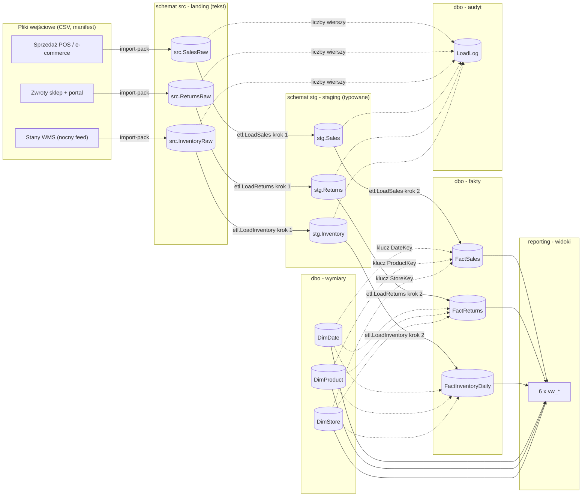

# RetailDW – dokumentacja bazy hurtowni danych

- **Źródło:** projekt SQL [RetailDW.sqlproj](../RetailDW/RetailDW.sqlproj) (SQL Server 2022, T-SQL)
- **Stan na:** 2026-11-17
- **Odbiorcy:** developerzy (zmiany w schemacie i ETL), analitycy (zrozumienie modelu i widoków)
- **Konwencje nazewnicze:** [sql-style-guide.md](./sql-style-guide.md) – sekcja 6 pokazuje różnice między przewodnikiem a stanem faktycznym

## Spis treści

1. [Przegląd](#1-przeglad)
2. [Struktura projektu i ścieżki plików](#2-struktura-projektu-i-sciezki-plikow)
3. [Schematy](#3-schematy)
4. [Wymiary](#4-wymiary)
5. [Fakty](#5-fakty)
6. [Konwencje](#6-konwencje)
7. [Tabele techniczne (src, stg, audyt)](#7-tabele-techniczne-src-stg-audyt)
8. [Procedury ETL](#8-procedury-etl)
9. [Przepływ ETL](#9-przeplyw-etl)
10. [Widoki raportowe](#10-widoki-raportowe)
11. [Uprawnienia i skrypty](#11-uprawnienia-i-skrypty)
12. [Ograniczenia i uwagi dla analityków](#12-ograniczenia-i-uwagi-dla-analitykow)

---

## 1. Przegląd

| Element | Wartość |
|---|---|
| Model | Gwiazda (Kimball), 2 tabele faktów, 3 wymiary |
| Źródła | Dzienny extract POS/e-commerce (sprzedaż), zwroty (sklep + portal), nocny feed stanów z WMS |
| Ładowanie | Pełne przeładowanie (`DELETE` + `INSERT`) przez 3 procedury `etl.Load*` |
| Audyt | Tabela `dbo.LoadLog`, jeden wiersz na uruchomienie procedury |
| Widoki | 6 widoków w schemacie `reporting` |

## 2. Struktura projektu i ścieżki plików

| Ścieżka (względem `RetailDW\`) | Zawartość | Liczba plików |
|---|---|---|
| `RetailDW.sqlproj` | Definicja projektu (SDK `Microsoft.Build.Sql` 2.2.0, `Sql160`, collation `1045, CI`) | 1 |
| `Security\` | Definicje schematów `etl`, `src`, `stg`, `reporting` | 4 |
| `Tables\dbo.*.sql` | Wymiary, fakty, `LoadLog` | 6 |
| `Tables\src.*.sql` | Tabele lądowania (dane jako tekst) | 3 |
| `Tables\stg.*.sql` | Tabele stagingowe (dane typowane) | 3 |
| `Procedures\etl.Load*.sql` | Procedury ładujące | 3 |
| `Views\reporting.vw_*.sql` | Widoki raportowe | 6 |
| `Scripts\PostDeployment.sql` | Skrypt post-deploy: seed wymiarów | 1 |
| `Scripts\Seed\00-DimDate.sql` | Seed kalendarza | 1 |
| `Scripts\Seed\01-DimProduct.sql` | Seed produktów (SKU) | 1 |
| `Scripts\Seed\02-DimStore.sql` | Seed sklepów | 1 |
| `.gitignore` | Ignoruje `bin/` i `obj/` | 1 |

Skrypty operacyjne (poza projektem SQL):

| Ścieżka (względem katalogu głównego repo) | Rola |
|---|---|
| `scripts\dw.ps1` | Główne narzędzie: `setup`, `import-p0`, `import-pack`, `etl`, `verify`, `backup`, `restore`, `apply-sql`, `build`, `help` |
| `docs\sql-style-guide.md` | Przewodnik stylu SQL |
| `docker-compose.yml`, `mssql.conf`, `.env` | Lokalny SQL Server |
| `data\P0\manifest.json` | Manifest paczki P0 (CSV) – folder **nieobecny** w repo, dostarczany osobno |

## 3. Schematy

| Schemat | Plik definicji | Rola | Wykorzystanie |
|---|---|---|---|
| `dbo` | wbudowany | Model dimensional (wymiary, fakty, audyt) | Raporty i analitycy |
| `src` | [src.sql](../RetailDW/Security/src.sql) | Landing zone – dane surowe | Zapis: import CSV; odczyt: `etl` |
| `stg` | [stg.sql](../RetailDW/Security/stg.sql) | Staging – dane typowane i zwalidowane | Zapis/odczyt: `etl` |
| `etl` | [etl.sql](../RetailDW/Security/etl.sql) | Procedury ładujące | Uruchamiane przez `scripts\dw.ps1 etl` |
| `reporting` | [reporting.sql](../RetailDW/Security/reporting.sql) | Widoki raportowe | BI, analitycy |

Kierunek przepływu: `src` → `stg` → `dbo`. Widoki czytają wyłącznie z `dbo`.

## 4. Wymiary

### 4.1. `dbo.DimDate`

Plik: [dbo.DimDate.sql](../RetailDW/Tables/dbo.DimDate.sql) · Seed: [00-DimDate.sql](../RetailDW/Scripts/Seed/00-DimDate.sql) · Zakres seedu: 2024-12-01 – 2026-12-31 · Klucz: `DateKey`

Opis: kalendarz, jeden wiersz na dzień. Tygodnie wg ISO-8601 (poniedziałek–niedziela); `IsoYear` może różnić się od `Year` wokół 1 stycznia.

| Kolumna | Typ | Null | Opis |
|---|---|---|---|
| `DateKey` | INT | NOT NULL | PK, format `yyyymmdd` |
| `Date` | DATE | NOT NULL | Data kalendarzowa (unikalna) |
| `Year` | SMALLINT | NOT NULL | Rok kalendarzowy |
| `Quarter` | TINYINT | NOT NULL | Kwartał |
| `Month` | TINYINT | NOT NULL | Miesiąc |
| `MonthName` | NVARCHAR(20) | NOT NULL | Nazwa miesiąca |
| `YearMonth` | NVARCHAR(7) | NOT NULL | Np. `2026-09` |
| `IsoYear` | SMALLINT | NOT NULL | Rok ISO |
| `IsoWeek` | TINYINT | NOT NULL | Tydzień ISO |
| `YearWeek` | NVARCHAR(8) | NOT NULL | Np. `2026-W38` |
| `DayOfWeek` | TINYINT | NOT NULL | 1 = poniedziałek |
| `DayName` | NVARCHAR(20) | NOT NULL | Nazwa dnia |
| `IsWeekend` | BIT | NOT NULL | Sobota/niedziela |
| `Season` | NVARCHAR(10) | NOT NULL | Sezon handlowy, do którego należy dzień |

Indeksy: `PK_DimDate` (CLUSTERED, `DateKey`), `UX_DimDate_Date` (UNIQUE, `Date`), `IX_DimDate_YearWeek` (`YearWeek`).

### 4.2. `dbo.DimProduct`

Plik: [dbo.DimProduct.sql](../RetailDW/Tables/dbo.DimProduct.sql) · Seed: [01-DimProduct.sql](../RetailDW/Scripts/Seed/01-DimProduct.sql) · Klucz: `ProductKey` (IDENTITY) · Ziarno: **SKU** (wariant rozmiar/kolor stylu)

Opis: produkt na poziomie SKU. „Model” w raportach = grupowanie po `StyleCode`; „produkt” zwykle = `SKU`. `ListPrice` to cena katalogowa brutto (z VAT), `UnitCost` to koszt zakupu jednostki.

| Kolumna | Typ | Null | Opis |
|---|---|---|---|
| `ProductKey` | INT IDENTITY | NOT NULL | PK (klucz surogatowy) |
| `SKU` | NVARCHAR(40) | NOT NULL | Kod wariantu, np. `W-JKT-001-CZA-M` (unikalny) |
| `StyleCode` | NVARCHAR(20) | NOT NULL | Kod stylu, np. `W-JKT-001` |
| `StyleName` | NVARCHAR(100) | NOT NULL | Nazwa stylu |
| `Department` | NVARCHAR(20) | NOT NULL | Dział |
| `Category` | NVARCHAR(30) | NOT NULL | Kategoria |
| `Color` | NVARCHAR(20) | NOT NULL | Kolor |
| `Size` | NVARCHAR(5) | NOT NULL | Rozmiar |
| `ListPrice` | DECIMAL(10,2) | NOT NULL | Cena katalogowa brutto |
| `UnitCost` | DECIMAL(10,2) | NOT NULL | Koszt jednostki |
| `IsActive` | BIT | NOT NULL | Domyślnie 1 (`DF_DimProduct_IsActive`) |

Indeksy: `PK_DimProduct`, `UX_DimProduct_SKU` (UNIQUE, `SKU`), `IX_DimProduct_StyleCode` (`StyleCode`, INCLUDE `Category`, `Department`, `Size`).

### 4.3. `dbo.DimStore`

Plik: [dbo.DimStore.sql](../RetailDW/Tables/dbo.DimStore.sql) · Seed: [02-DimStore.sql](../RetailDW/Scripts/Seed/02-DimStore.sql) · Klucz: `StoreKey` (IDENTITY) · Ziarno: sklep lub kanał online

Opis: sklepy stacjonarne oraz sklep online (modelowany jako sklep, aby każda sprzedaż miała lokalizację). `SalesAreaM2` to **aktualna** powierzchnia; nie odzwierciedla historii. `RemodelDate` to data ostatniej zmiany powierzchni.

| Kolumna | Typ | Null | Opis |
|---|---|---|---|
| `StoreKey` | INT IDENTITY | NOT NULL | PK |
| `StoreCode` | NVARCHAR(20) | NOT NULL | Kod sklepu, np. `S-WAW-01` (unikalny) |
| `StoreName` | NVARCHAR(100) | NOT NULL | Nazwa |
| `City` | NVARCHAR(50) | NOT NULL | Miasto |
| `Region` | NVARCHAR(50) | NOT NULL | Województwo |
| `Channel` | NVARCHAR(10) | NOT NULL | `STORE` lub `ONLINE` (CHECK `CK_DimStore_Channel`) |
| `Format` | NVARCHAR(20) | NOT NULL | Format, np. `Galeria`, `Ulica` |
| `SalesAreaM2` | INT | NULL | Powierzchnia sprzedażowa; NULL dla online |
| `OpenedDate` | DATE | NOT NULL | Data otwarcia |
| `RemodelDate` | DATE | NULL | Data ostatniej przebudowy |

Indeksy: `PK_DimStore`, `UX_DimStore_StoreCode` (UNIQUE, `StoreCode`).

## 5. Fakty

### 5.1. `dbo.FactSales`

Plik: [dbo.FactSales.sql](../RetailDW/Tables/dbo.FactSales.sql) · Ładowany przez: `etl.LoadSales` · Klucz: `SalesKey` (BIGINT IDENTITY)

| Atrybut | Wartość |
|---|---|
| Ziarno (grain) | Jedna pozycja paragonu: SKU w ramach jednej transakcji |
| Typ miar | Addytywne: `Quantity`, `DiscountAmount`, `GrossAmount`, `NetAmount`; `UnitCost`/`UnitPrice` to wartości jednostkowe |
| Wymiary | `DateKey` → `DimDate`, `ProductKey` → `DimProduct`, `StoreKey` → `DimStore` |
| Degenerate dimension | `TransactionNo`, `LineNumber` |

| Kolumna | Typ | Null | Opis |
|---|---|---|---|
| `SalesKey` | BIGINT IDENTITY | NOT NULL | PK |
| `DateKey` | INT | NOT NULL | FK → `DimDate` |
| `ProductKey` | INT | NOT NULL | FK → `DimProduct` |
| `StoreKey` | INT | NOT NULL | FK → `DimStore` |
| `TransactionNo` | NVARCHAR(30) | NOT NULL | Numer transakcji (degenerate) |
| `LineNumber` | INT | NOT NULL | Numer pozycji w transakcji |
| `Quantity` | INT | NOT NULL | Ilość |
| `UnitPrice` | DECIMAL(10,2) | NOT NULL | Cena jednostkowa w transakcji (brutto) |
| `DiscountAmount` | DECIMAL(10,2) | NOT NULL | Rabat (kwota) |
| `GrossAmount` | DECIMAL(12,2) | NOT NULL | `Quantity * UnitPrice - DiscountAmount`, z VAT |
| `NetAmount` | DECIMAL(12,2) | NOT NULL | `GrossAmount / 1.23`, bez VAT |
| `UnitCost` | DECIMAL(10,2) | NOT NULL | Koszt jednostki skopiowany z `DimProduct` w chwili ładowania |
| `LoadId` | INT | NOT NULL | Id uruchomienia z `dbo.LoadLog` |

Indeksy: `PK_FactSales` (CLUSTERED, `SalesKey`), `IX_FactSales_DateKey` (`DateKey`, INCLUDE `ProductKey`, `StoreKey`, `Quantity`, `GrossAmount`, `NetAmount`), `IX_FactSales_ProductKey` (`ProductKey`), `IX_FactSales_TransactionNo` (`TransactionNo`).

Uwaga: `NetAmount` używa stałej stawki 1,23 (VAT 23%) zakodowanej w procedurze.

### 5.2. `dbo.FactReturns`

Plik: [dbo.FactReturns.sql](../RetailDW/Tables/dbo.FactReturns.sql) · Ładowany przez: `etl.LoadReturns` · Klucz: `ReturnKey` (BIGINT IDENTITY)

| Atrybut | Wartość |
|---|---|
| Ziarno (grain) | Jedna zwrócona pozycja |
| Wymiary | `DateKey` (data zwrotu), `ProductKey`, `StoreKey` |
| Degenerate dimension | `ReturnNo`, `TransactionNo`, `ReturnReason` |

| Kolumna | Typ | Null | Opis |
|---|---|---|---|
| `ReturnKey` | BIGINT IDENTITY | NOT NULL | PK |
| `DateKey` | INT | NOT NULL | FK → `DimDate` |
| `ProductKey` | INT | NOT NULL | FK → `DimProduct` |
| `StoreKey` | INT | NOT NULL | FK → `DimStore` |
| `ReturnNo` | NVARCHAR(30) | NOT NULL | Numer zwrotu |
| `TransactionNo` | NVARCHAR(30) | NOT NULL | Numer oryginalnej transakcji |
| `Quantity` | INT | NOT NULL | Ilość zwrócona |
| `ReturnAmount` | DECIMAL(12,2) | NOT NULL | Kwota zwrotu, z VAT, wartość dodatnia |
| `ReturnReason` | NVARCHAR(30) | NULL | Powód zwrotu |
| `LoadId` | INT | NOT NULL | Id uruchomienia |

Indeksy: `PK_FactReturns`, `IX_FactReturns_DateKey` (`DateKey`, INCLUDE `ProductKey`, `StoreKey`, `Quantity`, `ReturnAmount`).

### 5.3. `dbo.FactInventoryDaily`

Plik: [dbo.FactInventoryDaily.sql](../RetailDW/Tables/dbo.FactInventoryDaily.sql) · Ładowany przez: `etl.LoadInventory` · Klucz: `InventoryKey` (BIGINT IDENTITY)

| Atrybut | Wartość |
|---|---|
| Ziarno (grain) | Dzień × SKU × sklep; stan na zamknięcie dnia |
| Typ | **Snapshot** (nie log ruchów). Różnica między dwoma wierszami nie jest transakcją |
| Zakres | Tylko bieżący sezon; brak wierszy przed początkiem feedu |

| Kolumna | Typ | Null | Opis |
|---|---|---|---|
| `InventoryKey` | BIGINT IDENTITY | NOT NULL | PK |
| `DateKey` | INT | NOT NULL | FK → `DimDate` (data snapshotu) |
| `ProductKey` | INT | NOT NULL | FK → `DimProduct` |
| `StoreKey` | INT | NOT NULL | FK → `DimStore` |
| `StockQuantity` | INT | NOT NULL | Stan magazynowy na koniec dnia |
| `LoadId` | INT | NOT NULL | Id uruchomienia |

Indeksy: `PK_FactInventoryDaily`, `IX_FactInventoryDaily_DateKey` (`DateKey`, INCLUDE `ProductKey`, `StoreKey`, `StockQuantity`).

## 6. Konwencje

### 6.1. Konwencje faktycznie stosowane w kodzie

| Obszar | Konwencja | Przykład z repo |
|---|---|---|
| Nazwy obiektów | `Schema.Name`, PascalCase, po angielsku | `dbo.FactSales`, `etl.LoadSales` |
| Tabele wymiarów | `Dim<Name>` | `DimProduct` |
| Tabele faktów | `Fact<Name>` | `FactSales` |
| Tabele warstw | `src.<Name>Raw`, `stg.<Name>` | `src.SalesRaw`, `stg.Sales` |
| Procedury ETL | `etl.Load<Name>` | `etl.LoadReturns` |
| Widoki raportowe | `reporting.vw_<Name>` | `reporting.vw_SalesWeekly` |
| Klucz główny | `PK_<Table>` | `PK_FactSales` |
| Klucz obcy | `FK_<Table>_<RefTable>` | `FK_FactReturns_DimStore` |
| Indeks | `IX_<Table>_<Columns>`, unikalny `UX_<Table>_<Column>` | `IX_FactSales_DateKey`, `UX_DimStore_StoreCode` |
| Wartość domyślna | `DF_<Table>_<Column>` | `DF_LoadLog_Status` |
| Check | `CK_<Table>_<Column>` | `CK_DimStore_Channel` |
| Klucz surogatowy | `<Name>Key` (INT wymiary, BIGINT fakty) | `ProductKey`, `SalesKey` |
| Klucz daty | `DateKey` = `yyyymmdd` | `20260917` |
| Audyt wiersza | `LoadId` w tabelach `dbo.Fact*` i `stg`; `SourceFile`, `ExtractedAt` w `src` i `stg` | `FactSales.LoadId` |
| Ładowanie | Pełne przeładowanie: `DELETE` + `INSERT`, w `TRY/CATCH` z `XACT_ABORT ON` | `etl.LoadSales` |
| Tekst w `src` | Wszystkie kolumny `NVARCHAR`; typowanie w `etl` przez `TRY_CAST` | `src.SalesRaw.Quantity` |
| Formatowanie | Nagłówek komentarza `/* ... */` z opisem, ziarnem i źródłem | każdy plik tabeli, procedury i widoku |

### 6.2. Różnice między przewodnikiem a kodem

Przewodnik: [sql-style-guide.md](./sql-style-guide.md)

| Temat | Przewodnik mówi | Kod robi |
|---|---|---|
| Schematy warstw | `stg`, `etl`, `dwh`, `rpt` | `src`, `stg`, `etl`, `dbo`, `reporting` |
| Nazwa procedury ETL | `usp_<Layer>_<Target>`, np. `usp_Etl_LoadDimProduct` | `etl.Load<Name>` |
| Nazwa widoku | `vw_<Name>` lub `Rpt.<Name>` | `reporting.vw_<Name>` (zgodne z pierwszą opcją) |
| Wiersz `Unknown` (`Key = -1`) | Każdy wymiar ma wiersz `-1` | **Brak** – `INNER JOIN` w ETL odrzuca wiersze z nieznanym produktem/sklepem/datą |
| Unikalność faktów | `UQ_<Table>_<Columns>` | Brak `UQ_` na faktach |
| Wartości domyślne | `DF_<Table>_<Column>` dla miar | Tylko `DF_DimProduct_IsActive`, `DF_LoadLog_*`, `DF_src_*_ExtractedAt` |
| Komentarze w tabeli faktów | Grain w dokumentacji | Zgodne (nagłówek każdego pliku) |

## 7. Tabele techniczne (src, stg, audyt)

### 7.1. Landing zone – `src`

| Tabela | Plik | Źródło | Kolumny danych (wszystkie tekstowe) | Metadane |
|---|---|---|---|---|
| `src.SalesRaw` | [src.SalesRaw.sql](../RetailDW/Tables/src.SalesRaw.sql) | Dzienny extract POS / e-commerce | `TransactionNo`, `LineNumber`, `SalesDate`, `SKU`, `StoreCode`, `Quantity`, `UnitPrice`, `DiscountAmount` | `RawId` (PK), `SourceFile`, `ExtractedAt` |
| `src.ReturnsRaw` | [src.ReturnsRaw.sql](../RetailDW/Tables/src.ReturnsRaw.sql) | Zwroty ze sklepów i portalu | `ReturnNo`, `TransactionNo`, `ReturnDate`, `SKU`, `StoreCode`, `Quantity`, `ReturnAmount`, `ReturnReason` | `RawId`, `SourceFile`, `ExtractedAt` |
| `src.InventoryRaw` | [src.InventoryRaw.sql](../RetailDW/Tables/src.InventoryRaw.sql) | Nocny feed stanów z WMS | `SnapshotDate`, `SKU`, `StoreCode`, `StockQuantity` | `RawId`, `SourceFile`, `ExtractedAt` |

Uwaga: `src.SalesRaw` ma indeks `IX_src_SalesRaw_SourceFile`. `src.ReturnsRaw` i `src.InventoryRaw` nie mają indeksów pomocniczych.

### 7.2. Staging – `stg`

| Tabela | Plik | Zapis | Kolumny | Filtr jakości (odrzuca wiersz gdy) | Indeks |
|---|---|---|---|---|---|
| `stg.Sales` | [stg.Sales.sql](../RetailDW/Tables/stg.Sales.sql) | `etl.LoadSales` | `StagingRowId`, `TransactionNo`, `LineNumber` INT, `SalesDate` DATE, `SKU`, `StoreCode`, `Quantity` INT, `UnitPrice` DEC(10,2), `DiscountAmount` DEC(10,2) (NULL → 0), `SourceFile`, `LoadId` | `TransactionNo`, `LineNumber`, `SalesDate`, `SKU`, `StoreCode`, `Quantity`, `UnitPrice` są NULL po konwersji | `IX_stg_Sales_SalesDate` |
| `stg.Returns` | [stg.Returns.sql](../RetailDW/Tables/stg.Returns.sql) | `etl.LoadReturns` | `StagingRowId`, `ReturnNo`, `TransactionNo`, `ReturnDate` DATE, `SKU`, `StoreCode`, `Quantity` INT, `ReturnAmount` DEC(10,2), `ReturnReason`, `SourceFile`, `LoadId` | `ReturnNo`, `TransactionNo`, `ReturnDate`, `SKU`, `StoreCode`, `Quantity`, `ReturnAmount` są NULL po konwersji | brak |
| `stg.Inventory` | [stg.Inventory.sql](../RetailDW/Tables/stg.Inventory.sql) | `etl.LoadInventory` | `StagingRowId`, `SnapshotDate` DATE, `SKU`, `StoreCode`, `StockQuantity` INT, `SourceFile`, `LoadId` | `SnapshotDate`, `SKU`, `StoreCode`, `StockQuantity` są NULL po konwersji | `IX_stg_Inventory_SnapshotDate` |

### 7.3. Audyt – `dbo.LoadLog`

Plik: [dbo.LoadLog.sql](../RetailDW/Tables/dbo.LoadLog.sql)

| Kolumna | Typ | Null | Opis |
|---|---|---|---|
| `LoadId` | INT IDENTITY | NOT NULL | PK, identyfikator uruchomienia |
| `PackageName` | NVARCHAR(100) | NOT NULL | Nazwa procedury, np. `etl.LoadSales` |
| `StartedAt` | DATETIME2(3) | NOT NULL | Start (UTC), domyślnie `SYSUTCDATETIME()` |
| `FinishedAt` | DATETIME2(3) | NULL | Koniec (UTC) |
| `Status` | NVARCHAR(20) | NOT NULL | `RUNNING` (domyślnie), `SUCCEEDED`, `FAILED` (CHECK) |
| `RowsRead` | INT | NULL | Liczba wierszy w `src` |
| `RowsLoaded` | INT | NULL | Liczba wierszy załadowanych do faktu |
| `RowsRejected` | INT | NULL | `RowsRead - RowsLoaded` (obejmuje błędy konwersji i brak dopasowania wymiaru) |
| `ErrorMessage` | NVARCHAR(4000) | NULL | Komunikat błędu przy `FAILED` |

## 8. Procedury ETL

| Procedura | Plik | Źródło | Cel | Kroki |
|---|---|---|---|---|
| `etl.LoadSales` | [etl.LoadSales.sql](../RetailDW/Procedures/etl.LoadSales.sql) | `src.SalesRaw` | `dbo.FactSales` | 1. Czyści `FactSales` i `stg.Sales`. 2. Konwertuje i waliduje do `stg.Sales`. 3. Łączy z wymiarami, liczy `GrossAmount`, `NetAmount`, kopiuje `UnitCost`. |
| `etl.LoadReturns` | [etl.LoadReturns.sql](../RetailDW/Procedures/etl.LoadReturns.sql) | `src.ReturnsRaw` | `dbo.FactReturns` | 1. Czyści `FactReturns` i `stg.Returns`. 2. Konwertuje i waliduje. 3. Łączy z wymiarami. |
| `etl.LoadInventory` | [etl.LoadInventory.sql](../RetailDW/Procedures/etl.LoadInventory.sql) | `src.InventoryRaw` | `dbo.FactInventoryDaily` | 1. Czyści fakt i `stg.Inventory`. 2. Konwertuje i waliduje. 3. Łączy z wymiarami. |

Wspólny wzorzec wszystkich trzech procedur:

| Element | Działanie |
|---|---|
| Transakcja | `SET XACT_ABORT ON`, błąd → `THROW` |
| Audyt | Wiersz w `dbo.LoadLog` na starcie (`RUNNING`), aktualizacja na `SUCCEEDED` lub `FAILED` |
| Liczba odrzuconych | `RowsRead - RowsLoaded` |
| Ponowne uruchomienie | Bezpieczne – pełne przeładowanie |
| Odrzucenia | Cicho, bez logu wierszy: wiersze z błędną konwersją lub brakującym wymiarem znikają z faktu |

## 9. Przepływ ETL

### 9.1. Kroki w tabelach

| Krok | Akcja | Wejście | Wyjście | Narzędzie / kod |
|---|---|---|---|---|
| 0 | Deploy schematu (DACPAC / projekt) | `RetailDW.sqlproj` | Obiekty w bazie | `scripts\dw.ps1 setup` / `build` |
| 1 | Seed wymiarów (PostDeployment) | `Scripts\Seed\*.sql` | `DimDate`, `DimProduct`, `DimStore` | `PostDeployment.sql` |
| 2 | Import CSV do landing zone | Pliki CSV wg manifestu | `src.SalesRaw`, `src.ReturnsRaw`, `src.InventoryRaw` | `scripts\dw.ps1 import-p0` / `import-pack -PackPath` |
| 3 | Konwersja i walidacja | `src.*Raw` | `stg.Sales`, `stg.Returns`, `stg.Inventory` | `etl.Load*` krok 1 |
| 4 | Dołączenie wymiarów i miary | `stg.*` + `dbo.Dim*` | `dbo.FactSales`, `dbo.FactReturns`, `dbo.FactInventoryDaily` | `etl.Load*` krok 2 |
| 5 | Audyt | Wynik każdej procedury | `dbo.LoadLog` | Wewnątrz `etl.Load*` |
| 6 | Weryfikacja | `LoadLog`, liczby wierszy | Podsumowanie | `scripts\dw.ps1 verify` |
| 7 | Backup / restore | Baza | Plik backupu | `scripts\dw.ps1 backup` / `restore` |

Uruchomienie ETL: `scripts\dw.ps1 etl -Feed all|sales|inventory|returns`. Dla `all` kolejność to `etl.LoadSales`, `etl.LoadInventory`, `etl.LoadReturns`.

### 9.2. Mapowanie plików na tabele

| Feed | Tabela docelowa `src` | Tabela `stg` | Tabela fakt | Procedura | Wymiary łączone |
|---|---|---|---|---|---|
| Sprzedaż | `src.SalesRaw` | `stg.Sales` | `dbo.FactSales` | `etl.LoadSales` | `DimDate` (`SalesDate`), `DimProduct` (`SKU`), `DimStore` (`StoreCode`) |
| Zwroty | `src.ReturnsRaw` | `stg.Returns` | `dbo.FactReturns` | `etl.LoadReturns` | `DimDate` (`ReturnDate`), `DimProduct` (`SKU`), `DimStore` (`StoreCode`) |
| Stany | `src.InventoryRaw` | `stg.Inventory` | `dbo.FactInventoryDaily` | `etl.LoadInventory` | `DimDate` (`SnapshotDate`), `DimProduct` (`SKU`), `DimStore` (`StoreCode`) |

Import CSV (`scripts\dw.ps1`): nagłówek pliku musi być identyczny z listą kolumn w manifeście (ta sama kolejność), a liczba pól w każdym wierszu musi się zgadzać. Liczba wierszy musi zgadzać się z manifestem. Import działa w jednej transakcji dla wszystkich plików. Skrypt **nie** wypełnia `SourceFile` (kolumna pozostaje NULL), a `ExtractedAt` ustawia domyślnie baza.

### 9.3. Diagram

## 10. Widoki raportowe

Wszystkie widoki są w schemacie `reporting`. Plik: `RetailDW\Views\reporting.<nazwa>.sql`.

| Widok | Plik | Źródło | Ziarno wyniku | Kluczowe kolumny | Przeznaczenie |
|---|---|---|---|---|---|
| `reporting.vw_SalesDaily` | [vw_SalesDaily](../RetailDW/Views/reporting.vw_SalesDaily.sql) | FactSales + DimDate/Store/Product | Dzień × sklep × dział × kategoria | `SalesDate`, `YearMonth`, `YearWeek`, `StoreCode`, `Channel`, `Region`, `Department`, `Category`, `Units`, `Transactions`, `GrossAmount`, `DiscountAmount`, `NetAmount`, `CostAmount` | Baza dla pytań dziennych; agregować po `YearMonth` lub `YearWeek` |
| `reporting.vw_SalesWeekly` | [vw_SalesWeekly](../RetailDW/Views/reporting.vw_SalesWeekly.sql) | FactSales + wymiary | Tydzień ISO × kanał × region × dział × kategoria | `IsoYear`, `IsoWeek`, `YearWeek`, `WeekStart`, `WeekEnd`, `Channel`, `Region`, `Department`, `Category`, miary jak wyżej | Raport poniedziałkowy (tydzień Pn–Nd) |
| `reporting.vw_MarginAnalysis` | [vw_MarginAnalysis](../RetailDW/Views/reporting.vw_MarginAnalysis.sql) | FactSales + DimDate/Product | Miesiąc × styl | `YearMonth`, `StyleCode`, `StyleName`, `Department`, `Category`, `Units`, `NetRevenue`, `CostAmount`, `GrossMargin`, `GrossMarginPct` | Przegląd marż merchandisingu |
| `reporting.vw_ProductPerformance` | [vw_ProductPerformance](../RetailDW/Views/reporting.vw_ProductPerformance.sql) | DimProduct + FactSales + FactReturns + FactInventoryDaily | SKU (wszystkie produkty, także bez sprzedaży) | `SKU`, `StyleCode`, `UnitsSoldTotal`, `NetRevenueTotal`, `UnitsSoldSeason`, `UnitsReturned`, `ReturnAmount`, `StockOnHand`, `SellThroughPct` | Scorecard SKU; sell-through tylko za bieżący sezon |
| `reporting.vw_StockAvailability` | [vw_StockAvailability](../RetailDW/Views/reporting.vw_StockAvailability.sql) | FactInventoryDaily + wymiary | Dzień stanu × sklep × dział × kategoria | `SnapshotDate`, `StoreCode`, `Department`, `Category`, `SkuCount`, `SkuInStock`, `AvailabilityPct`, `StockQuantity` | Dostępność towaru na półce |
| `reporting.vw_StoreScorecard` | [vw_StoreScorecard](../RetailDW/Views/reporting.vw_StoreScorecard.sql) | FactSales + DimStore/Date | Miesiąc × sklep | `StoreCode`, `Region`, `Channel`, `Format`, `SalesAreaM2`, `YearMonth`, `NetRevenue`, `Units`, `Transactions`, `AvgBasketValue`, `UnitsPerTransaction`, `NetRevenuePerM2` | Miesięczny scorecard menedżerów obszarów; tylko sklepy z `SalesAreaM2 > 0` |

## 11. Uprawnienia i skrypty

### 11.1. Schematy

| Plik | Polecenie | Uwagi |
|---|---|---|
| [Security\etl.sql](../RetailDW/Security/etl.sql) | `CREATE SCHEMA [etl];` | Właściciel domyślny |
| [Security\src.sql](../RetailDW/Security/src.sql) | `CREATE SCHEMA [src];` | |
| [Security\stg.sql](../RetailDW/Security/stg.sql) | `CREATE SCHEMA [stg];` | |
| [Security\reporting.sql](../RetailDW/Security/reporting.sql) | `CREATE SCHEMA [reporting] AUTHORIZATION [dbo];` | Jedyny schemat z jawnym właścicielem |

Role i `GRANT`-y nie są zdefiniowane w projekcie.

### 11.2. Skrypty operacyjne

| Skrypt | Akcja | Opis |
|---|---|---|
| [scripts\dw.ps1](../scripts/dw.ps1) | `help` | Lista akcji |
| | `setup` | Start lokalnego SQL Server (docker), utworzenie obiektów V0 i seed wymiarów |
| | `import-p0` | Import trzech CSV z `data\P0\manifest.json` do `src` (bez ETL) |
| | `import-pack -PackPath` | Import paczki uczestnika do `src` (bez ETL) |
| | `etl -Feed` | Uruchomienie procedur ETL |
| | `verify` | Liczby obiektów i ostatnie wpisy `LoadLog` |
| | `backup` / `restore` | Kopia zapasowa bazy |
| | `apply-sql` | Wykonanie pliku SQL |
| | `build` | Kompilacja projektu SQL (wymaga .NET SDK) |
| [Scripts\PostDeployment.sql](../RetailDW/Scripts/PostDeployment.sql) | Automatycznie po deploy | Seed `DimDate`, `DimProduct`, `DimStore` (tylko gdy tabela pusta) |

Seedy są idempotentne: każdy skrypt wykonuje `INSERT` tylko przy `IF NOT EXISTS (SELECT 1 FROM ...)`.

## 12. Ograniczenia i uwagi dla analityków

| # | Obszar | Ograniczenie | Skutek / co zrobić |
|---|---|---|---|
| 1 | Odrzucenia ETL | Wiersz bez poprawnego typu lub bez dopasowania w wymiarze jest pomijany bez logu | Porównać `LoadLog.RowsRead` z `RowsLoaded`; różnica = `RowsRejected` |
| 2 | Brak wiersza `Unknown` | Wymiary nie mają rekordu `-1` | Nieznany SKU/sklep/data znika z faktu; nie ma „nieprzypisanej” sprzedaży |
| 3 | Snapshot stanów | `FactInventoryDaily` to stan na koniec dnia | Nie sumować stanów po dniach; używać `MAX(DateKey)` lub średnich |
| 4 | Zakres stanów | Dane stanów tylko dla bieżącego sezonu | Porównania rok do roku dla stanów nie są możliwe |
| 5 | Sell-through | `SellThroughPct` liczony tylko za bieżący sezon | Nie mieszać z `UnitsSoldTotal` |
| 6 | Powierzchnia sklepu | `DimStore.SalesAreaM2` to wartość aktualna | Wskaźniki `NetRevenuePerM2` za przeszłe miesiące używają bieżącej powierzchni |
| 7 | Sklep online | `SalesAreaM2` = NULL, wykluczony z `vw_StoreScorecard` | Analizy per m² tylko dla stacjonarnych |
| 8 | VAT | `NetAmount` = `GrossAmount / 1.23` (stała stawka) | Zmiana stawki wymaga zmiany procedury |
| 9 | Koszt | `UnitCost` zapisany w faktach w chwili ładowania | Zmiana kosztu w `DimProduct` nie zmienia historii faktów bez przeładowania |
| 10 | Tydzień | Tydzień ISO (Pn–Nd); `IsoYear` ≠ `Year` na przełomie roku | Raporty tygodniowe grupować po `IsoYear` + `IsoWeek` |
| 11 | Zwroty | `ReturnAmount` dodatnie, bez powiązania z `FactSales` po kluczu | Łączyć po `TransactionNo` i `ProductKey` |
| 12 | Wymiary typu 1 | `DimProduct` i `DimStore` nadpisywane (brak SCD2) | Historia cen/atrybutów nie jest zachowana |
| 13 | Pełne przeładowanie | Każde uruchomienie kasuje fakt i przelicza od zera | Fakty odzwierciedlają zawsze aktualne `src`; brak historii wsadów |
